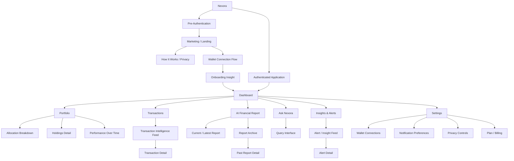
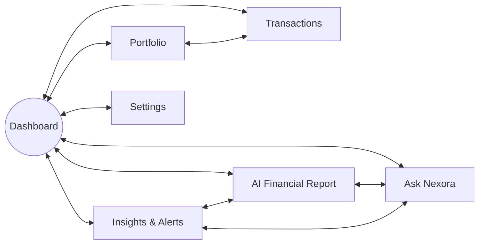
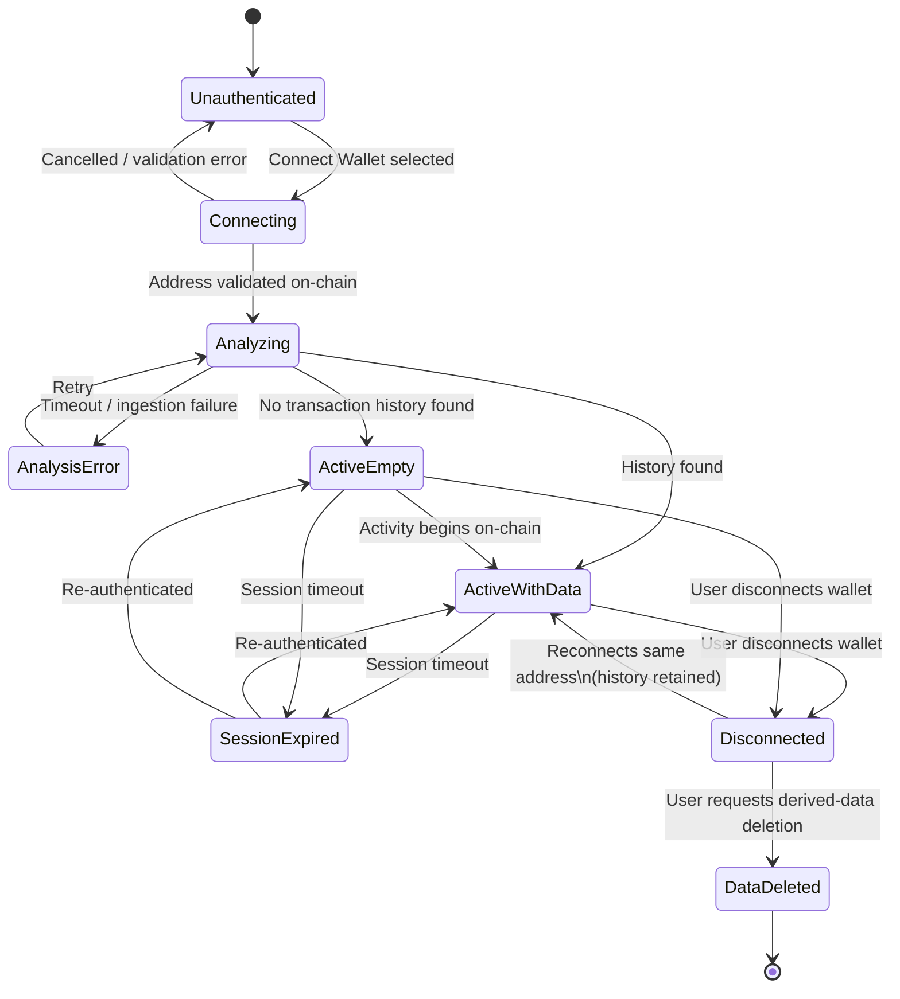

# NEXORA — WIREFRAMES.md
## AI Financial Intelligence Platform — Low-Fidelity Wireframe Specification
### Version 1.0 | Structural Blueprint for UI Design & Development

---

## 0. Purpose and How to Read This Document

This document translates Nexora's information architecture and user flows into **low-fidelity wireframe specifications** — skeletal layouts that define *what goes where* on every screen, without visual design, color, typography, or code.

**What this document provides:**
- Page-by-page structural blueprints
- Component hierarchy and placement
- Content organization rules
- Interaction patterns and user actions
- Responsive behavior guidance

**What this document does NOT provide:**
- Visual design (colors, fonts, shadows, gradients)
- UI polish (animations, transitions, micro-interactions)
- Code (HTML, CSS, React components)
- Final copy (placeholder text is used)

**How to use this document:**
- **UI Designers** — Use as the structural skeleton; apply visual design on top
- **Frontend Developers** — Use as the component layout specification
- **Product Managers** — Use as the final sanity check before design execution

---

## 1. Wireframe Philosophy

### 1.1 Core Principles

| Principle | Application |
|---|---|
| **Narrative-first** | Every screen leads with a sentence explaining "so what?" before showing detailed data |
| **Progressive disclosure** | Every page shows high-level summary first; depth is one click/tap away |
| **Single primary action** | Each screen has one clear primary call-to-action; secondary actions are visually subordinate |
| **Calm, uncluttered** | Generous spacing; data density is low, comprehension is high |
| **Consistent patterns** | Every AI narrative follows the same structure: computed fact + AI observation + source evidence |
| **Mobile-first responsive** | Structure works at all breakpoints; content priority order is fixed |

### 1.2 Layout Component Library

Every screen in Nexora is built from the following reusable structural components:

| Component | Purpose | Placement Rule |
|---|---|---|
| **Primary Narrative Block** | The leading sentence explaining current state | Top of every content section |
| **KPI Card** | Single important number with context | One per meaningful metric |
| **Widget** | Self-contained module with summary + expansion | Stacked vertically on mobile; grid on desktop |
| **Insight Item** | AI observation + source evidence link | Chronological list format |
| **Action Button** | Primary interaction (drill-down, ask, view) | Prominent, one per screen context |
| **Secondary Link** | Navigational or supplementary action | Visually subordinate to primary action |
| **Expansion Panel** | Progressive disclosure container | Hidden by default; reveals on interaction |
| **Evidence Section** | Source transaction(s) behind a claim | Accessible from every AI-generated claim |

---

## 2. Complete Page Inventory

| Page | Level | Parent | Screen Type |
|---|---|---|---|
| Marketing / Landing Surface | L1 (pre-auth) | — | Marketing |
| How It Works / Privacy Explainer | L1 (pre-auth) | Landing | Marketing |
| Wallet Connection Flow | L1 (pre-auth) | Landing | Onboarding |
| Onboarding Insight | L1 (transitional) | — | Onboarding |
| Dashboard | L1 | — | Hub |
| Portfolio — Allocation Breakdown | L2 | Portfolio | Detail |
| Portfolio — Holdings Detail | L2 | Portfolio | Detail |
| Portfolio — Performance Over Time | L2 | Portfolio | Detail |
| Transactions — Intelligence Feed | L2 | Transactions | Feed |
| Transactions — Transaction Detail | L3 | Transactions | Detail |
| AI Financial Report — Current Report | L2 | Report | Document |
| AI Financial Report — Report Archive | L2 | Report | List |
| AI Financial Report — Past Report Detail | L3 | Report | Document |
| Ask Nexora — Query Interface | L2 | Ask | Conversational |
| Insights & Alerts — Feed | L2 | Alerts | Feed |
| Insights & Alerts — Alert Detail | L3 | Alerts | Detail |
| Settings — Wallet Connections | L2 | Settings | Configuration |
| Settings — Notification Preferences | L2 | Settings | Configuration |
| Settings — Privacy Controls | L2 | Settings | Configuration |
| Settings — Plan / Billing | L2 | Settings | Configuration |

---

## 3. Site-Wide Structural Patterns

### 3.1 Global Navigation (Authenticated)

```
+--------------------------------------------------+
| [Nexora Logo]  [Nav: Dashboard]  [Nav: Portfolio]  |
| [Nav: Transactions]  [Nav: Report]  [Nav: Ask]     |
| [Nav: Alerts]  [Nav: Settings]  [User Avatar]      |
+--------------------------------------------------+
|                                                     |
|  [Quick Ask Bar — persistent across all screens]    |
|                                                     |
+--------------------------------------------------+
|                                                     |
|                [PAGE CONTENT AREA]                   |
|                                                     |
+--------------------------------------------------+
```

**Navigation Rules:**
- All seven L1 sections always visible (primary navigation)
- Current section highlighted
- Quick Ask Bar persists on every authenticated screen
- Settings accessible but not cross-linked to other sections

### 3.2 Content Unit Pattern (AI-Generated Content)

Every AI-generated insight follows this exact structural pattern:

```
+--------------------------------------------------+
| [Computed Fact Block]                              |
|   • Number / Figure (deterministic, verified)      |
|   • Brief context (time period, comparison)        |
+--------------------------------------------------+
| [AI Narrative Block]                               |
|   • One-sentence explanation of what it means      |
|   • Plain language, no jargon                      |
+--------------------------------------------------+
| [Source Evidence Link]                             |
|   • "See transactions that support this claim"     |
|   • Expands to show underlying transaction list    |
+--------------------------------------------------+
```

**Critical Rule:** The computed fact and AI narrative are always two separate, identifiable content blocks — never merged.

### 3.3 Empty State Pattern

```
+--------------------------------------------------+
| [Status Icon — neutral/calm]                      |
|                                                     |
| [Empty State Headline]                             |
|   • What's missing (clearly stated)               |
|                                                     |
| [Explanatory Text]                                 |
|   • Why it's empty and what happens next          |
|                                                     |
| [Next Step / What to Expect]                      |
|   • When something will change                     |
+--------------------------------------------------+
```

---

## 4. Landing Page / Marketing Surface

### 4.1 Purpose
First-visit explainer that builds trust and motivates wallet connection.

### 4.2 User Goal
Understand what Nexora does, why it's trustworthy, and decide to connect a wallet.

### 4.3 Page Structure

```
+--------------------------------------------------+
| [Nav: Logo]  [Nav: How It Works]  [CTA: Connect]  |
+--------------------------------------------------+
|                                                     |
| [Hero Section]                                     |
|   • Headline: Value proposition (single sentence)  |
|   • Sub-headline: What Nexora does in plain terms  |
|   • Primary CTA: "Connect Wallet"                  |
|                                                     |
+--------------------------------------------------+
|                                                     |
| [Trust Signals Section]                            |
|   • "Read-only — never access your funds"         |
|   • "No private keys — ever"                      |
|   • "Your data is private"                        |
|                                                     |
+--------------------------------------------------+
|                                                     |
| [How It Works Section]                             |
|   • Step 1: Connect your Stellar wallet           |
|   • Step 2: Nexora analyzes your history          |
|   • Step 3: Get AI-powered financial insights     |
|                                                     |
+--------------------------------------------------+
|                                                     |
| [Footer]                                           |
|   • Privacy policy link                           |
|   • Terms link                                    |
+--------------------------------------------------+
```

### 4.4 Component Structure

| Component | Content | Placement |
|---|---|---|
| Hero Headline | Product value prop | Top, centered |
| Hero Sub-headline | Plain-language explanation | Beneath headline |
| Connect CTA | "Connect Wallet" button | Prominent, primary action |
| Trust Badges | 3-4 trust statements | Below hero |
| How It Works | 3-step visual list | Mid-page |
| Privacy Link | Link to Privacy Explainer | Footer |

### 4.5 User Actions
- **Primary:** Click "Connect Wallet" → proceeds to Wallet Connection Flow
- **Secondary:** Click "How It Works" → navigates to Privacy Explainer
- **Tertiary:** Scroll to learn more → passive exploration

### 4.6 Responsive Notes
- **Desktop:** Full-width sections; trust badges in horizontal row
- **Mobile:** Single column; trust badges stacked vertically; CTA remains above fold

---

## 5. How It Works / Privacy Explainer

### 5.1 Purpose
Pre-connection trust-building document explaining Nexora's read-only, non-custodial model in plain language.

### 5.2 User Goal
Understand exactly what Nexora can and cannot do, and feel confident connecting a wallet.

### 5.3 Page Structure

```
+--------------------------------------------------+
| [Nav: Back to Home]  [Nav: Connect Wallet]         |
+--------------------------------------------------+
|                                                     |
| [Headline]                                         |
|   • "What Nexora can and cannot access"           |
|                                                     |
+--------------------------------------------------+
|                                                     |
| [Section: What We Can See]                        |
|   • Public wallet address                         |
|   • Transaction history (public data)             |
|   • Asset balances (public data)                  |
|                                                     |
+--------------------------------------------------+
|                                                     |
| [Section: What We Cannot See]                     |
|   • Private keys — never requested, never stored  |
|   • Secret seeds — never entered anywhere         |
|   • Funds — we cannot move or sign transactions   |
|                                                     |
+--------------------------------------------------+
|                                                     |
| [Section: How Your Data Is Used]                   |
|   • To generate your financial insights           |
|   • Not sold to third parties                     |
|   • Can be deleted at any time                    |
|                                                     |
+--------------------------------------------------+
|                                                     |
| [Section: Frequently Asked Questions]              |
|   • "Can I disconnect at any time?"               |
|   • "What happens if I delete my data?"           |
|   • "Do you store my transaction history?"        |
|                                                     |
+--------------------------------------------------+
|                                                     |
| [Primary CTA: Connect Wallet]                      |
+--------------------------------------------------+
```

### 5.4 Component Structure

| Component | Content | Placement |
|---|---|---|
| Headline | Trust-building statement | Top |
| Can See List | Bulleted list of accessible data | Left column |
| Cannot See List | Bulleted list of inaccessible data | Right column |
| FAQ Accordion | Expandable questions | Bottom |
| Connect CTA | "Connect Wallet" button | Persistent/fixed |

### 5.5 User Actions
- **Primary:** Click "Connect Wallet" → proceeds to Wallet Connection Flow
- **Secondary:** Click FAQ items → expands answers

---

## 6. Wallet Connection Flow

### 6.1 Purpose
The single onboarding action — connect a Stellar wallet in read-only mode.

### 6.2 User Goal
Successfully connect a Stellar wallet (by manual address or wallet connector) with explicit consent understanding.

### 6.3 Page Structure

```
+--------------------------------------------------+
| [Progress Indicator]  Step 1 of 2                 |
+--------------------------------------------------+
|                                                     |
| [Headline]                                         |
|   • "Connect Your Stellar Wallet"                  |
|   • Sub: "Read-only access — we never touch funds" |
|                                                     |
+--------------------------------------------------+
|                                                     |
| [Connection Method Toggle]                         |
|   • Option A: "Enter public address"              |
|   • Option B: "Connect with Freighter" (etc.)      |
|                                                     |
+--------------------------------------------------+
|                                                     |
| [Connection Method Content]                        |
|   • If Manual: Address input field                 |
|   • If Connector: "Connect" button                 |
|                                                     |
+--------------------------------------------------+
|                                                     |
| [Validation Feedback]                              |
|   • Inline validation (valid/invalid format)      |
|   • Secret-key warning (if detected)              |
|   • Address-not-found error (if applicable)       |
|                                                     |
+--------------------------------------------------+
|                                                     |
| [Consent Confirmation]                             |
|   • Checkbox or explicit confirmation             |
|   • "I understand Nexora can read my public data" |
|                                                     |
+--------------------------------------------------+
|                                                     |
| [Primary Action: Connect & Analyze]               |
+--------------------------------------------------+
```

### 6.4 Component Structure

| Component | Content | Placement |
|---|---|---|
| Progress | Step indicator | Top |
| Headline | Connection title + trust reassurance | Below progress |
| Method Toggle | Manual vs. Connector | Mid-page |
| Input Field | Public address (manual method) | Contextual |
| Connect Button | Wallet connector trigger | Contextual |
| Validation | Format/network check feedback | Below input |
| Consent Checkbox | Explicit read-only acknowledgment | Before final action |
| Final CTA | "Connect & Analyze" | Bottom |

### 6.5 User Actions
- **Primary:** Enter address (manual) → validate → confirm → connect
- **Primary:** Click connector button → approve in wallet → confirm → connect
- **Secondary:** Toggle between manual and connector methods
- **Back:** Return to Landing/Explainer

### 6.6 Critical Safety Flows

**Secret Key Detection:**
```
+--------------------------------------------------+
| [Warning Icon]                                     |
|                                                     |
| "This appears to be a secret key, not a public    |
| address. Never enter your private key anywhere."   |
|                                                     |
| [Dismiss and Re-enter]                             |
+--------------------------------------------------+
```

**Address Not Found:**
```
+--------------------------------------------------+
| [Info Icon]                                        |
|                                                     |
| "This address doesn't appear to exist on the      |
| Stellar network. Please check and try again."      |
|                                                     |
| [Try Again]                                        |
+--------------------------------------------------+
```

### 6.7 Responsive Notes
- **Desktop:** Side-by-side layout with method options
- **Mobile:** Single-column; input takes full width

---

## 7. Onboarding Insight

### 7.1 Purpose
First AI-generated observation, shown immediately after analysis completes — demonstrates value.

### 7.2 User Goal
See a valuable, trustworthy insight and feel confident continuing to the dashboard.

### 7.3 Page Structure

```
+--------------------------------------------------+
| [Progress: Analysis Complete]                      |
+--------------------------------------------------+
|                                                     |
| [Headline]                                         |
|   • "Here's what we found"                         |
|                                                     |
+--------------------------------------------------+
|                                                     |
| [Insight Card — follows Content Unit Pattern]     |
|                                                     |
|   +--------------------------------------------+  |
|   | [Computed Fact]                            |  |
|   |   • "80% of your portfolio is in XLM"     |  |
|   |   • "This is up from 65% last month"      |  |
|   +--------------------------------------------+  |
|   | [AI Narrative]                             |  |
|   |   • "Your portfolio is heavily concentrated |  |
|   |     in one asset. This could mean higher   |  |
|   |     volatility risk."                      |  |
|   +--------------------------------------------+  |
|   | [Source Evidence Link]                     |  |
|   |   • "See transactions that show this"     |  |
|   +--------------------------------------------+  |
|                                                     |
+--------------------------------------------------+
|                                                     |
| [Primary Action: Go to Dashboard]                  |
|                                                     |
| [Secondary Action: Ask a follow-up]                |
+--------------------------------------------------+
```

### 7.4 Component Structure

| Component | Content | Placement |
|---|---|---|
| Status Header | "Analysis Complete" | Top |
| Insight Card | One fact + one narrative + evidence | Center |
| Source Link | Expandable transaction list | Below narrative |
| Primary CTA | "Go to Dashboard" | Bottom |
| Secondary Link | "Ask Nexora about this" | Below primary |

### 7.5 User Actions
- **Primary:** Click "Go to Dashboard" → enters main product
- **Secondary:** Click "Ask Nexora about this" → pre-seeded Ask flow
- **Tertiary:** Click "See transactions" → expands source evidence

---

## 8. Dashboard

### 8.1 Purpose
The central hub — portfolio health at a glance with actionable entry points to all sections.

### 8.2 User Goal
Quickly understand current financial status and see what's new or needs attention.

### 8.3 Page Structure

```
+--------------------------------------------------+
| [Global Navigation — always present]               |
+--------------------------------------------------+
|                                                     |
| [Quick Ask Bar — persistent]                       |
|   "Ask Nexora something..."                        |
|                                                     |
+--------------------------------------------------+
|                                                     |
| [Portfolio Health Card — primary anchor widget]    |
|   +--------------------------------------------+  |
|   | [Health Status: "Stable" / "Concentrated"  |  |
|   |               / "Volatile"]                 |  |
|   | [Score: Qualitative + numeric indicator]    |  |
|   | [AI Explanation: "Your portfolio is ..."]   |  |
|   | [See Details →]                             |  |
|   +--------------------------------------------+  |
|                                                     |
+--------------------------------------------------+
|                                                     |
| [Performance Snapshot — time-series chart]         |
|   +--------------------------------------------+  |
|   | [Chart: 7D/30D/90D/All toggle]             |  |
|   | [Value Change: +X% / -X%]                   |  |
|   | [AI Delta: "Up 4% this month, mainly..."]   |  |
|   +--------------------------------------------+  |
|                                                     |
+--------------------------------------------------+
|                                                     |
| [Allocation Breakdown Widget]                      |
|   +--------------------------------------------+  |
|   | [Donut/Bar chart: asset % breakdown]       |  |
|   | [AI Concentration annotation if relevant]   |  |
|   | [See Full Portfolio →]                     |  |
|   +--------------------------------------------+  |
|                                                     |
+--------------------------------------------------+
|                                                     |
| [Recent Insights Feed]                             |
|   +--------------------------------------------+  |
|   | [Insight Item 1 — with timestamp]          |  |
|   |   • "Fee spend 20% above average this week" |  |
|   | [Insight Item 2 — with timestamp]          |  |
|   |   • "XLM price movement affected portfolio" |  |
|   | [See All Alerts →]                         |  |
|   +--------------------------------------------+  |
|                                                     |
+--------------------------------------------------+
|                                                     |
| [Fee Summary Card]                                 |
|   +--------------------------------------------+  |
|   | [Total fees: $X.XX this period]            |  |
|   | [Comparison: vs. historical average]       |  |
|   | [AI note: "Fees are in line with your..."]  |  |
|   +--------------------------------------------+  |
|                                                     |
+--------------------------------------------------+
```

### 8.4 Widget Priority Order (Mobile)

1. **Portfolio Health Card** — Always first, most important
2. **Performance Snapshot** — Shows trend
3. **Allocation Breakdown** — Shows composition
4. **Recent Insights Feed** — Shows what's new
5. **Fee Summary Card** — Supplementary

### 8.5 Component Structure

| Component | Content | Primary Action |
|---|---|---|
| Health Card | Status + score + explanation | "See Details" → Portfolio |
| Performance Chart | Time-series chart + delta | Toggle time windows |
| Allocation Widget | Asset % breakdown | "See Full Portfolio" |
| Insights Feed | Chronological insight list | "See All Alerts" |
| Fee Card | Total fees + comparison | (Passive display) |
| Quick Ask Bar | Input field | Opens Ask Nexora |

### 8.6 Empty State Variations

**ActiveEmpty (no transaction history):**
```
+--------------------------------------------------+
| [Health Card: "No data yet"]                      |
|   • "We haven't seen any activity in your wallet" |
|   • "Once you start transacting, insights appear" |
+--------------------------------------------------+
| [All other widgets show "Waiting for data"]       |
+--------------------------------------------------+
```

### 8.7 User Actions
- **Primary:** Review Health Card → immediate understanding
- **Secondary:** Click any widget's detail link → navigate deeper
- **Tertiary:** Use Quick Ask Bar → Ask Nexora
- **Quaternary:** Click navigation → other sections

### 8.8 Responsive Notes
- **Desktop:** Widgets in 2-column grid; Health Card spans full width
- **Mobile:** Widgets stack vertically in priority order; Health Card always first

---

## 9. Portfolio — Allocation Breakdown

### 9.1 Purpose
Detailed view of asset allocation with AI commentary on concentration and drift.

### 9.2 User Goal
Understand exactly what assets are held, in what proportions, and whether concentration is a concern.

### 9.3 Page Structure

```
+--------------------------------------------------+
| [Nav: Dashboard > Portfolio]                       |
+--------------------------------------------------+
|                                                     |
| [Sub-Navigation — Portfolio tabs]                  |
|   [Allocation]  [Holdings]  [Performance]         |
|                                                     |
+--------------------------------------------------+
|                                                     |
| [Allocation Summary]                               |
|   +--------------------------------------------+  |
|   | [Asset Breakdown Chart — donut/bar]        |  |
|   |   • Asset A: XX%                           |  |
|   |   • Asset B: XX%                           |  |
|   |   • Asset C: XX%                           |  |
|   +--------------------------------------------+  |
|   | [AI Concentration Commentary]               |  |
|   |   • "Your allocation is concentrated in..." |  |
|   |   • "This represents a X% drift from..."   |  |
|   +--------------------------------------------+  |
|                                                     |
+--------------------------------------------------+
|                                                     |
| [Asset List — detailed breakdown]                  |
|   +--------------------------------------------+  |
|   | [Asset A]  [Balance]  [% of total]         |  |
|   |   • USD value                              |  |
|   |   • Asset metadata (issuer, type)           |  |
|   +--------------------------------------------+  |
|   | [Asset B]  [Balance]  [% of total]         |  |
|   | [Asset C]  [Balance]  [% of total]         |  |
|   +--------------------------------------------+  |
+--------------------------------------------------+
```

### 9.4 Component Structure

| Component | Content | Primary Action |
|---|---|---|
| Sub-nav tabs | Allocation / Holdings / Performance | Switch view |
| Chart | Visual asset breakdown | (Passive display) |
| AI Commentary | Concentration analysis | (Passive display) |
| Asset List | Per-asset details | Click asset → Holdings Detail |

### 9.5 User Actions
- **Primary:** View allocation composition
- **Secondary:** Click an asset → Holdings Detail
- **Tertiary:** Switch to Holdings tab → detailed holdings view

### 9.6 Responsive Notes
- **Desktop:** Chart side-by-side with asset list
- **Mobile:** Chart full-width, asset list full-width below

---

## 10. Portfolio — Holdings Detail

### 10.1 Purpose
Detailed view of individual asset holdings with all metadata.

### 10.2 User Goal
See complete information about a specific holding.

### 10.3 Page Structure

```
+--------------------------------------------------+
| [Nav: Dashboard > Portfolio > Holdings Detail]     |
+--------------------------------------------------+
|                                                     |
| [Asset Header]                                     |
|   • Asset name + symbol                            |
|   • Asset type (native / issued)                   |
|   • Issuer information (if applicable)             |
|                                                     |
+--------------------------------------------------+
|                                                     |
| [Holding Information]                              |
|   +--------------------------------------------+  |
|   | [Balance: XX.XXXX]                         |  |
|   | [USD Value: $X,XXX.XX]                     |  |
|   | [% of Portfolio: XX%]                      |  |
|   +--------------------------------------------+  |
|                                                     |
+--------------------------------------------------+
|                                                     |
| [Additional Context — where available]             |
|   • Historical acquisition notes                  |
|   • Recent transactions involving this asset       |
|   • Price context (if available)                  |
|                                                     |
+--------------------------------------------------+
|                                                     |
| [Related Transactions]                             |
|   • List of recent transactions with this asset    |
|   • Click → navigate to Transaction Detail         |
+--------------------------------------------------+
```

### 10.4 Component Structure

| Component | Content | Primary Action |
|---|---|---|
| Asset Header | Name + metadata | (Passive display) |
| Holding Info | Balance + value + % | (Passive display) |
| Context | Historical/price info | (Passive display) |
| Related Txs | Transaction list | Click → Transaction Detail |

### 10.5 User Actions
- **Primary:** View holding details
- **Secondary:** Click related transaction → Transaction Detail
- **Back:** Return to Allocation Breakdown

---

## 11. Portfolio — Performance Over Time

### 11.1 Purpose
Time-series view of portfolio value evolution.

### 11.2 User Goal
See how portfolio value has changed over time and understand what drove the change.

### 11.3 Page Structure

```
+--------------------------------------------------+
| [Nav: Dashboard > Portfolio > Performance]         |
+--------------------------------------------------+
|                                                     |
| [Time Window Selector]                             |
|   [7D]  [30D]  [90D]  [All]                       |
|                                                     |
+--------------------------------------------------+
|                                                     |
| [Performance Chart]                                |
|   +--------------------------------------------+  |
|   | [Line chart: portfolio value over time]    |  |
|   | • X-axis: time                             |  |
|   | • Y-axis: value (USD)                      |  |
|   +--------------------------------------------+  |
|   | [Delta Summary]                             |  |
|   |   • "+4.2% over 30 days"                   |  |
|   |   • "Primary driver: XLM appreciation"     |  |
|   +--------------------------------------------+  |
|                                                     |
+--------------------------------------------------+
|                                                     |
| [Period Breakdown]                                 |
|   • Start value: $X,XXX                          |
|   • End value: $X,XXX                           |
|   • High: $X,XXX                                |
|   • Low: $X,XXX                                 |
|                                                     |
+--------------------------------------------------+
|                                                     |
| [Driver Analysis]                                  |
|   • Which assets contributed most to change       |
|   • AI narrative on performance drivers            |
+--------------------------------------------------+
```

### 11.4 Component Structure

| Component | Content | Primary Action |
|---|---|---|
| Time Selector | 7D / 30D / 90D / All | Change window |
| Chart | Line chart + delta | (Passive display) |
| Period Stats | Key numeric values | (Passive display) |
| Driver Analysis | AI narrative | (Passive display) |

### 11.5 User Actions
- **Primary:** Select time window → chart updates
- **Secondary:** Read AI driver explanation
- **Back:** Return to Portfolio

---

## 12. Transactions — Intelligence Feed

### 12.1 Purpose
Categorized, annotated, searchable transaction history with AI explanations.

### 12.2 User Goal
Find, understand, and explore transactions without using a blockchain explorer.

### 12.3 Page Structure

```
+--------------------------------------------------+
| [Nav: Dashboard > Transactions]                    |
+--------------------------------------------------+
|                                                     |
| [Search / Filter Bar]                              |
|   [Search: "natural language query..."]            |
|   [Filters: All] [Payment] [Swap] [Fee] [Receipt] |
|                                                     |
+--------------------------------------------------+
|                                                     |
| [Transaction Feed — reverse chronological]         |
|   +--------------------------------------------+  |
|   | [Transaction Item 1]                       |  |
|   |   • Date + time                           |  |
|   |   • Category badge: [Payment]             |  |
|   |   • Amount + asset                        |  |
|   |   • Counterparty (if applicable)          |  |
|   |   • AI annotation: "You sent XLM to..."   |  |
|   |   • [Click for details →]                 |  |
|   +--------------------------------------------+  |
|   | [Transaction Item 2]                       |  |
|   |   • Date + time                           |  |
|   |   • Category badge: [Swap]                |  |
|   |   • Amount + asset                        |  |
|   |   • AI annotation: "You swapped X for Y"  |  |
|   |   • [Click for details →]                 |  |
|   +--------------------------------------------+  |
|   | [Transaction Item 3]                       |  |
|   |   ...                                      |  |
|   +--------------------------------------------+  |
|                                                     |
| [Load More / Pagination]                           |
+--------------------------------------------------+
```

### 12.4 Component Structure

| Component | Content | Primary Action |
|---|---|---|
| Search Bar | Natural language query | Enter query → filter feed |
| Category Filters | 5 taxonomy categories | Click → filter feed |
| Transaction Item | Full transaction summary | Click → Transaction Detail |
| AI Annotation | One-line plain-language explanation | (Passive display) |
| Pagination | Load more | Click → load next page |

### 12.5 Transaction Item Layout

```
+--------------------------------------------------+
| [Date]        [Category Badge]                    |
| [Amount + Asset]  [Counterparty]                   |
|                                                    |
| AI: "You sent 50 XLM to G..."                      |
|                                                    |
| [Click to expand]                                  |
+--------------------------------------------------+
```

### 12.6 User Actions
- **Primary:** Scroll through transaction feed
- **Secondary:** Use search/filters → narrowed feed
- **Tertiary:** Click transaction → Transaction Detail

### 12.7 Empty State

**No transactions found:**
```
+--------------------------------------------------+
| [Search Icon]                                     |
|                                                    |
| "No transactions match your search"               |
|                                                    |
| Try adjusting your filters or search terms         |
|                                                    |
| [Clear Filters]                                    |
+--------------------------------------------------+
```

### 12.8 Responsive Notes
- **Desktop:** Search bar and filters visible by default
- **Mobile:** Search expands on focus; filters in collapsible row

---

## 13. Transactions — Transaction Detail

### 13.1 Purpose
Full view of a single transaction with all fields and plain-language explanation.

### 13.2 User Goal
See everything about a specific transaction and understand what happened.

### 13.3 Page Structure

```
+--------------------------------------------------+
| [Nav: Dashboard > Transactions > Transaction Detail]|
+--------------------------------------------------+
|                                                     |
| [Transaction Header]                               |
|   • Date + time                                    |
|   • Category badge                                 |
|   • Hash / reference (truncated)                   |
|                                                     |
+--------------------------------------------------+
|                                                     |
| [Transaction Overview]                             |
|   +--------------------------------------------+  |
|   | [Amount + Asset]  [Direction]              |  |
|   | [Counterparty / Destination]               |  |
|   | [Fee paid: X.XXXX XLM]                     |  |
|   +--------------------------------------------+  |
|   | [AI Plain-Language Explanation]             |  |
|   |   • "You sent 50 XLM to G... This was a..."|  |
|   |   • Full, readable description             |  |
|   +--------------------------------------------+  |
|                                                     |
+--------------------------------------------------+
|                                                     |
| [Raw Transaction Fields]                           |
|   • Transaction hash (full)                       |
|   • Ledger number                                  |
|   • Operation type                                 |
|   • Memo (if present)                              |
|   • Source account                                 |
|   • All operation details                         |
|                                                     |
+--------------------------------------------------+
|                                                     |
| [Context / Related Transactions]                   |
|   • Link to other transactions in same period     |
|   • Link to portfolio impact if relevant          |
+--------------------------------------------------+
```

### 13.4 Component Structure

| Component | Content | Primary Action |
|---|---|---|
| Header | Date + category + reference | (Passive display) |
| Overview | Amount + counterparty + fee | (Passive display) |
| AI Explanation | Plain-language description | (Passive display) |
| Raw Fields | Full transaction data | (Passive display) |
| Context | Related transactions | Click → navigate |

### 13.5 User Actions
- **Primary:** Read AI explanation to understand transaction
- **Secondary:** Review raw fields for verification
- **Tertiary:** Click related transaction link
- **Back:** Return to Transaction Feed

---

## 14. AI Financial Report — Current Report

### 14.1 Purpose
Nexora's flagship deliverable — a complete, readable financial statement.

### 14.2 User Goal
Read and understand a comprehensive analysis of financial activity for the period.

### 14.3 Page Structure

```
+--------------------------------------------------+
| [Nav: Dashboard > AI Financial Report]             |
|                                                     |
| [Report Header]                                    |
|   • "AI Financial Report"                         |
|   • Period: [Week of X, 2026]                    |
|   • Generated: [Date]                            |
|   • [Generate New] [Download (future)]           |
|                                                     |
+--------------------------------------------------+
|                                                     |
| [Report Navigation / Section Jump]                 |
|   [Summary] [Performance] [Allocation] [Activity]  |
|   [Fees] [Risk] [Recommendations] [Look Ahead]     |
|                                                     |
+--------------------------------------------------+
|                                                     |
| [Section 1: Summary Overview]                      |
|   +--------------------------------------------+  |
|   | [2-3 sentence AI narrative]                |  |
|   |   • Overall state in plain language        |  |
|   |   • Key takeaway for the period            |  |
|   +--------------------------------------------+  |
|                                                     |
+--------------------------------------------------+
|                                                     |
| [Section 2: Portfolio Performance]                 |
|   +--------------------------------------------+  |
|   | [Value Change: +X% / -X%]                  |  |
|   | [Start: $X,XXX] [End: $X,XXX]              |  |
|   | [AI narrative on drivers]                  |  |
|   | [Source Evidence Link]                     |  |
|   +--------------------------------------------+  |
|                                                     |
+--------------------------------------------------+
|                                                     |
| [Section 3: Allocation & Risk]                    |
|   +--------------------------------------------+  |
|   | [Current allocation summary]                |  |
|   | [AI concentration commentary]               |  |
|   | [Drift analysis]                           |  |
|   | [Source Evidence Link]                     |  |
|   +--------------------------------------------+  |
|                                                     |
+--------------------------------------------------+
|                                                     |
| [Section 4: Transaction Activity Highlights]       |
|   +--------------------------------------------+  |
|   | [Top 3-5 significant transactions]         |  |
|   | [Each with date + amount + explanation]    |  |
|   | [Source Evidence Link]                     |  |
|   +--------------------------------------------+  |
|                                                     |
+--------------------------------------------------+
|                                                     |
| [Section 5: Fee & Efficiency Analysis]            |
|   +--------------------------------------------+  |
|   | [Total fees this period]                   |  |
|   | [Comparison: vs. historical average]       |  |
|   | [AI inefficiency flags if any]             |  |
|   | [Source Evidence Link]                     |  |
|   +--------------------------------------------+  |
|                                                     |
+--------------------------------------------------+
|                                                     |
| [Section 6: Risk Flags]                           |
|   +--------------------------------------------+  |
|   | [List of risk flags with severity labels]   |  |
|   |   • "Concentration risk: XX% in XLM"       |  |
|   |   • "Volatility exposure: X%"              |  |
|   | [Each with plain-language explanation]      |  |
|   | [Source Evidence Link per flag]             |  |
|   +--------------------------------------------+  |
|                                                     |
+--------------------------------------------------+
|                                                     |
| [Section 7: Recommendations]                       |
|   +--------------------------------------------+  |
|   | [Non-prescriptive suggestions]              |  |
|   |   • "Given your concentration, you might..." |  |
|   |   • "This may be worth reviewing"           |  |
|   | [Each with reasoning]                      |  |
|   +--------------------------------------------+  |
|                                                     |
+--------------------------------------------------+
|                                                     |
| [Section 8: Look Ahead]                           |
|   +--------------------------------------------+  |
|   | [Closing narrative on what Nexora will]    |  |
|   | [watch for in the next period]              |  |
|   +--------------------------------------------+  |
|                                                     |
+--------------------------------------------------+
|                                                     |
| [Footer: Report Archive Link]                      |
|   "View past reports →"                           |
+--------------------------------------------------+
```

### 14.4 Section Structure Pattern (Repeated for Each Section)

Every report section follows the same pattern:

```
+--------------------------------------------------+
| [Section Title]                                    |
|                                                     |
| [Computed Facts Block]                             |
|   • Key numbers for this section                   |
|   • Deterministic, verified                        |
|                                                     |
| [AI Narrative Block]                               |
|   • Grounded explanation of the facts              |
|   • Plain language                                  |
|                                                     |
| [Source Evidence Link]                             |
|   • "See supporting transactions"                  |
|   • Expands to show data                           |
+--------------------------------------------------+
```

### 14.5 Component Structure

| Component | Content | Primary Action |
|---|---|---|
| Report Header | Title + period + date | (Passive display) |
| Section Nav | Jump links to each section | Click → scroll to section |
| Section | Title + facts + narrative + evidence | Click evidence → expand |
| Footer | Archive link | Navigate to Report Archive |

### 14.6 User Actions
- **Primary:** Read report linearly (top to bottom)
- **Secondary:** Click section jump → navigate to section
- **Tertiary:** Click source evidence → expand transaction list
- **Quaternary:** Click "View past reports" → Report Archive

### 14.7 Fallback State (Validation Failure)

If a section fails validation:
```
+--------------------------------------------------+
| [Section Title]                                    |
|                                                     |
| [Computed Facts Block — present]                   |
|   • All factual data shown                         |
|                                                     |
| [AI Narrative — absent, replaced with:]            |
|   • "We couldn't generate a narrative for this     |
|      section this period. The numbers above are    |
|      still accurate."                              |
+--------------------------------------------------+
```

### 14.8 Responsive Notes
- **Desktop:** Full-width reading; section nav as horizontal tabs
- **Mobile:** Full-width reading; section nav as dropdown or sticky jump menu

---

## 15. AI Financial Report — Report Archive

### 15.1 Purpose
List of all past reports, organized chronologically.

### 15.2 User Goal
Find and access a historical report.

### 15.3 Page Structure

```
+--------------------------------------------------+
| [Nav: Dashboard > AI Financial Report > Archive]   |
|                                                     |
| [Header]                                           |
|   • "Report Archive"                               |
|   • [Back to Current Report]                       |
|                                                     |
+--------------------------------------------------+
|                                                     |
| [Report List — reverse chronological]              |
|   +--------------------------------------------+  |
|   | [Report Entry — Week of March 10, 2026]   |  |
|   |   • Generated: March 10, 2026              |  |
|   |   • Summary: "Stable week, minor gains"    |  |
|   |   • [View Report →]                        |  |
|   +--------------------------------------------+  |
|   | [Report Entry — Week of March 3, 2026]    |  |
|   |   • Generated: March 3, 2026               |  |
|   |   • Summary: "Concentration alert triggered" |  |
|   |   • [View Report →]                        |  |
|   +--------------------------------------------+  |
|   | [Report Entry — Week of Feb 24, 2026]     |  |
|   |   ...                                      |  |
|   +--------------------------------------------+  |
|                                                     |
| [Load More / Pagination]                           |
+--------------------------------------------------+
```

### 15.4 Component Structure

| Component | Content | Primary Action |
|---|---|---|
| Header | Title + back link | Navigate |
| Report Entry | Week + date + summary | Click "View Report" |
| Pagination | Load more | Load next page |

### 15.5 User Actions
- **Primary:** Click "View Report" → Past Report Detail
- **Secondary:** Click "Back to Current Report" → Current Report

### 15.6 Empty State

**No reports yet:**
```
+--------------------------------------------------+
| [Calendar Icon]                                   |
|                                                    |
| "No reports generated yet"                        |
|                                                    |
| Your first report will arrive on [date]            |
|                                                    |
| [Return to Dashboard]                              |
+--------------------------------------------------+
```

---

## 16. Ask Nexora — Query Interface

### 16.1 Purpose
Natural-language Q&A over the user's own financial data.

### 16.2 User Goal
Ask a question about their finances and get a grounded, accurate answer.

### 16.3 Page Structure

```
+--------------------------------------------------+
| [Nav: Dashboard > Ask Nexora]                      |
|                                                     |
| [Header]                                           |
|   • "Ask Nexora"                                   |
|   • Sub: "Ask anything about your finances"        |
|                                                     |
+--------------------------------------------------+
|                                                     |
| [Chat / Query Interface]                           |
|   +--------------------------------------------+  |
|   | [User Message]                             |  |
|   |   • "How much did I lose to fees this       |  |
|   |      month?"                                |  |
|   +--------------------------------------------+  |
|   | [System Response — follows Content Unit]   |  |
|   |   • [Computed Fact]                        |  |
|   |     "Total fees: 5.2 XLM ($2.10)"         |  |
|   |   • [AI Narrative]                        |  |
|   |     "This is 12% above your average..."   |  |
|   |   • [Source Evidence Link]                |  |
|   |     "See the transactions"                |  |
|   +--------------------------------------------+  |
|   | [User Message 2 — follow-up]                 |  |
|   |   • "What were those fees from?"             |  |
|   +--------------------------------------------+  |
|   | [System Response 2]                         |  |
|   |   • [Specific fee breakdown]                |  |
|   +--------------------------------------------+  |
|                                                     |
| [Input Area — sticky at bottom]                    |
|   [Type your question...]  [Send]                 |
|                                                     |
| [Suggested Questions — if no history]              |
|   "How much XLM do I hold?"                        |
|   "What were my total fees this month?"            |
|   "Show me my activity over the last 30 days"      |
|   "How is my portfolio allocated?"                 |
+--------------------------------------------------+
```

### 16.4 Component Structure

| Component | Content | Primary Action |
|---|---|---|
| Header | Title + subtitle | (Passive display) |
| Message Thread | User + system messages | Scroll |
| System Response | Fact + narrative + evidence | Click evidence → expand |
| Input Area | Text field + send button | Type question → send |
| Suggestions | Example questions (if empty) | Click → pre-populate |

### 16.5 Out-of-Scope Response

**If question is out of scope:**
```
+--------------------------------------------------+
| [System Response]                                  |
|                                                    |
| "I can't answer that yet. Nexora can tell you     |
| about your balances, fees, activity, and          |
| allocation. Try asking something like:"            |
|                                                    |
| • "How much XLM did I receive in June?"          |
| • "What were my total fees this month?"          |
+--------------------------------------------------+
```

### 16.6 Prescriptive Advice Response

**If user asks "should I buy X":**
```
+--------------------------------------------------+
| [System Response]                                  |
|                                                    |
| "I can't give investment advice. I can tell you    |
| about your current holdings and how they've       |
| performed. Would you like to see your allocation   |
| breakdown?"                                        |
|                                                    |
| [View Allocation →]                                |
+--------------------------------------------------+
```

### 16.7 User Actions
- **Primary:** Type question → send → receive answer
- **Secondary:** Click suggested question → pre-populated
- **Tertiary:** Click source evidence → expand transaction list
- **Tertiary:** Ask follow-up → continues conversation

### 16.8 Responsive Notes
- **Desktop:** Input area fixed at bottom; chat scrolls
- **Mobile:** Same behavior; keyboard handling on focus

---

## 17. Insights & Alerts — Feed

### 17.1 Purpose
Proactive notification feed of risk flags, anomalies, and milestones.

### 17.2 User Goal
See what needs attention and understand why each alert was triggered.

### 17.3 Page Structure

```
+--------------------------------------------------+
| [Nav: Dashboard > Insights & Alerts]               |
|                                                     |
| [Header]                                           |
|   • "Insights & Alerts"                            |
|   • [Filter: All] [Risk] [Caution] [Stable]       |
|                                                     |
+--------------------------------------------------+
|                                                     |
| [Alert Feed — reverse chronological]               |
|   +--------------------------------------------+  |
|   | [Alert Item — Risk severity]               |  |
|   |   • [Severity Label: Risk]                |  |
|   |   • [Timestamp: 2 hours ago]              |  |
|   |   • [Headline: "Concentration risk..."]   |  |
|   |   • [Narrative: plain-language why]       |  |
|   |   • [Source Evidence Link]                |  |
|   |   • [Ask Nexora Follow-up]                |  |
|   |   • [Dismiss]                             |  |
|   +--------------------------------------------+  |
|   | [Alert Item — Caution severity]            |  |
|   |   • [Severity Label: Caution]              |  |
|   |   • [Timestamp: 1 day ago]                 |  |
|   |   • [Headline: "Fee spend elevated..."]    |  |
|   |   • [Narrative: plain-language why]        |  |
|   |   • [Source Evidence Link]                |  |
|   |   • [Dismiss]                             |  |
|   +--------------------------------------------+  |
|   | [Alert Item — Stable severity]             |  |
|   |   • [Severity Label: Stable]               |  |
|   |   • [Timestamp: 3 days ago]                |  |
|   |   • [Headline: "Portfolio milestone..."]    |  |
|   |   • [Narrative: plain-language why]        |  |
|   |   • [Dismiss]                             |  |
|   +--------------------------------------------+  |
|                                                     |
| [Load More / Pagination]                           |
+--------------------------------------------------+
```

### 17.4 Alert Item Structure

```
+--------------------------------------------------+
| [Severity Badge: RISK]    [Timestamp]              |
|                                                    |
| [Headline]                                         |
|   • "Your portfolio is 80% concentrated in XLM"   |
|                                                    |
| [Narrative]                                        |
|   • "This is 15% above your historical baseline.   |
|      This concentration means..."                  |
|                                                    |
| [Source Evidence] [Ask Follow-up] [Dismiss]        |
+--------------------------------------------------+
```

### 17.5 Severity Labels

| Severity | Label | Tone |
|---|---|---|
| Risk | "Risk" | Calm, informative, not alarmist |
| Caution | "Caution" | Neutral, observational |
| Stable | "Stable" | Positive, reassuring |

**Critical Rule:** Severity is text-labeled, never color-only.

### 17.6 Component Structure

| Component | Content | Primary Action |
|---|---|---|
| Header | Title + filters | Switch filter view |
| Alert Item | Severity + headline + narrative | Read |
| Source Evidence | Expandable transaction list | Click → expand |
| Ask Follow-up | Pre-seeded Ask Nexora | Click → navigate to Ask |
| Dismiss | Mark as read | Click → remove from unread |

### 17.7 User Actions
- **Primary:** Read alert to understand issue
- **Secondary:** Click source evidence → see triggering data
- **Tertiary:** Click Ask Follow-up → Ask Nexora pre-seeded
- **Quaternary:** Click Dismiss → mark as read

### 17.8 Empty State

**No alerts yet:**
```
+--------------------------------------------------+
| [Bell Icon]                                       |
|                                                    |
| "No alerts yet"                                   |
|                                                    |
| We'll notify you when we detect concentration      |
| risk, unusual fee patterns, or significant         |
| portfolio changes.                                 |
|                                                    |
| [Return to Dashboard]                              |
+--------------------------------------------------+
```

---

## 18. Insights & Alerts — Alert Detail

### 18.1 Purpose
Detailed view of a single alert with full context and evidence.

### 18.2 User Goal
Understand exactly why an alert was triggered and what it means.

### 18.3 Page Structure

```
+--------------------------------------------------+
| [Nav: Dashboard > Alerts > Alert Detail]           |
|                                                     |
| [Alert Header]                                     |
|   • Severity badge                                 |
|   • Timestamp                                      |
|   • Alert headline                                 |
|                                                     |
+--------------------------------------------------+
|                                                     |
| [Alert Narrative — full explanation]               |
|   +--------------------------------------------+  |
|   | [Computed Facts that triggered this]       |  |
|   |   • "Current concentration: 80% XLM"       |  |
|   |   • "Historical baseline: 65% XLM"         |  |
|   |   • "Drift: +15%"                          |  |
|   +--------------------------------------------+  |
|   | [AI Narrative]                             |  |
|   |   • Full explanation of what changed       |  |
|   |   • What it means for the user             |  |
|   +--------------------------------------------+  |
|   | [Triggering Data / Evidence]               |  |
|   |   • List of transactions that contributed  |  |
|   |   • Time period covered                    |  |
|   +--------------------------------------------+  |
|                                                     |
+--------------------------------------------------+
|                                                     |
| [Follow-up Actions]                                |
|   • [Ask Nexora about this] → pre-seeded           |
|   • [View related transactions]                    |
|   • [Dismiss]                                      |
+--------------------------------------------------+
```

### 18.4 Component Structure

| Component | Content | Primary Action |
|---|---|---|
| Header | Severity + timestamp + headline | (Passive display) |
| Facts | Triggering data | (Passive display) |
| Narrative | Full explanation | (Passive display) |
| Evidence | Supporting transactions | (Passive display) |
| Actions | Follow-up options | Click → navigate |

### 18.5 User Actions
- **Primary:** Read full explanation to understand alert
- **Secondary:** Click "Ask Nexora" → pre-seeded follow-up
- **Tertiary:** Click "View transactions" → related transaction list
- **Quaternary:** Dismiss → mark as read

---

## 19. Settings — Wallet Connections

### 19.1 Purpose
Manage wallet connection, disconnection, and data deletion.

### 19.2 User Goal
View connected wallet, disconnect, or request data deletion.

### 19.3 Page Structure

```
+--------------------------------------------------+
| [Nav: Dashboard > Settings > Wallet Connections]   |
|                                                     |
| [Header]                                           |
|   • "Wallet Connections"                           |
|   • Sub: "Manage how Nexora connects to your data" |
|                                                     |
+--------------------------------------------------+
|                                                     |
| [Connected Wallet Display]                         |
|   +--------------------------------------------+  |
|   | [Wallet Icon]                              |  |
|   |   • Address: G... (truncated)              |  |
|   |   • Connected: [Date]                     |  |
|   |   • Status: Active                         |  |
|   +--------------------------------------------+  |
|                                                     |
+--------------------------------------------------+
|                                                     |
| [Actions]                                          |
|   +--------------------------------------------+  |
|   | [Disconnect Wallet] — warns ingestion halts |  |
|   |   • "Disconnecting will stop data ingestion" |  |
|   |   • "Your reports will remain accessible"   |  |
|   +--------------------------------------------+  |
|   | [Delete Derived Data] — irreversible         |  |
|   |   • "This will permanently delete all..."    |  |
|   |   • Separate confirmation required          |  |
|   +--------------------------------------------+  |
|                                                     |
+--------------------------------------------------+
```

### 19.4 Component Structure

| Component | Content | Primary Action |
|---|---|---|
| Header | Title + subtitle | (Passive display) |
| Wallet Display | Address + status | (Passive display) |
| Disconnect | Button + warning | Click → confirmation |
| Delete Data | Button + irreversible warning | Click → confirmation |

### 19.5 Disconnect Confirmation

```
+--------------------------------------------------+
| [Dialog]                                           |
|                                                    |
| "Disconnect Wallet?"                               |
|                                                    |
| Your reports will remain available. Data           |
| ingestion will stop immediately.                   |
|                                                    |
| [Cancel]  [Disconnect]                             |
+--------------------------------------------------+
```

### 19.6 Delete Data Confirmation

```
+--------------------------------------------------+
| [Dialog — more prominent warning]                  |
|                                                    |
| "Delete All Derived Data?"                         |
|                                                    |
| This is permanent and irreversible.                |
|                                                    |
| All reports, insights, and analysis will be        |
| permanently removed.                               |
|                                                    |
| [Cancel]  [Delete Data]                            |
+--------------------------------------------------+
```

### 19.7 User Actions
- **Primary:** View connected wallet
- **Secondary:** Click "Disconnect" → confirm → disconnect
- **Tertiary:** Click "Delete Data" → confirm → delete

---

## 20. Settings — Notification Preferences

### 20.1 Purpose
Configure how and when users receive notifications.

### 20.2 User Goal
Control notification delivery methods and types.

### 20.3 Page Structure

```
+--------------------------------------------------+
| [Nav: Dashboard > Settings > Notifications]        |
|                                                     |
| [Header]                                           |
|   • "Notification Preferences"                     |
|                                                     |
+--------------------------------------------------+
|                                                     |
| [Delivery Methods]                                 |
|   +--------------------------------------------+  |
|   | [In-app notifications] — Toggle            |  |
|   |   • "Receive alerts in Nexora"             |  |
|   +--------------------------------------------+  |
|   | [Email notifications] — Toggle (stretch)   |  |
|   |   • "Receive reports and alerts via email" |  |
|   +--------------------------------------------+  |
|                                                     |
+--------------------------------------------------+
|                                                     |
| [Notification Types]                               |
|   +--------------------------------------------+  |
|   | [Weekly Report] — Toggle                   |  |
|   |   • "Receive your weekly AI Financial Report" |  |
|   +--------------------------------------------+  |
|   | [Risk Alerts] — Toggle                     |  |
|   |   • "Be notified of concentration and..."   |  |
|   +--------------------------------------------+  |
|   | [Caution Alerts] — Toggle                  |  |
|   |   • "Be notified of unusual fee patterns..." |  |
|   +--------------------------------------------+  |
+--------------------------------------------------+
```

### 20.4 Component Structure

| Component | Content | Primary Action |
|---|---|---|
| Header | Title | (Passive display) |
| Delivery Methods | Toggles for in-app/email | Toggle |
| Notification Types | Toggles for each type | Toggle |

### 20.5 User Actions
- **Primary:** Toggle notification preferences
- **Save:** Changes save immediately (no explicit save required)

---

## 21. Settings — Privacy Controls

### 21.1 Purpose
Plain-language privacy documentation and data-use controls.

### 21.2 User Goal
Understand how data is used and control privacy settings.

### 21.3 Page Structure

```
+--------------------------------------------------+
| [Nav: Dashboard > Settings > Privacy]              |
|                                                     |
| [Header]                                           |
|   • "Privacy Controls"                             |
|                                                     |
+--------------------------------------------------+
|                                                     |
| [Plain-Language Privacy Documentation]             |
|   +--------------------------------------------+  |
|   | "How Nexora uses your data"                |  |
|   |   • What we access: public blockchain data |  |
|   |   • What we don't access: private keys     |  |
|   |   • How we use it: to generate insights    |  |
|   |   • What we don't do: sell or share data   |  |
|   +--------------------------------------------+  |
|                                                     |
+--------------------------------------------------+
|                                                     |
| [Data Controls]                                    |
|   +--------------------------------------------+  |
|   | [Delete All Data] — separate from disconnect|  |
|   |   • "Request deletion of all derived data"  |  |
|   |   • [Learn more →]                         |  |
|   +--------------------------------------------+  |
|                                                     |
+--------------------------------------------------+
```

### 21.4 Component Structure

| Component | Content | Primary Action |
|---|---|---|
| Header | Title | (Passive display) |
| Documentation | Plain-language explanations | (Passive display) |
| Data Control | Delete data link | Click → confirmation |

### 21.5 User Actions
- **Primary:** Read privacy documentation
- **Secondary:** Click "Delete All Data" → confirmation flow

---

## 22. Settings — Plan / Billing

### 22.1 Purpose
View current tier and upgrade path (post-monetization).

### 22.2 User Goal
Understand current plan and options.

### 22.3 Page Structure

```
+--------------------------------------------------+
| [Nav: Dashboard > Settings > Plan]                 |
|                                                     |
| [Header]                                           |
|   • "Plan & Billing"                               |
|                                                     |
+--------------------------------------------------+
|                                                     |
| [Current Plan]                                     |
|   +--------------------------------------------+  |
|   | [Plan Name: Free]                          |  |
|   | [Features included]                        |  |
|   |   • Single wallet                         |  |
|   |   • Weekly report                          |  |
|   |   • Basic alerts                          |  |
|   +--------------------------------------------+  |
|                                                     |
+--------------------------------------------------+
|                                                     |
| [Upgrade Options — future]                         |
|   +--------------------------------------------+  |
|   | [Plan A: Plus]                             |  |
|   |   • Features list                          |  |
|   |   • [Upgrade]                             |  |
|   +--------------------------------------------+  |
|   | [Plan B: Pro]                              |  |
|   |   • Features list                          |  |
|   |   • [Upgrade]                             |  |
|   +--------------------------------------------+  |
+--------------------------------------------------+
```

### 22.4 Component Structure

| Component | Content | Primary Action |
|---|---|---|
| Header | Title | (Passive display) |
| Current Plan | Plan name + features | (Passive display) |
| Upgrade Options | Feature comparison | Click "Upgrade" (future) |

### 22.5 User Actions
- **Primary:** View current plan
- **Secondary:** Review upgrade options (future)

---

## 23. Error States (Cross-Cutting)

### 23.1 Invalid Address Format

```
+--------------------------------------------------+
| [Input Field — error state]                       |
|                                                    |
| "Please enter a valid Stellar public address."    |
|                                                    |
| Addresses start with 'G' and are 56 characters    |
| long.                                              |
|                                                    |
| [Try Again]                                        |
+--------------------------------------------------+
```

### 23.2 Secret Key Warning (Critical Safety)

```
+--------------------------------------------------+
| [Warning — prominent, hard stop]                   |
|                                                    |
| ⚠️ This appears to be a secret key.               |
|                                                    |
| Never enter your private key anywhere.             |
| Nexora only needs your public address.             |
|                                                    |
| [Go Back]                                          |
+--------------------------------------------------+
```

### 23.3 Address Not Found

```
+--------------------------------------------------+
| [Info]                                             |
|                                                    |
| "This address doesn't appear to exist on the       |
| Stellar network."                                  |
|                                                    |
| Please check the address and try again.           |
|                                                    |
| [Try Again]                                        |
+--------------------------------------------------+
```

### 23.4 Ingestion / Analysis Failure

```
+--------------------------------------------------+
| [Warning]                                          |
|                                                    |
| "We couldn't retrieve your data right now."       |
|                                                    |
| The Stellar network may be temporarily             |
| unavailable. Please try again.                     |
|                                                    |
| [Retry]  [Return to Dashboard]                     |
+--------------------------------------------------+
```

### 23.5 Analysis Timeout (Processing)

```
+--------------------------------------------------+
| [Progress — still working]                         |
|                                                    |
| "Analyzing your wallet..."                         |
|                                                    |
| This is taking longer than usual. Your wallet      |
| has a lot of activity. You can leave and check     |
| back later.                                        |
|                                                    |
| [Return to Dashboard]                              |
+--------------------------------------------------+
```

### 23.6 Session Expired

```
+--------------------------------------------------+
| [Message]                                          |
|                                                    |
| "Your session has expired. Please sign in again." |
|                                                    |
| [Sign In]                                          |
+--------------------------------------------------+
```

### 23.7 Rate Limit Reached

```
+--------------------------------------------------+
| [Message]                                          |
|                                                    |
| "You've been asking a lot of questions. Please    |
| slow down and try again in a few minutes."        |
|                                                    |
| [OK]                                               |
+--------------------------------------------------+
```

---

## 24. Empty States (Cross-Cutting)

### 24.1 No Transaction History

```
+--------------------------------------------------+
| [Empty State]                                      |
|                                                    |
| "No transaction history found"                     |
|                                                    |
| We can see your wallet, but there's no activity    |
| yet. Once you start transacting, insights will     |
| appear here.                                       |
|                                                    |
| [Return to Dashboard]                              |
+--------------------------------------------------+
```

### 24.2 No Insights This Period

```
+--------------------------------------------------+
| [Empty State]                                      |
|                                                    |
| "No significant changes this period"               |
|                                                    |
| Your portfolio remained stable. We'll keep         |
| watching and let you know if anything changes.     |
|                                                    |
| [Return to Dashboard]                              |
+--------------------------------------------------+
```

### 24.3 No Reports Yet

```
+--------------------------------------------------+
| [Empty State]                                      |
|                                                    |
| "No reports generated yet"                         |
|                                                    |
| Your first AI Financial Report will arrive on      |
| [date]. We'll notify you when it's ready.         |
|                                                    |
| [Return to Dashboard]                              |
+--------------------------------------------------+
```

### 24.4 No Alerts Yet

```
+--------------------------------------------------+
| [Empty State]                                      |
|                                                    |
| "No alerts yet"                                    |
|                                                    |
| We're monitoring your portfolio for concentration  |
| risk, unusual fees, and significant changes.       |
| We'll let you know when something needs attention. |
|                                                    |
| [Return to Dashboard]                              |
+--------------------------------------------------+
```

### 24.5 Ask Nexora — No Questions Yet

```
+--------------------------------------------------+
| [Empty State with Suggestions]                    |
|                                                    |
| "Ask Nexora anything about your finances"          |
|                                                    |
| Try one of these:                                  |
| • "How much XLM do I hold?"                       |
| • "What were my total fees this month?"           |
| • "Show me my activity over the last 30 days"     |
| • "How is my portfolio allocated?"                |
|                                                    |
| [Input: "Ask Nexora something..."]                 |
+--------------------------------------------------+
```

---

## 25. User Interactions Reference

### 25.1 Primary Interaction Patterns

| Interaction | Pattern | Context |
|---|---|---|
| Expand insight | Click "See details" / expansion handle | Every widget, every AI claim |
| View source evidence | Click "See transactions" | Every AI narrative |
| Navigate deeper | Click widget detail link | Dashboard → section |
| Navigate sections | Click navigation item | Global nav |
| Ask a question | Type in Quick Ask Bar | Any screen |
| Dismiss alert | Click "Dismiss" | Alert feed |
| Filter | Click filter option | Transactions, Alerts |
| Change time window | Click time selector | Performance views |

### 25.2 Feedback Patterns

| Action | Feedback | Location |
|---|---|---|
| Navigation | Section highlight | Global nav |
| Expansion | Section opens vertically | In content area |
| Source evidence | Transaction list appears | Beneath claim |
| Connection | Progress indicator | Wallet flow |
| Search | Filtered feed appears | Transactions |
| Toggle | State changes immediately | Settings |

### 25.3 Navigation Actions

| Action | Result |
|---|---|
| Click primary nav | Navigate to L1 section |
| Click widget "See details" | Navigate to L2 detail |
| Click transaction | Navigate to Transaction Detail |
| Click report | Navigate to Report Detail |
| Click alert | Navigate to Alert Detail |
| Click "Back" | Return to parent |
| Use Quick Ask Bar | Opens Ask Nexora |

---

## 26. Mobile/Desktop Differences

### 26.1 Navigation

| Aspect | Desktop | Mobile |
|---|---|---|
| Primary Nav | Horizontal bar, all sections visible | Bottom bar or menu drawer, all sections available |
| Section Jump | Horizontal tabs | Dropdown or sticky jump menu |
| Quick Ask Bar | Persistent, visible | Persistent, compact |
| Breadcrumbs | Full breadcrumb trail | Simplified back navigation |

### 26.2 Content Layout

| Aspect | Desktop | Mobile |
|---|---|---|
| Dashboard | 2-column grid | Single-column vertical stack |
| Portfolio | Side-by-side chart + list | Full-width chart, full-width list below |
| Report | Full-width reading | Full-width reading |
| Transactions | Search + filters always visible | Search expands; filters collapsible |
| Ask Nexora | Side-by-side or full | Full-width, input at bottom |

### 26.3 Interaction

| Aspect | Desktop | Mobile |
|---|---|---|
| Hover | Tooltip on hover | Tap to reveal |
| Expansion | Click to expand | Tap to expand |
| Input | Click to focus | Focus triggers keyboard |
| Scrolling | Standard scroll | Touch scroll |

### 26.4 Priority Order (Mobile Widget Stack)

1. Portfolio Health Card
2. Performance Snapshot
3. Allocation Breakdown
4. Recent Insights Feed
5. Fee Summary Card

---

## 27. Page Hierarchy — Mermaid Diagram



---

## 28. Navigation Flow — Mermaid Diagram



---

## 29. Content Unit Pattern — Mermaid Diagram

```mermaid
flowchart TD
    A[Computed Fact\nDeterministic — Financial Computation Layer] --> C[Combined Display]
    B[AI Narrative\nGrounded to the fact above — AI Interpretation Layer] --> C
    C --> D{User wants to verify?}
    D -- Yes --> E[Source Evidence Drill-Down\nunderlying transaction(s)]
    D -- No --> F[User continues browsing]
```

---

## 30. State Model — Mermaid Diagram



---

*End of Document — Nexora WIREFRAMES.md v1.0*