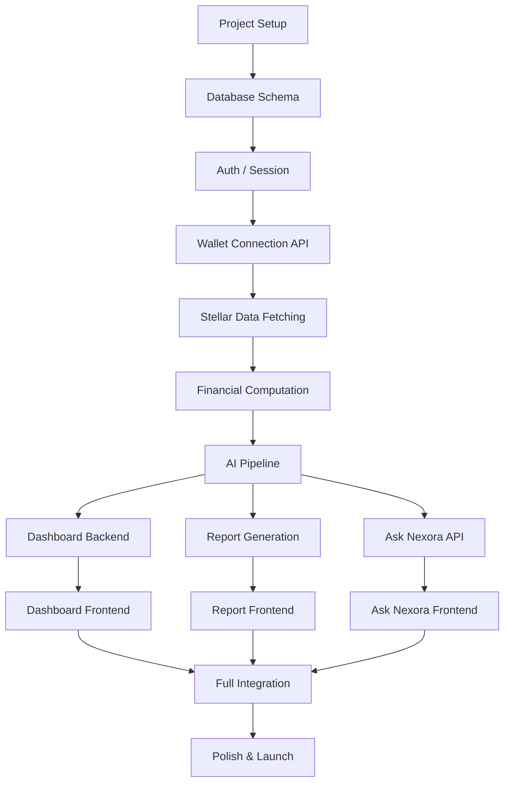
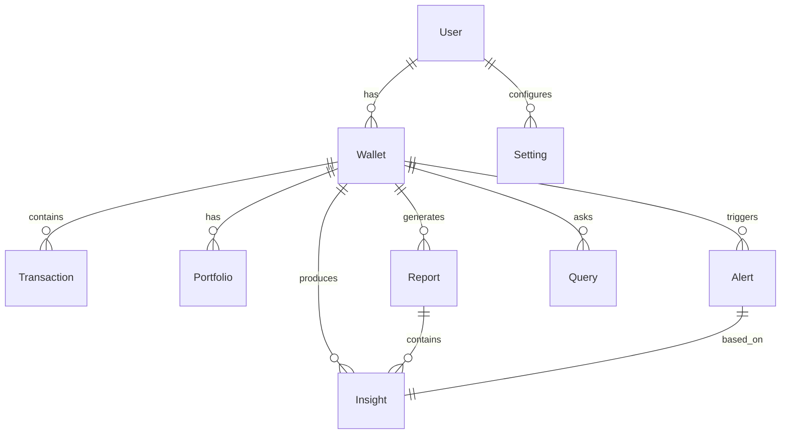

# NEXORA — MVP_BUILD_PLAN.md
## AI Financial Intelligence Platform — MVP Execution Plan
### Version 1.0 | 37-Day Sprint to Launch

---

## Executive Summary

This document provides a complete, actionable plan to build and launch the Nexora MVP within 37 days. Every decision prioritizes **speed, validation, and real user value** over perfection. We are building the smallest version that proves people will pay for financial understanding of their blockchain activity.

**Core MVP Thesis:** A user connects their Stellar wallet and within 60 seconds receives an AI-generated financial snapshot that answers "How am I actually doing?" — with a recurring weekly report that keeps them coming back.

**Key Constraints:**
- Single developer or small team (2-3 people)
- Single chain: Stellar only
- Read-only: no private keys, no custody
- AI-assisted, not AI-dependent (deterministic math + generative narrative)

---

## 1. MVP Strategy

### 1.1 What Is the Smallest Valuable Version?

The Nexora MVP is **a read-only Stellar wallet intelligence tool** that:

1. **Connects** to any Stellar wallet via public address
2. **Analyzes** transaction history, holdings, fees, and risk patterns
3. **Explains** findings in plain English through:
   - A dashboard with health score and key metrics
   - A weekly AI-generated financial report
   - A simple Q&A interface for specific questions

**Not built in MVP:**
- Multi-chain support
- Mobile apps (responsive web only)
- Transaction signing or fund movement
- Tax reporting
- Email delivery
- Multi-wallet aggregation
- Advanced AI agents
- Prescriptive investment advice

### 1.2 What Problem Must MVP Solve?

The MVP must prove that **AI can turn blockchain data into financial understanding that users trust and act upon**.

**Primary user pain addressed:** "I have transactions in my wallet but no idea if I'm financially healthy, over-concentrated, or bleeding value to fees."

**Success criteria:**
- User connects wallet → sees meaningful insight within 60 seconds
- User returns weekly for the report (or checks it because it was valuable)
- User trusts the numbers because they can verify them

### 1.3 Main User Journey (MVP)

```
Discover → Connect Wallet → Initial Analysis → Onboarding Insight → Dashboard → Ask Follow-up → Return Weekly for Report
```

**Simplified MVP flow:**
1. Landing page: "Connect your Stellar wallet. We read only public data."
2. Wallet connection: Enter address or connect via Freighter
3. Analysis: 60-second processing (spin/loading state)
4. Insight: Single most valuable observation appears first
5. Dashboard: Health card, allocation, fees, recent insights
6. Ask: A simple chat input for natural-language questions
7. Report: Weekly report generated and available in-app

---

## 2. MVP Feature Prioritization

### P0 — Must Have (MVP Ships With)

| Feature | Why It Matters | User Value | Complexity |
|---|---|---|---|
| **Wallet Connection** | Single onboarding action; entire product depends on this | User can start using Nexora in seconds | Medium |
| **Initial Analysis & Onboarding Insight** | First impression; proves value immediately | User immediately understands something they didn't before | Medium |
| **Portfolio Health Card** | Primary anchor; answers "how am I doing?" | Confidence and peace of mind | Low |
| **Asset Allocation Intelligence** | Shows concentration/risk | User knows if they're overexposed | Medium |
| **Transaction Intelligence Feed** | Replaces raw explorer data with understanding | User doesn't need to interpret transactions manually | Medium |
| **Fee & Cost Analysis** | Shows real financial drag | User knows what they're losing to fees | Low-Medium |
| **Weekly AI Financial Report** | Retention mechanic; flagship deliverable | User gets recurring value without remembering to check | High |
| **Ask Nexora (Basic)** | Conversational Q&A for balances, fees, activity | User can ask specific questions naturally | Medium |
| **Dashboard with Widgets** | Central hub; shows everything at a glance | User sees key metrics in one place | Low-Medium |
| **Source Evidence Drill-Down** | Builds trust; every claim verifiable | User can verify AI claims | Low |
| **Settings: Disconnect & Privacy** | User control; trust signal | User feels safe and in control | Low |

### P1 — Important (Post-MVP / Version 1.1)

| Feature | Why It Matters | User Value | Complexity |
|---|---|---|---|
| **Risk/Anomaly Alerts** | Proactive value without user action | User catches problems early | Medium |
| **Historical Performance Charts** | Trend visibility | User sees changes over time | Medium |
| **Report Archive** | Past reports accessible | User can track progress | Low |
| **Natural-Language Search** | Find transactions conversationally | User navigates easily | Medium |
| **Deeper Ask Nexora Intents** | More question types | More value from Q&A | Medium-High |
| **Email Report Delivery** | More reliable retention | User receives reports without logging in | Medium |

### P2 — Future (Version 2+)

- Multi-wallet aggregation
- Multi-chain support
- PDF/CSV exports
- Tax reporting
- Goal-based tracking
- Scenario modeling
- Automated rebalancing
- Smart contract integration
- B2B/API licensing
- Native mobile apps

---

## 3. 37-Day Development Roadmap

### Phase 1: Foundation (Days 1-4)

| Day | Tasks | Deliverables |
|---|---|---|
| 1 | Project setup, repo, environments | Working dev environment |
| 2 | Next.js + TypeScript setup, Tailwind | Basic app scaffolding |
| 3 | PostgreSQL setup, Prisma ORM | Database schema ready |
| 4 | Basic authentication (JWT) | User sessions working |

**Goal:** Development environment is fully configured and basic auth works.

### Phase 2: Backend Core (Days 5-10)

| Day | Tasks | Deliverables |
|---|---|---|
| 5 | Database models: User, Wallet, Transaction | Schema migration complete |
| 6 | Express API server setup | API routes scaffolded |
| 7 | Wallet connection endpoints | Connect/disconnect API |
| 8 | Stellar Horizon integration | Can fetch account data |
| 9 | Transaction fetch & processing | Raw transactions stored |
| 10 | Financial Computation Engine v1 | Balances, allocation, fees computed |

**Goal:** Backend can ingest Stellar data and compute financial metrics.

### Phase 3: Frontend Foundation (Days 11-16)

| Day | Tasks | Deliverables |
|---|---|---|
| 11 | Design system components (Design System → CSS) | Buttons, cards, inputs |
| 12 | Landing page + wallet connection flow | User can connect wallet |
| 13 | Dashboard layout + Portfolio Health Card | Health card visible |
| 14 | Allocation widget + Performance snapshot | Key widgets |
| 15 | Transaction feed (basic) | Transactions visible |
| 16 | Settings page + disconnect | Full settings flow |

**Goal:** User can connect wallet and see key dashboard metrics.

### Phase 4: AI & Intelligence (Days 17-24)

| Day | Tasks | Deliverables |
|---|---|---|
| 17 | AI pipeline setup (OpenAI integration) | Can call LLM with structured data |
| 18 | Onboarding insight generation | First AI observation works |
| 19 | Health card AI explanation | Health card with AI narrative |
| 20 | Transaction feed AI annotations | Transactions with explanations |
| 21 | Fee analysis + AI commentary | Fee summary with narrative |
| 22 | Ask Nexora basic intents | Simple Q&A working |
| 23 | Weekly report generation | Report logic complete |
| 24 | Report display + source evidence | Full report viewable |

**Goal:** All AI features are functional and validated.

### Phase 5: Integration & Polish (Days 25-31)

| Day | Tasks | Deliverables |
|---|---|---|
| 25 | Full dashboard integration | All widgets connected to real data |
| 26 | Quick Ask Bar | Persistent Q&A entry point |
| 27 | Report archive | Past reports accessible |
| 28 | Source evidence drill-down | Every AI claim verifiable |
| 29 | Loading states, empty states | All states handled |
| 30 | Error handling, edge cases | Graceful degradation |
| 31 | Dark/light mode toggle | Both modes working |

**Goal:** Product feels complete and polished.

### Phase 6: Testing & QA (Days 32-34)

| Day | Tasks | Deliverables |
|---|---|---|
| 32 | Functional testing (all flows) | All flows work end-to-end |
| 33 | Wallet testing (multiple addresses) | Various wallet types work |
| 34 | AI output testing + validation | No hallucinated numbers |

**Goal:** Product is stable and trustworthy.

### Phase 7: Deployment & Launch Prep (Days 35-37)

| Day | Tasks | Deliverables |
|---|---|---|
| 35 | Deployment setup (Vercel/Railway) | Staging environment live |
| 36 | Production deployment | Production live |
| 37 | Launch checklist + go/no-go | Ready for release |

**Goal:** Product is live and launch-ready.

---

## 4. Development Order

### 4.1 Dependency Flow



### 4.2 Build Order Priority

| Priority | Component | Depends On | Reason |
|---|---|---|---|
| 1 | Project Setup & Auth | None | Foundation for everything |
| 2 | Database Models | Auth | Data layer needed |
| 3 | Wallet Connection API | Auth, DB | Onboarding step |
| 4 | Stellar Data Fetching | Wallet API | Core data source |
| 5 | Financial Computation | Stellar Data | Numbers before AI |
| 6 | Dashboard Backend | Financial Computation | Data for frontend |
| 7 | AI Pipeline | Financial Computation | AI needs structured facts |
| 8 | Dashboard Frontend | Dashboard Backend | User sees value |
| 9 | Report Generation | AI Pipeline | Weekly retention |
| 10 | Ask Nexora | AI Pipeline | Interactive value |
| 11 | Polish & Integration | All | Complete experience |

---

## 5. Frontend Build Plan

### 5.1 Pages to Build (Priority Order)

| Priority | Page | Purpose | Complexity |
|---|---|---|---|
| 1 | Landing / Marketing | First impression, connect CTA | Low |
| 2 | Wallet Connection | Onboarding action | Medium |
| 3 | Dashboard | Hub for all insights | High |
| 4 | Portfolio | Detailed holdings | Medium |
| 5 | Transactions | Intelligent feed | Medium |
| 6 | AI Financial Report | Flagship deliverable | High |
| 7 | Ask Nexora | Q&A interface | Medium |
| 8 | Insights & Alerts | Notification feed | Low |
| 9 | Settings | User control | Low |

### 5.2 Components to Build (Priority Order)

| Priority | Component | Used In | Complexity |
|---|---|---|---|
| 1 | Primary Button | Everywhere | Low |
| 2 | Card | Everywhere | Low |
| 3 | KPI Display | Dashboard, Portfolio | Low |
| 4 | Primary Narrative Block | Dashboard, Report, Ask | Medium |
| 5 | Widget Container | Dashboard | Low |
| 6 | Source Evidence | Report, Ask, Alerts | Low |
| 7 | Wallet Connection Form | Landing | Medium |
| 8 | Health Card | Dashboard | Low-Medium |
| 9 | Allocation Donut | Dashboard, Portfolio | Medium |
| 10 | Performance Chart | Dashboard, Portfolio | Medium |
| 11 | Transaction Feed | Transactions | Medium |
| 12 | Quick Ask Bar | Everywhere | Medium |
| 13 | Report Display | Report | High |
| 14 | Chat Interface | Ask Nexora | Medium |

### 5.3 Required States

| State | Pages Affected | Handling |
|---|---|---|
| Loading | Dashboard, Portfolio, Report | Skeleton loading, spinners |
| Empty | Dashboard, Transactions, Report | Informative empty states |
| Error | Everywhere | Graceful error messages |
| No Wallet | Everywhere | Redirect to connect |
| Analyzing | Dashboard | Progress indicator |
| Data Refreshing | Dashboard | Subtle loading indicator |
| Dark/Light Mode | Everywhere | Theme toggle + system preference |

---

## 6. Backend Build Plan

### 6.1 APIs Needed (Priority Order)

| Priority | Endpoint | Method | Purpose |
|---|---|---|---|
| 1 | `/api/wallets/connect` | POST | Connect wallet |
| 2 | `/api/wallets/disconnect` | POST | Disconnect wallet |
| 3 | `/api/wallets/status` | GET | Check connection status |
| 4 | `/api/portfolio` | GET | Get portfolio data |
| 5 | `/api/transactions` | GET | Get transaction feed |
| 6 | `/api/transactions/:id` | GET | Transaction detail |
| 7 | `/api/reports/latest` | GET | Latest report |
| 8 | `/api/reports/archive` | GET | Report list |
| 9 | `/api/reports/:id` | GET | Specific report |
| 10 | `/api/ask` | POST | Natural-language query |
| 11 | `/api/alerts` | GET | Alert feed |
| 12 | `/api/settings` | GET/PUT | User settings |

### 6.2 Data Processing Flow

```
1. Wallet Connection → Store wallet address → Trigger initial sync
2. Initial Sync → Fetch last 100 transactions from Horizon
3. Transaction Processing → Categorize, store raw + normalized
4. Financial Computation → Compute balances, allocation, fees, metrics
5. Store computed facts → Portfolio table, Metrics table
6. Trigger AI → Generate onboarding insight, store
7. User views dashboard → API serves computed + AI data
8. Weekly report → Scheduled job computes period facts → AI generates report → Store
```

### 6.3 Database Requirements

| Table | Purpose | Key Fields |
|---|---|---|
| `users` | User accounts | id, email, created_at, last_active |
| `wallets` | Wallet connections | id, user_id, address, connected_at, last_synced |
| `transactions` | Stellar transactions | id, wallet_id, tx_hash, type, amount, asset, fee, timestamp |
| `portfolios` | Portfolio snapshots | id, wallet_id, computed_at, total_value_usd, allocation |
| `reports` | AI Financial Reports | id, wallet_id, period, generated_at, content, computed_facts |
| `insights` | AI observations | id, wallet_id, type, severity, headline, narrative, evidence |
| `alerts` | Risk alerts | id, wallet_id, insight_id, severity, triggered_at, dismissed |
| `queries` | Ask Nexora history | id, wallet_id, question, answer, intent, asked_at |
| `settings` | User preferences | user_id, notification_preferences, theme, privacy_settings |

### 6.4 Integration Order

```
1. Stellar Horizon API
   ↓
2. PostgreSQL (read/write)
   ↓
3. Redis (cache + queue)
   ↓
4. BullMQ (background jobs)
   ↓
5. OpenAI API (AI generation)
   ↓
6. All APIs integrated and tested
```

---

## 7. Stellar Integration Plan

### 7.1 Wallet Connection

| Method | Implementation | Priority |
|---|---|---|
| Manual Address Entry | Input field + validation | P0 |
| Freighter Extension | @stellar/freighter-api | P0 |
| WalletConnect | Future version | P1 |

**Validation:**
1. Check address format (Stellar public key pattern)
2. Verify address exists on Stellar network
3. Detect and reject secret key entries (critical safety!)

### 7.2 Data Fetching

| Operation | Method | Frequency |
|---|---|---|
| Account info | Horizon `accounts/{address}` | On connection |
| Transaction history | Horizon `accounts/{address}/transactions` | On connection + daily |
| Asset metadata | Horizon `assets` | On connection |
| Balance updates | Horizon `accounts/{address}` | Daily or on request |

**Pagination Strategy:**
```
Page 1: Fetch 50 transactions → Process → Store
Page 2: Fetch 50 transactions → Process → Store
...
Continue until no more or limit reached
```

### 7.3 Transaction Processing

**Categorization Logic:**

| Category | Detection | Stored As |
|---|---|---|
| Payment | type = 'payment' | 'payment' |
| Swap | type = 'path_payment' | 'swap' |
| Fee | fee_charged > 0 | 'fee' |
| Receipt | destination = user address | 'receipt' |
| Other | Default | 'other' |

**Normalization:**
- All amounts → String with 7-8 decimal places
- Asset codes → Normalized (XLM, USDC, etc.)
- Timestamps → ISO format
- Fee → XLM amount

### 7.4 Asset Analysis

**Supported Asset Types (MVP):**
- Native XLM
- Stellar-issued tokens (USDC, etc.)
- Tokenized funds/instruments

**Asset Metadata:** Fetch issuer, code, type from Horizon

### 7.5 Rate Limiting

| Operation | Limit | Handling |
|---|---|---|
| Horizon API calls | 100 req/min | Exponential backoff |
| Transaction fetch | 50 req/min per wallet | Batch processing |
| Full sync | Once per wallet/day | Background job |

---

## 8. AI Development Plan

### 8.1 AI Pipeline Overview

```
Structured Financial Facts → Retrieve Relevant Facts → Rank/Filter → Prompt Generation → LLM → Validation → Output
```

### 8.2 Data Preparation

**What AI Receives (never raw data):**

| Fact Type | Example | Source |
|---|---|---|
| Balance | "2,500 XLM ($500)" | Compute Engine |
| Allocation | "XLM: 80%, USDC: 15%, Other: 5%" | Compute Engine |
| Fee totals | "5.2 XLM ($2.10) this month" | Compute Engine |
| Transaction count | "12 transactions this month" | Compute Engine |
| Risk metrics | "Concentration: 80% (high)" | Compute Engine |
| Baseline comparison | "+15% above average" | Compute Engine |

### 8.3 Prompt Design

**Template Structure:**

```
[ROLE] You are Nexora, a calm, competent financial advisor.

[CONTEXT] The user's portfolio data:
- Total value: $12,450
- Top holdings: XLM (80%), USDC (15%), Other (5%)
- Fee spend this month: 5.2 XLM
- Historical baseline: 4.5 XLM average

[TASK] Generate a 2-3 sentence summary of the user's financial state.

[CONSTRAINTS] 
- Never invent numbers
- Use only the numbers provided above
- Be calm and factual
- Focus on what matters most

[OUTPUT FORMAT] Plain English, 2-3 sentences.
```

**Templates by Insight Type:**

| Insight Type | Prompt Template |
|---|---|
| Allocation commentary | "Describe the user's asset allocation, focusing on concentration risk..." |
| Fee commentary | "Analyze the user's fee spend compared to their baseline..." |
| Performance summary | "Summarize portfolio performance this period..." |
| Risk flag | "Explain why this concentration level is notable..." |
| Report summary | "Provide a brief overview of the user's financial state..." |

### 8.4 Financial Analysis Logic

**Deterministic (no AI):**

| Metric | Formula | Source |
|---|---|---|
| Balance | Sum of all transactions per asset | Database |
| Allocation | (Asset Value / Total Value) * 100 | Compute Engine |
| Fee total | Sum of fee_charged per transaction | Compute Engine |
| Transaction count | Count of transactions in period | Database |
| Concentration | Max allocation percentage | Compute Engine |
| Baseline | Moving average of user's own data | Compute Engine |

**AI-Enhanced:**

| Output | Input | AI Task |
|---|---|---|
| Health narrative | Score, concentration, fees | Explain what the metrics mean |
| Report sections | All computed facts | Generate readable narrative |
| Onboarding insight | One key computed fact | Explain significance |
| Alert narrative | Risk metric + threshold | Explain why triggered |

### 8.5 Report Generation

**Report Sections (8 total):**
1. Summary Overview
2. Portfolio Performance
3. Allocation & Risk
4. Transaction Activity Highlights
5. Fee & Efficiency Analysis
6. Risk Flags
7. Recommendations
8. Look Ahead

**Generation Flow:**
```
1. Compute all period facts (deterministic)
2. Rank insights by significance
3. For each section:
   a. Select relevant facts
   b. Generate with AI (templated prompt)
   c. Validate all numbers match source
4. Fall back to fact-only for invalid sections
5. Assemble final report
6. Store in database
```

### 8.6 Validation & Safety

**Validation Gates:**

| Check | Failure Handling |
|---|---|
| All numbers in AI output match source facts | Regenerate section or fact-only fallback |
| Output follows expected format | Fact-only fallback |
| No secret/personal data leaked | Strip before display |

**Prompt Safety:**

| Protection | Implementation |
|---|---|
| Injection prevention | Template-based prompts, never raw user input |
| PII protection | Never include address/name in prompts |
| Scope enforcement | Explicit constraints in system prompt |

---

## 9. Database Implementation Plan

### 9.1 Entity Relationship Diagram



### 9.2 Schema Definitions

**User:**
```sql
CREATE TABLE users (
  id UUID PRIMARY KEY DEFAULT gen_random_uuid(),
  email TEXT,
  auth_provider TEXT,
  created_at TIMESTAMP DEFAULT NOW(),
  updated_at TIMESTAMP DEFAULT NOW(),
  last_active TIMESTAMP DEFAULT NOW()
);
```

**Wallet:**
```sql
CREATE TABLE wallets (
  id UUID PRIMARY KEY DEFAULT gen_random_uuid(),
  user_id UUID REFERENCES users(id),
  address TEXT NOT NULL,
  connected_at TIMESTAMP DEFAULT NOW(),
  last_synced TIMESTAMP,
  is_active BOOLEAN DEFAULT TRUE,
  disconnected_at TIMESTAMP,
  UNIQUE(user_id, address)
);
```

**Transaction:**
```sql
CREATE TABLE transactions (
  id UUID PRIMARY KEY DEFAULT gen_random_uuid(),
  wallet_id UUID REFERENCES wallets(id),
  tx_hash TEXT NOT NULL,
  ledger INTEGER,
  timestamp TIMESTAMP,
  operation_type TEXT,
  amount TEXT,
  asset_code TEXT,
  asset_issuer TEXT,
  from_address TEXT,
  to_address TEXT,
  memo TEXT,
  fee_paid TEXT,
  category TEXT,
  normalized_amount DECIMAL(20,8),
  raw_data JSONB,
  processed_at TIMESTAMP DEFAULT NOW(),
  UNIQUE(wallet_id, tx_hash)
);
```

**Portfolio:**
```sql
CREATE TABLE portfolios (
  id UUID PRIMARY KEY DEFAULT gen_random_uuid(),
  wallet_id UUID REFERENCES wallets(id),
  computed_at TIMESTAMP DEFAULT NOW(),
  total_value_usd DECIMAL(20,2),
  allocation JSONB,
  risk_score DECIMAL(5,2),
  risk_level TEXT,
  metadata JSONB
);
```

**Report:**
```sql
CREATE TABLE reports (
  id UUID PRIMARY KEY DEFAULT gen_random_uuid(),
  wallet_id UUID REFERENCES wallets(id),
  user_id UUID REFERENCES users(id),
  period TEXT,
  period_start DATE,
  period_end DATE,
  generated_at TIMESTAMP DEFAULT NOW(),
  content JSONB,
  computed_facts JSONB,
  status TEXT DEFAULT 'pending',
  delivered_at TIMESTAMP
);
```

**Insight:**
```sql
CREATE TABLE insights (
  id UUID PRIMARY KEY DEFAULT gen_random_uuid(),
  wallet_id UUID REFERENCES wallets(id),
  report_id UUID REFERENCES reports(id),
  type TEXT,
  severity TEXT,
  headline TEXT,
  narrative TEXT,
  evidence JSONB,
  computed_facts JSONB,
  generated_at TIMESTAMP DEFAULT NOW(),
  dismissed BOOLEAN DEFAULT FALSE,
  dismissed_at TIMESTAMP
);
```

**Alert:**
```sql
CREATE TABLE alerts (
  id UUID PRIMARY KEY DEFAULT gen_random_uuid(),
  wallet_id UUID REFERENCES wallets(id),
  insight_id UUID REFERENCES insights(id),
  severity TEXT,
  type TEXT,
  message TEXT,
  trigger_data JSONB,
  triggered_at TIMESTAMP DEFAULT NOW(),
  dismissed BOOLEAN DEFAULT FALSE,
  dismissed_at TIMESTAMP
);
```

**Query:**
```sql
CREATE TABLE queries (
  id UUID PRIMARY KEY DEFAULT gen_random_uuid(),
  wallet_id UUID REFERENCES wallets(id),
  user_id UUID REFERENCES users(id),
  question TEXT,
  answer TEXT,
  intent TEXT,
  computed_facts JSONB,
  answered BOOLEAN DEFAULT FALSE,
  asked_at TIMESTAMP DEFAULT NOW(),
  answered_at TIMESTAMP,
  context JSONB
);
```

**Setting:**
```sql
CREATE TABLE settings (
  user_id UUID PRIMARY KEY REFERENCES users(id),
  notification_preferences JSONB,
  theme TEXT DEFAULT 'dark',
  privacy_settings JSONB,
  updated_at TIMESTAMP DEFAULT NOW()
);
```

### 9.3 Migration Strategy

| Phase | Action |
|---|---|
| Day 5 | Initial schema migration |
| Day 10 | Add computed fields |
| Day 18 | Add AI-related tables |
| Day 25 | Indexing for performance |
| Day 30 | Final schema review |

---

## 10. Testing Strategy

### 10.1 Functional Testing

| Test Area | What to Test | Success Criteria |
|---|---|---|
| Wallet Connection | Manual entry, Freighter | Valid address connects; invalid rejected; secret key rejected |
| Dashboard Loading | Health card, widgets | All widgets load with real data |
| Portfolio View | Allocation, holdings | Correct percentages; AI commentary present |
| Transaction Feed | List, categories, detail | All transactions categorized; annotations present |
| Report Generation | Scheduled, on-demand | Report generated within 60 seconds; all sections present |
| Ask Nexora | All supported intents | Correct answers; source evidence available |
| Settings | Disconnect, delete, preferences | Actions complete successfully |

### 10.2 Wallet Testing

| Scenario | Test Cases |
|---|---|
| Empty wallet | No transactions → empty state |
| New wallet (few txs) | 1-5 transactions → basic analysis |
| Active wallet (many txs) | 50-500 transactions → full analysis |
| Complex wallet | Swaps, path payments → correct categorization |
| Asset diversity | Multiple assets → accurate allocation |
| Long history | 1-2 years → performance over time |

### 10.3 AI Output Testing

| Test | Method | Success Criteria |
|---|---|---|
| Fact validation | Compare AI numbers to computed facts | 100% match |
| Narrative quality | Human review | Sentences are clear and useful |
| Hallucination check | Known data with known ground truth | No invented numbers |
| Tone check | Human review | Calm, competent tone |
| Consistency check | Multiple wallet types | Similar quality across data types |
| Edge cases | No data, unusual patterns | Graceful handling |

### 10.4 Security Testing

| Test | Method |
|---|---|
| Secret key detection | Try entering secret key → hard stop |
| Private key never requested | Walk through all flows → no private key input |
| Session security | Session invalidation on timeout |
| API authentication | Unauthenticated requests rejected |
| Rate limiting | Exceed rate limits → 429 response |
| CORS configuration | Cross-origin requests → proper CORS headers |

### 10.5 User Experience Testing

| Test | Method |
|---|---|
| First-time user | Watch user connect wallet → complete first insight |
| Returning user | User returns after report → finds report easily |
| Ask Nexora | User asks questions → gets useful answers |
| Mobile use | Test on various phone sizes → responsive |
| Loading states | Observe during analysis → clear progress |
| Error handling | Trigger errors → graceful messages |

---

## 11. Deployment Plan

### 11.1 Deployment Strategy

| Environment | Purpose | URL |
|---|---|---|
| Development | Local development | http://localhost:3000 |
| Staging | Testing + QA | https://staging.nexora.com |
| Production | Live product | https://nexora.com |

### 11.2 Frontend Deployment (Vercel)

```
1. Connect GitHub repository to Vercel
2. Configure environment variables
3. Set up automatic deployments from main branch
4. Preview deployments for PRs
5. Production deployment on merge to main
```

**Environment Variables:**
```
NEXT_PUBLIC_API_URL=https://api.nexora.com
NEXT_PUBLIC_SITE_URL=https://nexora.com
```

### 11.3 Backend Deployment (Railway or Heroku)

```
1. Connect GitHub repository to Railway/Heroku
2. Configure environment variables
3. Set up PostgreSQL add-on
4. Set up Redis add-on
5. Deploy with CI/CD
6. Automatic migrations on deploy
```

**Environment Variables:**
```
DATABASE_URL=postgresql://...
REDIS_URL=redis://...
JWT_SECRET=...
OPENAI_API_KEY=...
STELLAR_HORIZON_URL=https://horizon.stellar.org
```

### 11.4 Database Deployment

| Step | Action |
|---|---|
| 1 | Provision PostgreSQL instance (Railway/Heroku add-on) |
| 2 | Run Prisma migrations during deployment |
| 3 | Enable automated backups |
| 4 | Set up read replica for scaling (future) |

### 11.5 Environment Management

| Environment | Variables | Access |
|---|---|---|
| Development | Local .env | Developer only |
| Staging | Remote env vars | Team + QA |
| Production | Remote env vars | Team only |

---

## 12. MVP Scope Protection

### 12.1 What WILL NOT Be Built Before Launch

**Blockchain:**
- ❌ Multi-chain support (EVM, Solana, etc.)
- ❌ Smart contract integration (Soroban)
- ❌ Transaction signing or fund movement
- ❌ Token issuance or management
- ❌ Automated trading or rebalancing
- ❌ DeFi protocol interaction
- ❌ Staking or yield tracking

**Features:**
- ❌ Native mobile apps (iOS, Android)
- ❌ Email delivery (in-app only)
- ❌ PDF/CSV exports
- ❌ Tax reporting
- ❌ Multi-wallet aggregation
- ❌ Social features (sharing, leaderboards)
- ❌ Public API or SDK
- ❌ B2B/whitelabel licensing
- ❌ Goal-based tracking
- ❌ Scenario modeling
- ❌ Advanced anomaly detection
- ❌ Prescriptive investment advice

**AI:**
- ❌ Autonomous AI agents
- ❌ Predictive analytics
- ❌ Sentiment analysis
- ❌ Custom AI model training
- ❌ On-chain AI execution

**Infrastructure:**
- ❌ High-availability setup
- ❌ Global load balancing
- ❌ Advanced observability
- ❌ Custom domain (free tier first)
- ❌ SSL (auto-provisioned)

**User Experience:**
- ❌ Onboarding email sequences
- ❌ Push notifications
- ❌ Multi-language support
- ❌ Accessibility beyond WCAG AA
- ❌ Advanced analytics

### 12.2 Scope Protection Rules

1. **If it's not in the PRD, we're not building it** — No feature creep
2. **If it's not a P0, it waits until post-MVP** — Focus is everything
3. **If it takes more than 2 days to implement, reassess** — Break it down or defer
4. **If it doesn't directly serve the core user journey, cut it** — Ruthless prioritization
5. **If it's "nice to have," it's a "we'll see"** — Optimize for must-have only

---

## 13. Risk Management

### 13.1 Technical Risks

| Risk | Probability | Impact | Mitigation |
|---|---|---|---|
| **Stellar Horizon downtime** | Medium | High | Implement retry logic with exponential backoff; cache last successful data |
| **Database performance issues** | Medium | High | Add proper indexing; implement caching layer (Redis) |
| **API rate limiting** | Medium | Medium | Batch requests; implement request queuing |
| **Frontend performance** | Low | Medium | Code splitting; lazy loading; optimize assets |
| **Authentication bugs** | Medium | High | Extensive testing; clear error messages |

### 13.2 Time Risks

| Risk | Probability | Impact | Mitigation |
|---|---|---|---|
| **Feature creep** | High | Critical | Strict P0/P1 prioritization; daily scope check |
| **AI integration delays** | Medium | High | Start with simple prompts; iterate after launch |
| **Stellar integration complexity** | Medium | High | Start with Horizon API; use official SDK |
| **Design implementation time** | Medium | Medium | Use design system components; avoid custom design |
| **Testing bottlenecks** | Medium | Medium | Continuous testing from day 1 |

### 13.3 AI Risks

| Risk | Probability | Impact | Mitigation |
|---|---|---|---|
| **Hallucinated numbers** | Medium | Critical | Validation gate after every AI generation |
| **API costs** | Medium | High | Caching; prompt optimization; fallback to fact-only |
| **Prompt injection** | Low | High | Template-based prompts; no raw user input |
| **Inconsistent quality** | Medium | Medium | Human QA on sample outputs; iterative prompt improvement |
| **Latency** | Medium | Medium | Async processing; loading states |

### 13.4 Blockchain Risks

| Risk | Probability | Impact | Mitigation |
|---|---|---|---|
| **Network fork** | Low | Medium | Use latest Horizon; monitor network |
| **Asset price data missing** | Medium | Medium | Use reliable price API; fallback to last known price |
| **Transaction parsing errors** | Medium | Medium | Robust categorization; fallback to 'other' category |
| **Account data size** | High | Medium | Pagination; limit history depth (e.g., last 1000 txs) |

### 13.5 Risk Mitigation Summary

| Risk Area | Primary Mitigation | Secondary Mitigation |
|---|---|---|
| Technical | Retry logic, caching, monitoring | Load testing, redundancy |
| Time | Strict scope, daily standups | Feature cut as needed |
| AI | Validation gate, fallback | Human QA, prompt templates |
| Blockchain | Error handling, fallback | Multiple data sources |
| Team | Clear ownership, communication | Pair programming on complex tasks |

---

## 14. Launch Checklist

### 14.1 Pre-Launch Checklist

**Code Complete:**
- [ ] All P0 features implemented
- [ ] All P1 features deferred (documented for post-MVP)
- [ ] No console errors in production build
- [ ] All API endpoints returning expected data
- [ ] All database migrations applied

**Testing Complete:**
- [ ] All functional tests passing
- [ ] Wallet connection works (manual + Freighter)
- [ ] Edge cases handled (empty wallet, no history, etc.)
- [ ] AI outputs validated (no hallucinations)
- [ ] Error states are clear and helpful
- [ ] Mobile responsive tested (various screen sizes)

**Deployment Ready:**
- [ ] Staging environment fully functional
- [ ] Production environment configured
- [ ] Environment variables set correctly
- [ ] Database backups configured
- [ ] SSL certificate valid
- [ ] DNS configured (nexora.com → deployment)

**Security Verified:**
- [ ] No private keys requested or stored
- [ ] Secret key entry rejected
- [ ] Session management working
- [ ] API authentication required
- [ ] Rate limiting implemented
- [ ] CORS configured correctly

**User Experience:**
- [ ] Loading states implemented
- [ ] Empty states informative
- [ ] Error messages helpful
- [ ] Dark/light mode working
- [ ] Navigation intuitive
- [ ] Quick Ask Bar accessible
- [ ] Source evidence available

**Content Ready:**
- [ ] Landing page copy complete
- [ ] Privacy policy clear and accessible
- [ ] How it works explainer
- [ ] Example reports available (test data)
- [ ] Help/FAQ content (basic)

**Analytics/Support:**
- [ ] Basic monitoring set up
- [ ] Error logging configured
- [ ] User feedback mechanism
- [ ] Support contact available

### 14.2 Launch Day Checklist

- [ ] Deploy to production
- [ ] Verify all endpoints with real data
- [ ] Test wallet connection with new address
- [ ] Generate test report (daily/weekly)
- [ ] Verify dashboard loads with real data
- [ ] Test Ask Nexora with supported questions
- [ ] Monitor for errors
- [ ] Announce launch (Twitter, Stellar community, etc.)
- [ ] Prepare for feedback

### 14.3 Post-Launch Checklist (Week 1)

- [ ] Monitor error logs
- [ ] Review user feedback
- [ ] Fix critical bugs
- [ ] Track retention metrics
- [ ] Identify highest-value features for next sprint
- [ ] Plan Version 1.1 features
- [ ] Celebrate launch! 🎉

---

## 15. Post-MVP Priorities

### 15.1 Version 1.1 (Weeks 1-4 Post-Launch)

| Priority | Feature | Reason |
|---|---|---|
| 1 | Bug fixes | Ensure stability |
| 2 | Email report delivery | Boost retention |
| 3 | Risk/Anomaly alerts | Proactive value |
| 4 | Report archive | Past insights accessible |
| 5 | Improved Ask Nexora | More value |

### 15.2 Version 1.2 (Months 2-3)

| Priority | Feature | Reason |
|---|---|---|
| 1 | Multi-wallet aggregation | Power users |
| 2 | PDF/CSV exports | Professional use |
| 3 | Performance charts | Trend visibility |
| 4 | Deeper insights | More value per user |
| 5 | Premium tier | Monetization |

### 15.3 Version 2.0 (Months 4-6)

| Priority | Feature | Reason |
|---|---|---|
| 1 | Multi-chain support | Expand market |
| 2 | Goal-based tracking | Stickiness |
| 3 | Scenario modeling | Power users |
| 4 | API/Whitelabel | B2B revenue |

---

## 16. Summary

### 16.1 What We're Building

- Read-only Stellar wallet intelligence
- Dashboard with health score, allocation, fees
- Weekly AI Financial Report
- Basic Ask Nexora Q&A
- Source evidence for trust
- Settings and privacy controls

### 16.2 What We're Not Building (MVP)

- Multi-chain
- Mobile apps
- Transaction signing
- Tax reporting
- Email
- Complex AI agents
- B2B features

### 16.3 37-Day Timeline

| Phase | Days | Focus |
|---|---|---|
| Foundation | 1-4 | Project setup, auth |
| Backend Core | 5-10 | APIs, Stellar integration |
| Frontend Foundation | 11-16 | Pages, components |
| AI & Intelligence | 17-24 | AI pipeline, reports |
| Integration & Polish | 25-31 | Complete product |
| Testing & QA | 32-34 | Stability |
| Deployment | 35-37 | Launch |

### 16.4 Critical Success Factors

1. **Wallet connection works** (first impression is everything)
2. **AI numbers are accurate** (trust is paramount)
3. **Report is useful** (retention depends on it)
4. **Product is stable** (no broken flows)
5. **Source evidence is always available** (verifiability builds trust)

### 16.5 Final Word

This plan is realistic for a solo developer or small team (2-3 people). The key is **ruthless prioritization** and **strict scope control**. If something takes too long or doesn't directly serve the core user journey, cut it. Launch with a solid product that does one thing well, then iterate based on real user feedback.

**Good luck, team. Let's build Nexora.** 🚀

---

*End of Document — Nexora MVP_BUILD_PLAN.md v1.0*