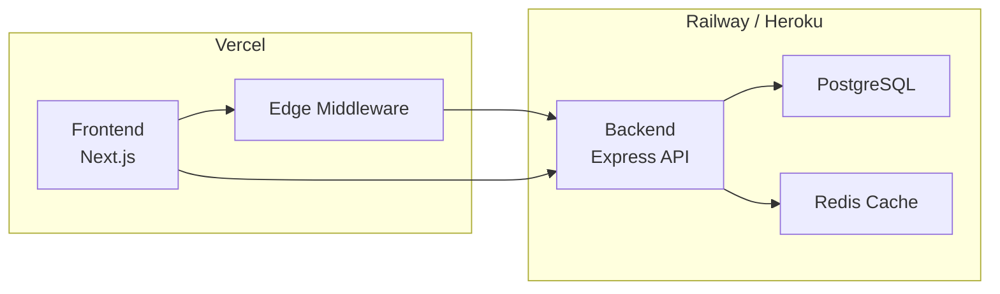

# NEXORA — FRONTEND ARCHITECTURE.md
## AI Financial Intelligence Platform — Frontend Architecture Specification
### Version 1.0 | Senior Frontend Architect's Design Document

---

## 1. Frontend Goals

### 1.1 Frontend Responsibilities

The Nexora frontend serves as the **interpretive presentation layer** — the user-facing interface that transforms computed financial data and AI-generated narratives into an understandable, trustworthy, and actionable experience. Its responsibilities are:

| Responsibility | Description |
|---|---|
| **Narrative Presentation** | Render AI-generated financial narratives as the primary content, with computed facts as supporting evidence — not the reverse |
| **Data Visualization** | Present financial data (allocation, performance, fees) through clean, minimal charts that support rather than replace the narrative |
| **Interaction Handling** | Manage all user interactions: wallet connection, navigation, Q&A, filtering, and progressive disclosure |
| **State Orchestration** | Coordinate client-side state (auth, wallet, preferences, UI state) with server-state management |
| **Trust Anchoring** | Render source evidence on demand for every AI claim, maintaining the "show your work" promise |
| **Responsive Delivery** | Deliver a consistent experience across desktop, tablet, and mobile breakpoints without degrading content availability |
| **Performance Optimization** | Load critical content first, lazy-load secondary content, and maintain perceived performance during data fetching |
| **Security Enforcement** | Implement client-side security controls: never request/transmit private keys, validate inputs, and enforce session management |

### 1.2 User Experience Goals

| Goal | Description | Implementation Strategy |
|---|---|---|
| **Narrative-First Experience** | The frontend must lead with plain-language explanations, not raw data | Render `PrimaryNarrativeBlock` components at the top of every content section; charts and numbers support the narrative, not the other way around |
| **60-Second Time-to-Value** | Users should understand their financial profile within 60 seconds of connection | Optimize the Dashboard's initial load; show real data as soon as it's available; avoid blocking users with unnecessary setup steps |
| **Calm, Trustworthy Interface** | The interface should feel professional, never frantic or hype-driven | Use the design system's restrained palette; avoid flashing, vibrating, or alarmist animations; maintain generous whitespace |
| **Progressive Disclosure** | Simple by default, detailed on demand | Every content section shows a summary; users click to reveal depth (charts, source evidence, full reports) |
| **Consistent "Voice" Across Surfaces** | Dashboard, Report, and Ask Nexora feel like the same product talking | Reuse the same component patterns (`Computed Fact → AI Narrative → Source Evidence`) everywhere AI content appears |
| **Zero Dead Ends** | Every terminal state (empty portfolio, no alerts, out-of-scope question) is an explained, positive state | Design informative empty states for every possible "no data" scenario |
| **Trust-Building First Session** | Users can verify the first AI claim they see | Show source evidence inline on the Onboarding Insight, not hidden behind a click |

### 1.3 Performance Goals

| Metric | Target | Rationale |
|---|---|---|
| **First Contentful Paint (FCP)** | < 1.5s | Users should see meaningful content quickly |
| **Largest Contentful Paint (LCP)** | < 2.5s | Dashboard widgets should render within the acceptable range |
| **Time to Interactive (TTI)** | < 3.5s | Users should be able to click and interact without delay |
| **Initial Dashboard Load** | < 3s (3G) | Users connecting for the first time should see their insight within the 60-second analysis window |
| **Client-Side Navigation** | < 300ms | Section-to-section navigation should feel instant |
| **Chart Rendering** | < 200ms | Charts should appear without blocking the UI thread |
| **Lighthouse Score** | ≥ 90 | Performance, Accessibility, Best Practices, SEO |
| **Bundle Size (Initial)** | < 200KB (gzipped) | Minimize JavaScript payload for mobile users |
| **Bundle Size (Total)** | < 1MB (gzipped) | Lazy-load non-critical chunks |

### 1.4 Scalability Goals

| Goal | Description |
|---|---|
| **Feature Scalability** | The frontend architecture must support adding new sections (e.g., multi-wallet view in V2) without refactoring core patterns |
| **Component Reusability** | UI and product components must be reusable across different sections (e.g., `PrimaryNarrativeBlock` used in Dashboard, Report, Ask Nexora, and Alerts) |
| **State Scalability** | State management must handle growing complexity (multi-wallet, more preferences, more user types) without becoming unmanageable |
| **Team Scalability** | The architecture should support multiple developers working in parallel on different features without merge conflicts |
| **Performance Scalability** | As data volume grows (more transactions, longer history), the frontend must remain performant through pagination, virtualization, and caching |

---

## 2. Technology Stack

### 2.1 Framework: Next.js 14 (App Router)

**Why Next.js?**

| Factor | Rationale |
|---|---|
| **Hybrid Rendering** | Server-side rendering for landing pages (SEO-critical); client-side rendering for authenticated dashboard (dynamic data) |
| **Built-in API Routes** | Lightweight API endpoints for nextjs-specific needs (preview data, proxying) — though the primary API is the backend Express server |
| **File-Based Routing** | Clean, predictable routing structure that maps directly to the IA |
| **Optimized Bundling** | Automatic code splitting, lazy loading, and image optimization out of the box |
| **Middleware** | Authentication, redirects, and request handling at the edge |
| **Server Components** | Reduce client-side JavaScript for static or semi-static content (report rendering, settings pages) |
| **App Router** | Nested layouts, loading states, error boundaries, and parallel routes for complex dashboard layouts |
| **TypeScript Support** | First-class TypeScript integration |

**App Router vs. Pages Router:** We use App Router for its superior loading/error state handling, nested layouts, and React Server Component support.

### 2.2 Language: TypeScript 5 (Strict Mode)

| Aspect | Implementation |
|---|---|
| **Strict Mode** | `strict: true`, `noUncheckedIndexedAccess: true`, `noImplicitReturns: true` |
| **Types** | Shared types between frontend and backend via a `types` workspace package |
| **API Types** | Generated from backend OpenAPI/Swagger or manually maintained Zod schemas |
| **Component Props** | Explicitly typed with `interface` or `type` exports |
| **Hooks** | Typed return values for all custom hooks |

**Why TypeScript Strict Mode?** Nexora's trust model depends on accurate data rendering. TypeScript strict mode catches type mismatches at compile time — preventing cases where a component expects a number but receives a string, or where a field is missing entirely.

### 2.3 Styling: Tailwind CSS + CSS Modules

**Primary Approach: Tailwind CSS**

| Factor | Rationale |
|---|---|
| **Design System Alignment** | Tailwind's utility classes map directly to the design tokens (colors, spacing, typography) |
| **Development Speed** | Rapid UI development without context-switching to CSS files |
| **Bundle Size** | Purge unused styles in production → minimal CSS payload |
| **Dark/Light Mode** | First-class dark mode support with `dark:` variants |
| **Responsive Design** | Mobile-first with `sm:`, `md:`, `lg:` breakpoints |
| **Consistency** | Enforces design system constraints (no arbitrary colors, spacing values) |

**Secondary Approach: CSS Modules (for complex components)**

| Use Case | Example |
|---|---|
| **Complex Animations** | Charts with custom transitions |
| **Third-Party Overrides** | Chart library styling that can't be done with Tailwind utilities |
| **Complex Grid Layouts** | Custom responsive layouts not covered by Tailwind's grid classes |

**Why Not CSS-in-JS?** CSS-in-JS (styled-components, Emotion) adds runtime overhead and increases bundle size. Tailwind + CSS Modules provides a zero-runtime, predictable styling solution.

### 2.4 UI Library: Custom Design System

**Approach:** Build a component library from scratch using the Design System specification, rather than using a third-party library (MUI, Chakra, Radix).

| Factor | Rationale |
|---|---|
| **Full Control** | Complete alignment with the Design System without fighting a third-party library's conventions |
| **Bundle Size** | No unused components; minimal dependency overhead |
| **Accessibility** | Build accessibility in from the start (not retrofitted) |
| **Consistency** | One source of truth for all UI components |
| **Evolution** | Easier to evolve the design system over time |

**Third-Party Dependencies (Minimal):**

| Dependency | Purpose |
|---|---|
| `react-hook-form` | Form handling (wallet connection, settings) |
| `zod` | Runtime validation (forms, API responses) |
| `clsx` / `cn` | Conditional class name utilities |

### 2.5 State Management

**Two-Layer State Architecture:**

| Layer | Technology | Responsibility |
|---|---|---|
| **Server State** | React Query (TanStack Query) | Caching, background refetching, optimistic updates, pagination of API data |
| **Client State** | Zustand | UI state (sidebar open, modals), user preferences, wallet connection state, dashboard configuration |

**Why React Query?**

| Factor | Rationale |
|---|---|
| **Automatic Caching** | Data stays fresh with stale-while-revalidate |
| **Background Refetching** | Dashboard data updates silently in the background |
| **Optimistic Updates** | UI feels responsive (e.g., dismissing an alert) |
| **Pagination Support** | Transaction feed pagination with `useInfiniteQuery` |
| **Deduplication** | Multiple components requesting the same data → single network request |
| **DevTools** | Excellent debugging experience |

**Why Zustand over Redux?**

| Factor | Rationale |
|---|---|
| **Simplicity** | Minimal boilerplate; less code to maintain |
| **Performance** | No unnecessary re-renders; selector-based subscription |
| **Bundle Size** | ~3KB vs. Redux's ~20KB+ |
| **TypeScript** | Excellent TypeScript support |
| **DevTools** | Redux DevTools integration available |

**Why Not Context API?** Context API re-renders all consumers on any state change, causing performance issues in complex dashboards. Zustand provides granular subscriptions.

### 2.6 Data Fetching Approach

| Layer | Technology | Description |
|---|---|---|
| **API Client** | Native `fetch` with middleware | Lightweight, no additional dependencies |
| **Type-Safe Client** | `fetch` + Zod | Validation of API responses at runtime |
| **Data Fetching** | React Query | Server-state management |
| **Authentication** | HTTP-only cookies (backend) | Session management; frontend reads `authenticated` status |

**API Client Structure:**

```
fetch → auth middleware (adds credentials) → API call → response → Zod validation → typed data → React Query cache
```

**Why Not tRPC?** tRPC would require both frontend and backend to use TypeScript in the same way (monorepo). With a separate backend (Express) and frontend (Next.js), tRPC adds complexity. We'll use a typed `fetch` wrapper with Zod validation instead.

### 2.7 Chart Libraries: Recharts + D3 (Custom)

| Chart Type | Library | Rationale |
|---|---|---|
| **Standard Charts** | Recharts | Declarative, built on D3, good API, customizable, excellent TypeScript support |
| **Custom Visualizations** | D3 (custom) | For charts not covered by Recharts (e.g., custom donut charts, specialized visualizations) |

**Why Recharts?**

| Factor | Rationale |
|---|---|
| **Declarative** | Components like `<LineChart />`, `<BarChart />` are intuitive |
| **Lightweight** | Smaller bundle size than chart.js |
| **Responsive** | `responsiveContainer` works well |
| **Accessibility** | Good support for keyboard navigation and ARIA |
| **Dark/Light Mode** | Easy to theme with design system colors |

**Why Not Chart.js?** Chart.js is imperative (canvas-based) and doesn't integrate as smoothly with React's declarative pattern. Recharts is SVG-based, allowing better accessibility and styling.

**Chart Responsiveness:**
- Desktop: Full chart with detailed axes and tooltips
- Mobile: Simplified axis labels, smaller tooltips, horizontal scrolling for multi-bar charts

### 2.8 Testing Stack

| Test Type | Tool | Rationale |
|---|---|---|
| **Unit Testing** | Vitest | Fast, compatible with Vite ecosystem |
| **Component Testing** | React Testing Library | Test user behavior, not implementation |
| **E2E Testing** | Playwright | Cross-browser testing, reliable selectors |
| **Mocking** | MSW (Mock Service Worker) | API mocking for development and testing |
| **Snapshot Testing** | Vitest + React Testing Library | Catch unintended UI changes (use sparingly) |

### 2.9 Development Tooling

| Tool | Purpose |
|---|---|
| **ESLint** | Code quality and consistency |
| **Prettier** | Code formatting |
| **Husky** | Git hooks (pre-commit linting) |
| **Storybook** | UI component development and documentation |
| **Chromatic** | Visual regression testing (optional) |
| **Next.js DevTools** | Performance and build debugging |
| **React Query DevTools** | Server-state debugging |

---

## 3. Application Structure

### 3.1 Overview

```
frontend/
├── app/                        # Next.js App Router
│   ├── (auth)/                # Authentication routes (no sidebar)
│   │   ├── login/
│   │   └── signup/
│   ├── (marketing)/           # Public/marketing routes
│   │   ├── page.tsx           # Landing page
│   │   ├── how-it-works/
│   │   ├── privacy/
│   │   └── layout.tsx
│   ├── (dashboard)/           # Authenticated routes with sidebar
│   │   ├── dashboard/
│   │   │   └── page.tsx
│   │   ├── portfolio/
│   │   │   ├── page.tsx
│   │   │   ├── allocation/
│   │   │   ├── holdings/
│   │   │   └── performance/
│   │   ├── journal/
│   │   │   └── page.tsx
│   │   ├── report/
│   │   │   ├── page.tsx
│   │   │   └── [id]/
│   │   ├── transactions/
│   │   │   ├── page.tsx
│   │   │   └── [id]/
│   │   ├── watchlist/
│   │   │   └── page.tsx
│   │   ├── news/
│   │   │   └── page.tsx
│   │   ├── top-traders/
│   │   │   └── page.tsx
│   │   ├── settings/
│   │   │   ├── page.tsx
│   │   │   ├── connections/
│   │   │   ├── notifications/
│   │   │   ├── privacy/
│   │   │   └── billing/
│   │   └── layout.tsx        # Dashboard layout (sidebar + header)
│   ├── api/                   # Next.js API routes (minimal)
│   ├── layout.tsx             # Root layout
│   ├── loading.tsx            # Global loading state
│   ├── error.tsx              # Global error boundary
│   └── not-found.tsx          # 404 page
├── components/
│   ├── ui/                    # Primitive UI components
│   │   ├── Button/
│   │   ├── Card/
│   │   ├── Input/
│   │   ├── Badge/
│   │   ├── Toggle/
│   │   ├── Modal/
│   │   └── ...
│   ├── layout/                # Layout components
│   │   ├── Sidebar/
│   │   ├── Header/
│   │   ├── Footer/
│   │   └── QuickAskBar/
│   ├── product/               # Product-specific components
│   │   ├── HealthCard/
│   │   ├── AllocationWidget/
│   │   ├── InsightCard/
│   │   ├── TransactionCard/
│   │   ├── JournalCard/
│   │   ├── PerformanceChart/
│   │   ├── RiskScoreCard/
│   │   ├── PrimaryNarrativeBlock/
│   │   ├── SourceEvidence/
│   │   └── ...
│   ├── dashboard/             # Dashboard-specific components
│   │   ├── DashboardWidget/
│   │   ├── HealthCardWidget/
│   │   ├── PerformanceWidget/
│   │   ├── AllocationWidget/
│   │   ├── InsightsWidget/
│   │   └── FeeWidget/
│   ├── report/                # Report-specific components
│   │   ├── ReportSection/
│   │   ├── ReportNavigation/
│   │   └── ReportArchive/
│   ├── ask/                   # Ask Nexora components
│   │   ├── ChatInterface/
│   │   ├── MessageBubble/
│   │   ├── SuggestedQuestions/
│   │   └── QuickAskBar/
│   ├── wallet/                # Wallet connection components
│   │   ├── WalletConnection/
│   │   ├── AddressInput/
│   │   ├── ConnectorButton/
│   │   └── ConnectionStatus/
│   └── shared/                # Shared components
│       ├── LoadingSpinner/
│       ├── EmptyState/
│       ├── ErrorBoundary/
│       ├── ThemeToggle/
│       └── ...
├── features/                  # Feature-based modules
│   ├── portfolio/             # Portfolio feature
│   │   ├── hooks/
│   │   ├── services/
│   │   ├── types/
│   │   └── components/
│   ├── transactions/          # Transactions feature
│   ├── journal/               # Trading Journal feature
│   ├── report/                # AI Report feature
│   ├── ask/                   # Ask Nexora feature
│   ├── alerts/                # Insights & Alerts feature
│   └── settings/              # Settings feature
├── hooks/                     # Custom React hooks
│   ├── useWallet.ts
│   ├── useAuth.ts
│   ├── useDashboard.ts
│   ├── useTransactions.ts
│   ├── useReport.ts
│   ├── useAskNexora.ts
│   ├── useAlerts.ts
│   └── ...
├── lib/                       # Utility libraries
│   ├── api/                   # API client
│   │   ├── client.ts
│   │   ├── endpoints/
│   │   ├── middleware/
│   │   └── types/
│   ├── validation/            # Zod schemas
│   │   ├── portfolio.ts
│   │   ├── transactions.ts
│   │   └── ...
│   ├── utils/                 # General utilities
│   │   ├── formatCurrency.ts
│   │   ├── formatDate.ts
│   │   ├── cn.ts
│   │   └── ...
│   └── constants/             # Application constants
│       ├── routes.ts
│       ├── config.ts
│       └── designTokens.ts
├── stores/                    # Zustand stores
│   ├── useUserStore.ts
│   ├── useWalletStore.ts
│   ├── useDashboardStore.ts
│   ├── usePreferencesStore.ts
│   └── useSubscriptionStore.ts
├── types/                     # Global TypeScript types
│   ├── api.ts
│   ├── domain.ts
│   ├── component.ts
│   └── index.ts
├── styles/                    # Global styles
│   ├── globals.css
│   └── themes/
│       ├── dark.css
│       └── light.css
├── public/                    # Static assets
│   ├── icons/
│   ├── images/
│   └── fonts/
├── tests/                     # Test files
│   ├── unit/
│   ├── integration/
│   └── e2e/
├── .eslintrc.js
├── .prettierrc
├── next.config.js
├── tailwind.config.js
├── tsconfig.json
├── package.json
└── README.md
```

### 3.2 Folder Responsibilities

| Folder | Responsibility |
|---|---|
| **`app/`** | Next.js App Router; defines routes, layouts, and page-level components. Grouped by route groups `(auth)`, `(marketing)`, `(dashboard)` |
| **`components/`** | Reusable components. `ui/` = primitive UI components (Button, Input); `product/` = domain-specific components (HealthCard, InsightCard); `layout/` = structural components (Sidebar, Header) |
| **`features/`** | Feature-based modules. Each feature contains its own components, hooks, services, and types. This is where most business-logic components live |
| **`hooks/`** | Custom React hooks for data fetching and business logic. Hooks return data and operations; they don't render anything |
| **`lib/`** | Utilities: API client, validation schemas, formatters, constants. No React code here |
| **`stores/`** | Zustand stores for client state (UI state, preferences, wallet state) |
| **`types/`** | Global TypeScript types. Domain types (`api.ts`), component props (`component.ts`), and shared types |
| **`styles/`** | Global CSS and theme definitions. Dark/light mode styles |
| **`public/`** | Static assets: icons, images, fonts |
| **`tests/`** | All test files, organized by test type |

---

## 4. Page Architecture

### 4.1 Public Pages (Pre-Authentication)

#### Landing Page (`/`)

| Aspect | Description |
|---|---|
| **Purpose** | First-visit explainer and CTA for wallet connection |
| **Main Sections** | Hero, Value Proposition, How It Works, Trust Signals, Footer |
| **Required Components** | `Button` (Connect Wallet), `Card` (feature grid), `Badge` (trust signals) |
| **User Actions** | Click "Connect Wallet" → Wallet Connection Flow; Scroll to learn more |
| **Data** | Static marketing content (no API calls) |
| **Accessibility** | Skip-to-content link, proper heading hierarchy, ARIA labels on all CTAs |
| **SEO** | Static generation; meta tags for title, description, Open Graph |

#### How It Works (`/how-it-works`)

| Aspect | Description |
|---|---|
| **Purpose** | Pre-connection trust building — explainer of read-only, non-custodial model |
| **Main Sections** | Overview, "What We Can See", "What We Cannot See", FAQ |
| **Required Components** | `Accordion` (FAQ), `Card`, `Badge` |
| **User Actions** | Click "Connect Wallet" → Wallet Connection Flow; Expand FAQ items |
| **Data** | Static marketing content |
| **Accessibility** | FAQ accordion is keyboard-accessible with ARIA expanded states |

#### Wallet Connection Flow (`/connect`)

| Aspect | Description |
|---|---|
| **Purpose** | The single onboarding action — connect a Stellar wallet in read-only mode |
| **Main Sections** | Method selection (Manual / Connector), Address input, Consent confirmation, Primary CTA |
| **Required Components** | `AddressInput`, `ConnectorButton`, `Checkbox`, `Button` (Connect & Analyze) |
| **User Actions** | Enter address (manual) or click connector button; confirm read-only consent; submit |
| **Data** | Validates address format client-side; resolves on-chain via backend API |
| **Error States** | Invalid format (inline), secret key detected (hard stop), address not found (network error) |
| **Accessibility** | Form inputs with labels; error messages announced to screen readers; focus management on validation |

#### Onboarding Insight (Transitional)

| Aspect | Description |
|---|---|
| **Purpose** | First AI-generated observation shown immediately after analysis completes |
| **Main Sections** | Insight Card (Computed Fact → AI Narrative → Source Evidence), Primary CTA |
| **Required Components** | `PrimaryNarrativeBlock`, `SourceEvidence`, `Button` (Go to Dashboard) |
| **User Actions** | Read insight; expand source evidence; go to Dashboard |
| **Data** | From `GET /api/portfolio/onboarding-insight` (or equivalent) |
| **Loading State** | Spinner while insight is generated |
| **Error State** | Fact-only fallback if AI validation fails |

### 4.2 Authenticated Pages

#### Dashboard (`/dashboard`)

| Aspect | Description |
|---|---|
| **Purpose** | Hub and anchor — portfolio health at a glance |
| **Main Sections** | Portfolio Health Card, Performance Snapshot, Allocation Breakdown, Recent Insights Feed, Fee Summary Card, Quick Ask Bar |
| **Required Components** | `HealthCard`, `PerformanceChart`, `AllocationWidget`, `InsightsFeed`, `FeeCard`, `QuickAskBar` |
| **User Actions** | Expand widgets; drill into full sections; ask question via Quick Ask Bar; change time window |
| **Data** | From `GET /api/dashboard` (aggregated portfolio, performance, insights, alerts) |
| **Loading State** | Skeleton widgets that fill in progressively |
| **Empty State** | "Connect a wallet to get started" (if no wallet) or "No data yet" (ActiveEmpty state) |
| **Dynamic Behavior** | Dashboard adapts based on user type (Trader, Investor, Digital Asset User, Financial Team) — see Section 6 |

#### Portfolio (`/portfolio`)

| Aspect | Description |
|---|---|
| **Purpose** | Full holdings and allocation detail |
| **Sub-Pages** | Allocation Breakdown (`/portfolio/allocation`), Holdings Detail (`/portfolio/holdings`), Performance Over Time (`/portfolio/performance`) |
| **Main Sections** | Sub-navigation tabs, Allocation Chart, Asset List, AI Concentration Commentary |
| **Required Components** | `Tabs`, `DonutChart`, `AssetList`, `PrimaryNarrativeBlock`, `SourceEvidence` |
| **User Actions** | View allocation; click asset → Holdings Detail; switch tabs; view source evidence |
| **Data** | From `GET /api/portfolio` (allocation, holdings, performance) |
| **Loading State** | Skeleton chart + list |
| **Empty State** | No holdings → explain what will appear here |

#### Trading Journal (`/journal`)

| Aspect | Description |
|---|---|
| **Purpose** | Automated, searchable, annotated record of every trade |
| **Main Sections** | Journal Feed, Performance Summary, Pattern Detection, Behavioral Markers |
| **Required Components** | `JournalCard`, `PerformanceSummary`, `PatternCard`, `FilterBar`, `Pagination` |
| **User Actions** | Filter by asset, time period, setup, outcome; add tags/notes; export journal |
| **Data** | From `GET /api/journal` (trades, performance, patterns) |
| **Loading State** | Skeleton journal feed |
| **Empty State** | "No trades found yet. Once you start trading, your journal will auto-populate." |

#### AI Financial Report (`/report`)

| Aspect | Description |
|---|---|
| **Purpose** | The flagship deliverable — a periodic, readable financial statement |
| **Sub-Pages** | Current Report (`/report`), Report Archive (`/report/archive`), Past Report (`/report/[id]`) |
| **Main Sections** | 8 fixed sections: Summary Overview, Portfolio Performance, Allocation & Risk, Transaction Activity, Fee & Efficiency, Risk Flags, Recommendations, Look Ahead |
| **Required Components** | `ReportSection`, `ReportNavigation`, `PrimaryNarrativeBlock`, `SourceEvidence`, `ReportArchiveList` |
| **User Actions** | Read linearly; jump to section; view source evidence; ask follow-up via Ask Nexora |
| **Data** | From `GET /api/reports/latest`, `GET /api/reports/archive`, `GET /api/reports/[id]` |
| **Loading State** | Full-page loading skeleton |
| **Empty State** | "No reports yet" with next-report date |
| **Fallback** | Individual sections degrade to fact-only if AI validation fails |

#### Transactions (`/transactions`)

| Aspect | Description |
|---|---|
| **Purpose** | Categorized, searchable, intelligible transaction history |
| **Sub-Pages** | Transaction Feed (`/transactions`), Transaction Detail (`/transactions/[id]`) |
| **Main Sections** | Search/Filter Bar, Transaction Feed (reverse-chronological), Pagination |
| **Required Components** | `SearchBar`, `CategoryFilter`, `TransactionCard`, `Pagination`, `SourceEvidence` |
| **User Actions** | Scroll feed; search by natural language; filter by category; select transaction for detail |
| **Data** | From `GET /api/transactions` (paginated), `GET /api/transactions/[id]` |
| **Loading State** | Skeleton rows |
| **Empty State** | "No transactions match your search" with Clear Filters action |

#### Ask Nexora (`/ask`)

| Aspect | Description |
|---|---|
| **Purpose** | Natural-language Q&A over the user's own financial data |
| **Main Sections** | Chat Interface (message thread), Input Area, Suggested Questions (first-use) |
| **Required Components** | `ChatInterface`, `MessageBubble`, `QueryInput`, `SuggestedQuestions`, `SourceEvidence` |
| **User Actions** | Type question; send; ask follow-up; click suggested question; view source evidence |
| **Data** | From `POST /api/ask` (question → answer) |
| **Loading State** | "Thinking" indicator |
| **Empty State** | Suggested questions to reduce blank-page hesitation |
| **Error State** | Unsupported intent → honest scope statement + closest supported alternative |
| **Out-of-Scope** | Explicitly clarify if question is unsupported or prescriptive advice |

#### Watchlist (`/watchlist`)

| Aspect | Description |
|---|---|
| **Purpose** | Track assets of interest; receive price and performance alerts |
| **Main Sections** | Watchlist, Price Alerts, Performance Tracking |
| **Required Components** | `WatchlistCard`, `PriceAlert`, `AddAssetButton`, `PriceChart` |
| **User Actions** | Add/remove assets; set price alerts; view price history |
| **Data** | From `GET /api/watchlist`, `POST /api/watchlist` |
| **Loading State** | Skeleton cards |
| **Empty State** | "No assets watched. Add assets to track." |

#### News (`/news`)

| Aspect | Description |
|---|---|
| **Purpose** | Curated market news integrated with user's portfolio context |
| **Main Sections** | Top Stories, Market Overview, Contextual News |
| **Required Components** | `NewsCard`, `MarketOverview`, `NewsFilter` |
| **User Actions** | Read headlines; click for full article; filter by asset |
| **Data** | From `GET /api/news` (curated news) |
| **Loading State** | Skeleton cards |

#### Top Traders (`/top-traders`)

| Aspect | Description |
|---|---|
| **Purpose** | Learn from the best by seeing what top traders are doing |
| **Main Sections** | Top Trader Rankings, Trader Insights, Learn from the Best |
| **Required Components** | `TraderCard`, `TraderMetrics`, `LearningContent` |
| **User Actions** | View top trader profiles; see performance metrics (aggregated, anonymized); learn from strategies |
| **Data** | From `GET /api/top-traders` |
| **Loading State** | Skeleton cards |

#### Settings (`/settings`)

| Aspect | Description |
|---|---|
| **Sub-Pages** | Wallet Connections (`/settings/connections`), Notifications (`/settings/notifications`), Privacy (`/settings/privacy`), Billing (`/settings/billing`) |
| **Main Sections** | Connection management, preferences, privacy controls, plan/billing |
| **Required Components** | `Toggle`, `Button`, `Dialog` (disconnect/delete confirmations), `Form` |
| **User Actions** | Disconnect wallet (reversible); delete derived data (irreversible); toggle preferences; view plan |
| **Data** | From `GET /api/settings`, `PUT /api/settings` |
| **Loading State** | Skeleton settings panels |
| **Critical UX** | Disconnect and Delete are two separate actions, each with distinct confirmation flows |

---

## 5. Component Architecture

### 5.1 UI Components (Primitives)

| Component | Responsibility | Props |
|---|---|---|
| **Button** | Primary, secondary, ghost variants; loading state; disabled state | `variant`, `size`, `loading`, `disabled`, `onClick`, `children` |
| **Card** | Container for content with consistent padding, border, shadow | `className`, `children` |
| **Modal** | Overlay dialog with header, body, footer; accessible focus management | `isOpen`, `onClose`, `title`, `children`, `size` |
| **Input** | Form input with label, error state, helper text | `label`, `value`, `onChange`, `error`, `helperText`, `type` |
| **Select** | Dropdown selector with label, options, error state | `label`, `options`, `value`, `onChange`, `error` |
| **Table** | Data table with headers, sorting, pagination | `columns`, `data`, `sortable`, `pagination` |
| **Badge** | Small label for status, categories, severity | `variant` (stable/caution/risk), `children` |
| **Toggle** | Switch/toggle component | `checked`, `onChange`, `label`, `disabled` |
| **Dialog** | Confirmation modal for destructive actions | `isOpen`, `onClose`, `onConfirm`, `title`, `description`, `confirmLabel` |
| **Tooltip** | Hover/tap info | `content`, `children`, `position` |
| **Spinner** | Loading indicator | `size`, `color` |
| **Skeleton** | Loading placeholder | `width`, `height`, `variant` (circle, rectangle, text) |

### 5.2 Product Components (Domain-Specific)

| Component | Responsibility | Usage |
|---|---|---|
| **PrimaryNarrativeBlock** | Render computed fact + AI narrative as distinct blocks | Every AI-bearing screen (Dashboard, Report, Ask, Alerts) |
| **SourceEvidence** | Expandable list of source transactions behind a claim | Every AI-generated claim — trust anchor |
| **HealthCard** | Portfolio health status + score + explanation | Dashboard top-of-page anchor |
| **AllocationWidget** | Donut/bar chart with asset allocation + concentration commentary | Dashboard, Portfolio |
| **InsightCard** | AI observation with severity label, narrative, source evidence | Dashboard feed, Alerts feed |
| **TransactionCard** | Categorized transaction with amount, asset, date, AI annotation | Transaction feed |
| **JournalCard** | Trade journal entry with performance metrics | Trading Journal |
| **PerformanceChart** | Time-series line chart with delta summary | Dashboard, Portfolio, Report |
| **RiskScoreCard** | Risk metrics (concentration, volatility, drawdown) | Portfolio, Report |
| **FeeCard** | Fee total + comparison to historical average | Dashboard, Report |
| **ReportSection** | One section of the AI Financial Report | Report pages |
| **MessageBubble** | User or system message in Ask Nexora | Ask Nexora chat |
| **SuggestedQuestions** | Example supported questions for first-use | Ask Nexora empty state |
| **WalletConnection** | Wallet connection method selector + input | Wallet Connection Flow |
| **ConnectionStatus** | Display connected wallet status | Dashboard header, Settings |
| **EmptyState** | Informative empty state with next steps | All empty state scenarios |
| **QuickAskBar** | Persistent input field for Ask Nexora | Every authenticated screen |

### 5.3 Component Composition Rules

| Rule | Description |
|---|---|
| **DRY** | Every component is reusable and has a single responsibility |
| **Composition over Configuration** | Use `children` and slots over complex props |
| **Controlled vs. Uncontrolled** | UI primitives (Input, Toggle) are controlled; product components manage their own data |
| **Prop Drilling Avoidance** | Use context or stores for deeply nested data |
| **Accessibility First** | Every component has ARIA attributes, keyboard navigation, focus management |
| **Responsive First** | Components are designed mobile-first with responsive variants |
| **Dark/Light Mode** | Every component supports both modes via design tokens |

---

## 6. Dashboard Frontend Architecture

### 6.1 Dashboard Layout

```
┌─────────────────────────────────────────────────────────────────┐
│  [Sidebar]  [Header: Logo, QuickAskBar, User Avatar]           │
│  ─────────                                                      │
│  │ Nexora │  [Quick Ask Bar — persistent]                     │
│  │        │                                                    │
│  │ Dash   │  ┌─────────────────────────────────────────────┐   │
│  │ Port   │  │  [Widget Grid — 2 columns]                  │   │
│  │ Journal│  │  ┌─────────────┐  ┌─────────────┐         │   │
│  │ Report │  │  │ Health Card │  │ Performance │         │   │
│  │ Tx     │  │  └─────────────┘  └─────────────┘         │   │
│  │ Ask    │  │  ┌─────────────┐  ┌─────────────┐         │   │
│  │ Alerts │  │  │ Allocation  │  │ Insights    │         │   │
│  │        │  │  └─────────────┘  └─────────────┘         │   │
│  │ Settings│  │  ┌─────────────────────────────────────┐   │   │
│  │        │  │  │ Fee Card                            │   │   │
│  │        │  │  └─────────────────────────────────────┘   │   │
│  └────────│  └─────────────────────────────────────────────┘   │
│           │                                                    │
│           │  [Footer]                                           │
└───────────┴─────────────────────────────────────────────────────┘
```

### 6.2 Sidebar Structure

| Element | Content | Behavior |
|---|---|---|
| **Logo** | Nexora brand mark | Navigates to Dashboard |
| **Primary Navigation** | Dashboard, Portfolio, Journal, Report, Transactions, Ask, Alerts | Highlight active section; collapse on mobile |
| **Secondary Navigation** | Watchlist, News, Top Traders | Optional; expandable |
| **Utilities** | Settings, Theme Toggle, User Profile | Bottom of sidebar |
| **Mobile** | Bottom navigation bar | 5 visible items + overflow menu |

### 6.3 Header Structure

| Element | Content | Behavior |
|---|---|---|
| **Logo** | Nexora (small) | Navigates to Dashboard |
| **Quick Ask Bar** | Input field with "Ask Nexora something..." | Persistent across all screens |
| **User Avatar** | Initials or avatar | Dropdown: Profile, Settings, Logout |
| **Notifications** | Bell icon with badge | Opens notification dropdown |

### 6.4 Widget Architecture

Each widget follows the same structural pattern:

```typescript
interface WidgetProps {
  data: WidgetData;
  isLoading: boolean;
  isError: boolean;
  onExpand?: () => void;
  className?: string;
}

interface WidgetData {
  title: string;
  primaryValue: string | number;
  secondaryValue?: string | number;
  narrative?: string; // AI-generated explanation
  sourceEvidence?: SourceEvidenceData[];
  // Widget-specific data
}
```

**Widget Rendering Flow:**

```
Widget Container → Fetch data → Render skeleton → Data ready → Render widget content
    ↓
User clicks "See details" → Expand to full view → Navigate to section
```

### 6.5 Dynamic Dashboard Based on User Type

The Dashboard adapts based on the user's selected type (set during onboarding, changeable in Settings).

#### User Type Configuration

| User Type | Primary Widget | Secondary Widgets | Tertiary Widgets |
|---|---|---|---|
| **Trader** | Health Card | Performance, Allocation, Insights, Fee, Journal Highlights | Watchlist |
| **Investor** | Health Card | Performance, Allocation, Risk Metrics, Insights | Benchmark Comparison |
| **Digital Asset User** | Health Card (simplified) | Portfolio Explained, Recent Activity, Learning Tip | Fee Card |
| **Financial Team** | Health Card | Multi-Wallet View, Team Activity, Insights | Reports |

#### Dashboard Configuration Logic

```typescript
// Pseudo-code
const dashboardConfig = useMemo(() => {
  const config = getBaseConfig();
  
  switch (userType) {
    case 'trader':
      config.widgets = [HealthCard, Performance, Allocation, Insights, Fee, JournalHighlights];
      config.primaryAction = 'Open Journal';
      break;
    case 'investor':
      config.widgets = [HealthCard, Performance, Allocation, RiskMetrics, Insights];
      config.primaryAction = 'View Risk Report';
      break;
    case 'digital-asset-user':
      config.widgets = [HealthCard, PortfolioExplained, RecentActivity, LearningTip];
      config.primaryAction = 'Learn More';
      break;
    case 'financial-team':
      config.widgets = [HealthCard, MultiWalletView, TeamActivity, Insights];
      config.primaryAction = 'View Team Dashboard';
      break;
  }
  
  return config;
}, [userType]);
```

#### Widget Priority Order (Mobile)

1. **Health Card** — Always first, most important
2. **Primary Widget** — Based on user type (Performance for Trader, Risk for Investor, etc.)
3. **Secondary Widget** — Based on user type
4. **Insights Feed** — Always present
5. **Fee/Utility Widget** — Supplementary

### 6.6 Dashboard Performance Optimization

| Technique | Implementation |
|---|---|
| **Lazy Loading** | Widgets below the fold are lazy-loaded |
| **Virtualization** | Long lists (transactions, insights) use virtualization |
| **Caching** | React Query caches dashboard data for 5 minutes |
| **Stale-While-Revalidate** | Show cached data while fetching updates in background |
| **Skeleton Loading** | Skeletons for all widgets during initial load |
| **Code Splitting** | Widgets are separate chunks loaded on demand |
| **Chart Optimization** | Charts use `useMemo` and `React.memo` to prevent re-renders |

---

## 7. State Management

### 7.1 State Architecture Overview

```mermaid
flowchart TD
    subgraph "Client State (Zustand)"
        UI[UI State\nsidebar, modals, theme]
        User[User State\nprofile, preferences]
        Wallet[Wallet State\nconnection, addresses]
        Config[Dashboard Config\nwidget order, user type]
        Sub[Subscription State\ntier, features]
    end

    subgraph "Server State (React Query)"
        Portfolio[Portfolio Data]
        Txs[Transaction Data]
        Report[Report Data]
        Alerts[Alert Data]
        Ask[Ask Responses]
        Settings[Settings Data]
    end

    subgraph "Persistence"
        Local[Local Storage\npreferences, theme]
        Cookie[HTTP-only Cookie\nauth session]
    end

    User --> Local
    Config --> Local
    Wallet --> Cookie
    React Query --> API[API Server]
```

### 7.2 Zustand Stores

#### User Store (`useUserStore`)

```typescript
interface UserStore {
  // State
  user: User | null;
  isAuthenticated: boolean;
  isLoading: boolean;
  
  // Actions
  setUser: (user: User) => void;
  clearUser: () => void;
  setLoading: (loading: boolean) => void;
  updateUser: (updates: Partial<User>) => void;
}

// Usage: auth status, profile data, session management
```

#### Wallet Store (`useWalletStore`)

```typescript
interface WalletStore {
  // State
  address: string | null;
  status: 'disconnected' | 'connecting' | 'connected' | 'error';
  isReadOnly: boolean;
  
  // Actions
  connect: (address: string) => void;
  disconnect: () => void;
  setStatus: (status: WalletStatus) => void;
  reset: () => void;
}

// Usage: wallet connection status, read-only guarantee display
```

#### Dashboard Store (`useDashboardStore`)

```typescript
interface DashboardStore {
  // State
  userType: 'trader' | 'investor' | 'digital-asset-user' | 'financial-team';
  widgetOrder: string[];
  expandedWidgets: string[];
  timeWindow: '7d' | '30d' | '90d' | 'all';
  
  // Actions
  setUserType: (type: UserType) => void;
  setWidgetOrder: (order: string[]) => void;
  toggleWidget: (widgetId: string) => void;
  setTimeWindow: (window: TimeWindow) => void;
  resetPreferences: () => void;
}

// Usage: dashboard personalization, widget visibility, time window selection
```

#### Preferences Store (`usePreferencesStore`)

```typescript
interface PreferencesStore {
  // State
  theme: 'dark' | 'light' | 'system';
  notifications: NotificationPreferences;
  language: 'en' | 'es' | 'fr'; // future
  accessibility: AccessibilityPreferences;
  
  // Actions
  setTheme: (theme: Theme) => void;
  setNotifications: (prefs: NotificationPreferences) => void;
  setLanguage: (lang: Language) => void;
  reset: () => void;
}

// Usage: user preferences stored in localStorage, synced with backend
```

### 7.3 React Query Structure

| Query Key | Hook | Description |
|---|---|---|
| `['portfolio', walletAddress]` | `usePortfolio()` | Portfolio data (allocation, holdings, performance) |
| `['transactions', walletAddress, filters]` | `useTransactions(filters)` | Transaction feed with pagination |
| `['report', 'latest']` | `useLatestReport()` | Most recent AI Financial Report |
| `['report', 'archive']` | `useReportArchive()` | List of past reports |
| `['report', id]` | `useReport(id)` | Single past report |
| `['insights']` | `useInsights()` | Recent insights feed |
| `['alerts']` | `useAlerts()` | Alert feed |
| `['settings']` | `useSettings()` | User settings |
| `['journal']` | `useJournal(filters)` | Trading journal entries |

### 7.4 State Persistence

| Data | Persistence | Sync |
|---|---|---|
| **Auth Session** | HTTP-only cookie (backend) | Automatically included in API requests |
| **User Preferences** | localStorage + backend | Synced on change; hydrated from localStorage on load |
| **Dashboard Config** | localStorage + backend | Synced on change; hydrated from localStorage on load |
| **Wallet Connection** | Session storage | Cleared on logout |
| **UI State** | Memory only | Reset on navigation |
| **Theme** | localStorage | Applied on load; follows system preference by default |

### 7.5 Hydration Strategy

```typescript
// Pages/App.tsx
function App() {
  // 1. Hydrate Zustand stores from localStorage on mount
  useHydrateStores();
  
  // 2. Check auth status from cookie (via API)
  const { data: authData } = useAuth();
  
  // 3. If authenticated, fetch initial data
  const { data: portfolio } = usePortfolio();
  
  // 4. Render UI
  return <Dashboard />;
}
```

---

## 8. API Communication Layer

### 8.1 API Client Architecture

```
┌─────────────────────────────────────────────────────────────────┐
│  React Components/Hooks                                         │
│    ↓                                                             │
│  React Query (useQuery, useMutation)                            │
│    ↓                                                             │
│  API Client (typed fetch wrapper)                               │
│    ├── Auth Middleware (adds credentials)                       │
│    ├── Request Builder (URL, params, body)                      │
│    ├── Response Parser (JSON → typed object)                    │
│    └── Error Handler (status codes → typed errors)              │
│    ↓                                                             │
│  Backend API (Express)                                          │
└─────────────────────────────────────────────────────────────────┘
```

### 8.2 API Client Implementation

```typescript
// lib/api/client.ts

interface ApiClientConfig {
  baseUrl: string;
  headers: Record<string, string>;
  timeout: number;
}

class ApiClient {
  private baseUrl: string;
  private headers: Record<string, string>;
  
  constructor(config: ApiClientConfig) {
    this.baseUrl = config.baseUrl;
    this.headers = config.headers;
  }
  
  async request<T>(endpoint: string, options: RequestInit): Promise<T> {
    const url = `${this.baseUrl}${endpoint}`;
    const response = await fetch(url, {
      ...options,
      headers: {
        ...this.headers,
        ...options.headers,
      },
      credentials: 'include', // Send HTTP-only cookies
    });
    
    if (!response.ok) {
      throw new ApiError(response.status, await response.json());
    }
    
    const data = await response.json();
    
    // Validate response with Zod schema
    return this.validateResponse(data);
  }
  
  get<T>(endpoint: string, params?: Record<string, any>): Promise<T> {
    const url = params ? `${endpoint}?${new URLSearchParams(params)}` : endpoint;
    return this.request<T>(url, { method: 'GET' });
  }
  
  post<T>(endpoint: string, data?: any): Promise<T> {
    return this.request<T>(endpoint, {
      method: 'POST',
      body: JSON.stringify(data),
    });
  }
  
  put<T>(endpoint: string, data?: any): Promise<T> {
    return this.request<T>(endpoint, {
      method: 'PUT',
      body: JSON.stringify(data),
    });
  }
  
  delete<T>(endpoint: string): Promise<T> {
    return this.request<T>(endpoint, { method: 'DELETE' });
  }
}

export const api = new ApiClient({
  baseUrl: process.env.NEXT_PUBLIC_API_URL || '/api',
  headers: {
    'Content-Type': 'application/json',
  },
  timeout: 30000,
});
```

### 8.3 API Endpoint Services

```typescript
// lib/api/endpoints/portfolio.ts

export const portfolioService = {
  getPortfolio: (params?: PortfolioParams) =>
    api.get<PortfolioResponse>('/portfolio', params),
  
  getAllocation: () =>
    api.get<AllocationResponse>('/portfolio/allocation'),
  
  getPerformance: (window?: TimeWindow) =>
    api.get<PerformanceResponse>('/portfolio/performance', { window }),
  
  getHoldings: () =>
    api.get<HoldingsResponse>('/portfolio/holdings'),
};
```

### 8.4 React Query Integration

```typescript
// hooks/usePortfolio.ts

export function usePortfolio() {
  return useQuery({
    queryKey: ['portfolio'],
    queryFn: () => portfolioService.getPortfolio(),
    staleTime: 5 * 60 * 1000, // 5 minutes
    cacheTime: 10 * 60 * 1000, // 10 minutes
    refetchOnWindowFocus: true,
    refetchInterval: 5 * 60 * 1000, // 5 minutes
  });
}

export function usePerformance(window: TimeWindow = '30d') {
  return useQuery({
    queryKey: ['performance', window],
    queryFn: () => portfolioService.getPerformance(window),
    staleTime: 5 * 60 * 1000,
  });
}
```

### 8.5 Authentication Handling

```typescript
// lib/api/middleware/auth.ts

export function withAuth(request: Request) {
  // HTTP-only cookies are automatically included with credentials: 'include'
  // No need to manually add tokens
  return request;
}

// In API client
async request<T>(endpoint: string, options: RequestInit): Promise<T> {
  const url = `${this.baseUrl}${endpoint}`;
  const response = await fetch(url, {
    ...options,
    credentials: 'include', // This sends HTTP-only cookies
  });
  // ...
}
```

### 8.6 Error Handling

```typescript
// lib/api/error.ts

export class ApiError extends Error {
  status: number;
  code: string;
  message: string;
  details?: any;
  
  constructor(status: number, data: any) {
    super(data.message || 'An error occurred');
    this.status = status;
    this.code = data.code || 'UNKNOWN_ERROR';
    this.message = data.message || 'An error occurred';
    this.details = data.details;
  }
}

// Error handling in React Query
function usePortfolio() {
  return useQuery({
    queryKey: ['portfolio'],
    queryFn: () => portfolioService.getPortfolio(),
    onError: (error: ApiError) => {
      if (error.status === 401) {
        // Redirect to login
        redirectToLogin();
      } else if (error.status === 429) {
        // Show rate limit message
        toast.error('Too many requests. Please slow down.');
      } else {
        // Show generic error
        toast.error(error.message);
      }
    },
  });
}
```

### 8.7 Loading States

```typescript
// components/ui/LoadingBoundary.tsx

interface LoadingBoundaryProps {
  isLoading: boolean;
  isError: boolean;
  error?: ApiError;
  loadingComponent?: React.ReactNode;
  errorComponent?: React.ReactNode;
  children: React.ReactNode;
}

export function LoadingBoundary({
  isLoading,
  isError,
  error,
  loadingComponent = <Skeleton />,
  errorComponent = <ErrorMessage error={error} />,
  children,
}: LoadingBoundaryProps) {
  if (isLoading) return loadingComponent;
  if (isError) return errorComponent;
  return children;
}
```

---

## 9. Responsive Architecture

### 9.1 Breakpoints

| Breakpoint | Min Width | Max Width | Layout |
|---|---|---|---|
| **Mobile** | 320px | 767px | Single column, 4-column grid |
| **Tablet** | 768px | 1023px | 8-column grid |
| **Desktop** | 1024px | 1439px | 12-column grid |
| **Wide** | 1440px | — | 12-column grid, max-width 1200px |

### 9.2 Desktop Experience

| Aspect | Description |
|---|---|
| **Navigation** | Full sidebar with all seven L1 sections visible |
| **Dashboard** | 2-column widget grid; Health Card spans full width |
| **Portfolio** | Side-by-side chart + asset list |
| **Report** | Full-width reading; section nav as horizontal tabs |
| **Transactions** | Search + filters always visible; full-width feed |
| **Ask Nexora** | Side-by-side or full-width with persistent input |
| **Charts** | Full detail, tooltips on hover |
| **Interactions** | Hover reveals tooltips; click for expansion |

### 9.3 Tablet Experience

| Aspect | Description |
|---|---|
| **Navigation** | Collapsible sidebar or top nav; bottom bar for primary sections |
| **Dashboard** | 2-column grid with reduced padding |
| **Portfolio** | Side-by-side but smaller; chart reduced |
| **Report** | Full-width; section nav as scrollable tabs |
| **Transactions** | Search + filters visible; feed full-width |
| **Ask Nexora** | Full-width; input at bottom |
| **Charts** | Simplified labels; tap for tooltips |

### 9.4 Mobile Experience

| Aspect | Description |
|---|---|
| **Navigation** | Bottom navigation bar (5 visible + overflow) |
| **Dashboard** | Single-column vertical stack; widget order is priority order |
| **Portfolio** | Full-width chart; full-width asset list below |
| **Report** | Full-width; section nav as sticky dropdown |
| **Transactions** | Search expands on focus; filters collapsible |
| **Ask Nexora** | Full-width; input fixed at bottom; keyboard handling |
| **Charts** | Simplified labels; horizontal scrolling for multi-bar charts |
| **Touch Targets** | Minimum 44px hit areas |
| **Gestures** | Swipe for navigation; pull-to-refresh |

### 9.5 Responsive Implementation Strategy

| Technique | Implementation |
|---|---|
| **Mobile-First** | Write mobile styles first; use `md:`, `lg:` for larger screens |
| **Tailwind Responsive Classes** | `className="w-full md:w-1/2 lg:w-1/3"` |
| **Component Responsiveness** | Each component adapts via responsive variants |
| **Conditional Rendering** | Hide/show components based on breakpoint |
| **Chart Responsiveness** | Recharts `responsiveContainer` |
| **Images** | Next.js `Image` with `sizes` attribute |

---

## 10. Security Considerations

### 10.1 Wallet Security

| Risk | Mitigation |
|---|---|
| **Private Key Exposure** | Never request, store, or transmit private keys in the frontend |
| **Secret Key Entry** | Detect secret key pattern in address input → hard stop, safety warning |
| **Phishing** | Validate address format; warn users about entering private keys |
| **Man-in-the-Middle** | All API calls over HTTPS; TLS 1.3 |
| **Connection Integrity** | Verify address resolves on Stellar network before storing |

### 10.2 Authentication Security

| Risk | Mitigation |
|---|---|
| **Session Hijacking** | HTTP-only cookies for JWT; `Secure`, `SameSite=Strict`, `HttpOnly` flags |
| **Cross-Site Scripting (XSS)** | HTTP-only cookies prevent XSS token theft; sanitize user inputs |
| **Cross-Site Request Forgery (CSRF)** | `SameSite=Strict` cookies; CSRF tokens for state-changing requests |
| **Session Expiry** | Refresh tokens; redirect to login on expiry |
| **Rate Limiting** | API rate limiting; frontend shows "slow down" message |

### 10.3 Sensitive Data Handling

| Risk | Mitigation |
|---|---|
| **Data in Transit** | TLS 1.3 for all API communication |
| **Data in Browser** | No sensitive data stored in localStorage; session data in HTTP-only cookies |
| **PII** | Minimize PII collection; no storage of wallet addresses in localStorage |
| **Console Logging** | Disable console logs in production; no logging of sensitive data |
| **DevTools** | No sensitive data exposed in DevTools |

### 10.4 Frontend Security Headers

```typescript
// next.config.js
const securityHeaders = [
  {
    key: 'X-DNS-Prefetch-Control',
    value: 'on',
  },
  {
    key: 'Strict-Transport-Security',
    value: 'max-age=63072000; includeSubDomains; preload',
  },
  {
    key: 'X-XSS-Protection',
    value: '1; mode=block',
  },
  {
    key: 'X-Frame-Options',
    value: 'SAMEORIGIN',
  },
  {
    key: 'X-Content-Type-Options',
    value: 'nosniff',
  },
  {
    key: 'Referrer-Policy',
    value: 'origin-when-cross-origin',
  },
];
```

### 10.5 Wallet Connection Security Flow

```
User enters address or connects via Freighter
    ↓
Client-side format validation (Stellar public key pattern)
    ↓
Secret key detection → Hard stop + safety warning if detected
    ↓
Client-side consent confirmation ("Read-only access")
    ↓
Address sent to backend via HTTPS
    ↓
Backend validates address exists on Stellar network
    ↓
Session created with HTTP-only cookie
    ↓
Frontend receives authenticated status
```

---

## 11. Development Order

### Phase 1: Foundation (Days 1-4)

| Step | Tasks | Deliverables |
|---|---|---|
| 1.1 | Project setup (Next.js, TypeScript, Tailwind) | Working dev environment |
| 1.2 | Design system tokens (colors, spacing, typography) | Tailwind config with design tokens |
| 1.3 | UI component library (Button, Card, Input, etc.) | Reusable UI components |
| 1.4 | Layout components (Sidebar, Header, Quick Ask Bar) | Dashboard layout structure |

**Goal:** Development environment is fully configured and core UI components are built.

### Phase 2: Authentication & Wallet (Days 5-8)

| Step | Tasks | Deliverables |
|---|---|---|
| 2.1 | Authentication flow (login, signup, logout) | Auth pages + API integration |
| 2.2 | Zustand stores (user, wallet, preferences) | State management set up |
| 2.3 | Wallet connection flow (manual + Freighter) | Wallet connection working |
| 2.4 | React Query setup + API client | API communication layer |

**Goal:** Users can create an account and connect a wallet.

### Phase 3: Dashboard Foundation (Days 9-14)

| Step | Tasks | Deliverables |
|---|---|---|
| 3.1 | Dashboard layout (sidebar, header, widget grid) | Dashboard skeleton |
| 3.2 | Portfolio Health Card widget | Health card with mock data |
| 3.3 | Performance Snapshot widget | Performance chart with mock data |
| 3.4 | Allocation Breakdown widget | Allocation donut with mock data |
| 3.5 | Insights Feed widget | Insight list with mock data |
| 3.6 | Fee Summary Card | Fee card with mock data |

**Goal:** Dashboard renders with mock data; users can see the full layout.

### Phase 4: Core Features (Days 15-24)

| Step | Tasks | Deliverables |
|---|---|---|
| 4.1 | Portfolio pages (allocation, holdings, performance) | Full portfolio with real data |
| 4.2 | Transaction feed + detail | Transactions with categorization |
| 4.3 | Trading Journal | Journal with performance metrics |
| 4.4 | AI Financial Report (current + archive) | Report display and navigation |
| 4.5 | Ask Nexora chat interface | Q&A with mock responses |
| 4.6 | Insights & Alerts feed | Alert display and filtering |

**Goal:** All core authenticated pages are built and functioning.

### Phase 5: Data Integration (Days 25-30)

| Step | Tasks | Deliverables |
|---|---|---|
| 5.1 | Real API integration (portfolio, transactions) | Data from backend |
| 5.2 | Real API integration (report, ask, alerts) | AI data from backend |
| 5.3 | React Query caching + background refetching | Optimized data fetching |
| 5.4 | Error handling + loading states | All states covered |
| 5.5 | Empty states + edge cases | Informative empty states |

**Goal:** All pages are connected to the real backend API.

### Phase 6: Polish & Advanced Features (Days 31-35)

| Step | Tasks | Deliverables |
|---|---|---|
| 6.1 | Responsive polish (mobile + tablet) | All breakpoints working |
| 6.2 | Dark/light mode toggle | Both modes supported |
| 6.3 | Accessibility audit + fixes | WCAG 2.1 AA compliant |
| 6.4 | Performance optimization | Lighthouse score ≥ 90 |
| 6.5 | Settings pages (connections, notifications, privacy, billing) | Full settings |
| 6.6 | Dashboard personalization (user type) | Dynamic dashboard |

**Goal:** Product is polished, accessible, and performant.

### Phase 7: Testing & Launch (Days 36-37)

| Step | Tasks | Deliverables |
|---|---|---|
| 7.1 | E2E tests for critical flows | Key user journeys tested |
| 7.2 | Bug fixes + polish | Critical issues resolved |
| 7.3 | Production deployment | Live on Vercel/Railway |
| 7.4 | Launch checklist | Ready for release |

**Goal:** Product is stable and launch-ready.

---

## 12. Appendix

### 12.1 Technology Decision Matrix

| Decision Point | Chosen Technology | Alternatives Considered | Why Chosen |
|---|---|---|---|
| Framework | Next.js 14 | Vite + React Router, Remix | SSR for SEO, built-in API routes, excellent DX |
| Language | TypeScript 5 | JavaScript, Flow | Type safety, maintainability |
| Styling | Tailwind CSS + CSS Modules | Styled-components, Emotion, Vanilla Extract | Zero runtime, design system alignment |
| State (Server) | React Query | SWR, Apollo Client, RTK Query | Excellent caching, dev tools, background refetching |
| State (Client) | Zustand | Redux, Context API, Jotai | Minimal boilerplate, performance, bundle size |
| Charts | Recharts + D3 | Chart.js, Nivo, Victory | Declarative, accessible, customizable |
| Forms | React Hook Form | Formik, Final Form | Performance, validation, TypeScript |
| Validation | Zod | Yup, Joi, io-ts | TypeScript-first, excellent DX |
| Testing | Vitest + React Testing Library | Jest + React Testing Library | Faster, Vite compatibility |
| E2E | Playwright | Cypress, Puppeteer | Cross-browser, reliable selectors |

### 12.2 Performance Budget

| Asset Type | Size Limit (gzipped) |
|---|---|
| **Initial HTML** | < 10KB |
| **Initial JavaScript** | < 200KB |
| **Total JavaScript** | < 1MB |
| **CSS** | < 30KB |
| **Images** | < 100KB (per image) |
| **Fonts** | < 50KB |

### 12.3 Accessibility Checklist

| Requirement | Status |
|---|---|
| WCAG 2.1 AA compliance | ✅ Required |
| Keyboard navigability | ✅ Required |
| Screen reader compatibility | ✅ Required |
| Color contrast (4.5:1 min) | ✅ Required |
| Focus indicators visible | ✅ Required |
| No color-only meaning | ✅ Required |
| Reduced motion support | ✅ Required |
| Alt text on all images | ✅ Required |
| ARIA labels on interactive elements | ✅ Required |
| Semantic HTML | ✅ Required |

### 12.4 Browser Support

| Browser | Minimum Version |
|---|---|
| **Chrome** | 90+ |
| **Firefox** | 88+ |
| **Safari** | 14+ |
| **Edge** | 90+ |
| **Opera** | 76+ |
| **Mobile Safari** | 14+ |
| **Mobile Chrome** | 90+ |

### 12.5 Deployment Architecture



**Deployment Flow:**
1. Developer pushes to `main` branch
2. GitHub Actions runs tests + linting
3. Vercel builds and deploys frontend
4. Railway/Heroku builds and deploys backend
5. Database migrations run automatically
6. Staging → Production promotion

---

*End of Document — Nexora FRONTEND_ARCHITECTURE.md v1.0*