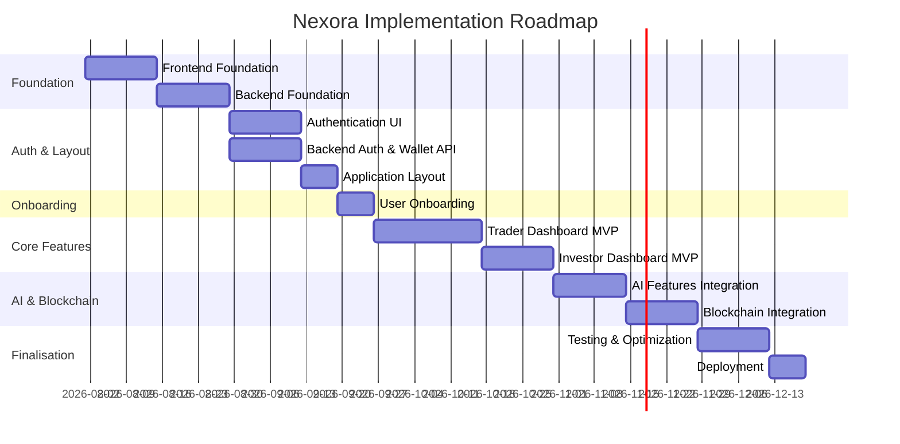

# NEXORA — IMPLEMENTATION_PLAN.md
## AI Financial Intelligence Platform — Development Execution Plan
### Version 1.0 | Senior Software Architect & Technical Project Manager's Guide

---

## 1. Implementation Strategy

### 1.1 Core Development Philosophy

Nexora will be built using a **user‑journey‑first, agile** methodology. Every development sprint is aligned with a tangible piece of the user's experience—from first visit to habitual use. We prioritise **working software over comprehensive documentation**, and we validate each step with real data and real user feedback as early as possible.

**Strategic Principles:**

| Principle | How We Apply It |
|-----------|-----------------|
| **Journey‑First Development** | Build features in the order users encounter them — not by technical layer or personal preference. |
| **Vertical Slices** | Complete one user journey end‑to‑end (frontend + backend + AI) before starting the next. |
| **Fake‑It‑Til‑You‑Make‑It** | Use mock data and simplified implementations for non‑critical features to unblock UI development. |
| **AI as a Wrapper** | Build deterministic financial logic first; AI narrates over it, never the reverse. |
| **Test Early, Test Often** | Unit tests for core logic; integration tests for critical flows; E2E tests for user journeys. |
| **Deploy Often** | Continuous integration and deployment from day one; staging environment always reflects the latest build. |
| **Mobile‑First Thinking** | Design and build for mobile first; desktop is a progressive enhancement. |

### 1.2 Technology Stack Summary

| Layer | Technology | Purpose |
|-------|------------|---------|
| **Frontend** | Next.js 14 (App Router), TypeScript, Tailwind CSS, React Query, Zustand | Responsive web application |
| **Backend** | Node.js 20 LTS, Express, TypeScript, Prisma, PostgreSQL, Redis, BullMQ | API, data processing, AI orchestration |
| **AI** | OpenAI API (GPT‑4/3.5), custom prompt pipelines, validation gates | Narrative generation, grounding |
| **Blockchain** | Stellar Horizon API, Freighter integration | Read‑only wallet data |
| **Infrastructure** | Vercel (frontend), Railway/Heroku (backend), CloudFront (CDN) | Hosting, deployment, scaling |

These choices are fully aligned with the existing **TECHNICAL_ARCHITECTURE.md** and **FRONTEND_ARCHITECTURE.md**.

### 1.3 Development Flow & Timeline

We will execute the project in **10 development phases**, each lasting **1‑3 weeks**, with a total target of **16‑20 weeks** to a production‑ready MVP.

- **Frontend and backend are developed in parallel** within each phase.
- **AI and blockchain integrations are treated as services** that can be mocked initially and integrated later.
- **Staging environment** is updated at the end of each phase for internal testing.

---

## 2. Development Phases

### Phase 1: Frontend Foundation

| Aspect | Description |
|--------|-------------|
| **Goal** | Establish a robust, scalable frontend development environment with all core tooling, routing, styling, and a shared component library. |
| **Tasks** | - Set up Next.js project with TypeScript, Tailwind CSS, and ESLint/Prettier. - Define design tokens (colors, spacing, typography) as Tailwind configuration. - Implement foundational UI components (Button, Card, Input, Badge, Modal, etc.) based on the design system. - Configure routing structure (public vs. authenticated routes) using Next.js App Router. - Set up Storybook for component documentation and development. - Create global layouts (root layout, marketing layout, dashboard layout skeleton). - Implement dark/light theme switching using next-themes. |
| **Required Tech** | Next.js 14, TypeScript, Tailwind CSS, Storybook, next-themes, clsx, class-variance-authority |
| **Dependencies** | None (can start immediately) |
| **Expected Outcome** | A working development environment with a component library and a basic page structure that can be extended in later phases. The application can be run locally and deployed to a staging URL. |

---

### Phase 2: Backend Foundation

| Aspect | Description |
|--------|-------------|
| **Goal** | Establish the backend API server, database models, and core infrastructure for authentication and data storage. |
| **Tasks** | - Set up Node.js/Express project with TypeScript. - Configure PostgreSQL database (local and production) with Prisma ORM. - Design initial database schema (User, Wallet, Transaction, Portfolio, Report, Insight, Alert, Query, Settings). - Implement authentication endpoints (sign up, login, logout, session validation) using JWT and HTTP‑only cookies. - Set up environment variables and configuration management. - Create API route scaffolding for all planned endpoints (see **TECHNICAL_ARCHITECTURE.md**). - Implement basic error handling and validation middleware. - Set up Redis and BullMQ for background job processing. - Configure logging and monitoring (Winston, Prometheus). |
| **Required Tech** | Node.js 20, Express, TypeScript, Prisma, PostgreSQL, Redis, BullMQ, JWT, Winston, Zod |
| **Dependencies** | Phase 1 (frontend) can proceed in parallel; database schema is independent. |
| **Expected Outcome** | A running backend with authentication and a database ready to store user and wallet data. The API is testable via Postman or automated tests. |

---

### Phase 3: Authentication Experience (UI + Backend Integration)

| Aspect | Description |
|--------|-------------|
| **Goal** | Deliver a complete authentication flow, including login, signup, social authentication (Google, X), and wallet connection UI. |
| **Tasks** | - Build Login and Signup pages with forms, validation, and error handling. - Implement Google OAuth and X OAuth buttons (frontend redirect + backend callbacks). - Build Wallet Connection page with manual address input and Freighter connector integration. - Implement read‑only consent confirmation and secret‑key detection warnings. - Integrate frontend authentication with backend session management (HTTP‑only cookies). - Implement protected route middleware (redirect unauthenticated users to login). - Create a global authentication context/store (Zustand) for user state. |
| **Required Tech** | Next.js, React Hook Form, Zod, Freighter API, OAuth libraries, Zustand, React Query |
| **Dependencies** | Phase 1 & 2 (frontend and backend foundations) |
| **Expected Outcome** | Users can sign up, log in, connect their Stellar wallet, and are redirected to the dashboard with a valid session. The wallet connection flow includes all safety checks and consent steps. |

---

### Phase 4: Application Layout & Navigation

| Aspect | Description |
|--------|-------------|
| **Goal** | Build the authenticated application shell with sidebar, header, persistent Quick Ask Bar, and responsive navigation that matches the information architecture. |
| **Tasks** | - Create the Dashboard layout (sidebar on desktop, bottom navigation on mobile). - Implement all primary navigation items (Dashboard, Portfolio, Journal, Report, Transactions, Ask, Alerts, Settings). - Build the Header with logo, Quick Ask Bar, notification bell, and user avatar dropdown. - Ensure the Quick Ask Bar is persistent across all authenticated pages. - Implement responsive breakpoints (mobile, tablet, desktop) using Tailwind utilities. - Create a global navigation state (collapsed/expanded sidebar) using Zustand. - Add breadcrumb navigation (optional) for deeper pages. |
| **Required Tech** | Next.js (layouts), Tailwind CSS, Zustand, React (useState for UI) |
| **Dependencies** | Phase 3 (authentication) – we need a logged‑in user to test the layout. |
| **Expected Outcome** | A fully functional application shell that allows seamless navigation between all sections. The layout adapts correctly to all screen sizes. |

---

### Phase 5: User Onboarding

| Aspect | Description |
|--------|-------------|
| **Goal** | Collect user profile information (experience level, primary goal, user type) and personalise the dashboard experience from day one. |
| **Tasks** | - Build the Profile Setup multi‑step form (name, time zone, experience level, primary goal). - Implement User Type Selection (Trader, Investor, Digital Asset User, Financial Team) with descriptive cards. - Store user preferences in the database and synchronise with frontend state. - Implement dashboard personalisation logic: based on user type, determine which widgets to show and in what order. - Create the onboarding flow that guides the user through these steps immediately after wallet connection. - Build the "Onboarding Insight" page – the first AI observation generated after initial analysis. - Integrate with the backend's Initial Analysis endpoint to fetch the first insight. |
| **Required Tech** | React Hook Form, Zustand, React Query, backend API endpoints for profile update |
| **Dependencies** | Phase 4 (layout), Phase 2 (backend), plus the first insight generation logic (which will be built later, but we can mock it initially). |
| **Expected Outcome** | New users complete a smooth onboarding process and land on a personalised dashboard that reflects their user type. The dashboard dynamically adjusts widget visibility and prioritisation. |

---

### Phase 6: Trader Dashboard MVP

| Aspect | Description |
|--------|-------------|
| **Goal** | Deliver the core dashboard experience for the Trader persona, including portfolio overview, trading journal, risk score, AI insights, transactions, and watchlist. |
| **Tasks** | - Build the Portfolio Health Card (status, score, AI explanation). - Implement the Performance Snapshot chart (7D/30D/90D/All) with delta summary. - Build the Allocation Breakdown widget (donut chart + concentration commentary). - Create the Trading Journal feed (list of trades with auto‑categorisation, performance metrics). - Implement the Risk Score Card (concentration, volatility, drawdown metrics). - Build the AI Insight Cards (top 3–5 observations from the AI pipeline). - Create the Transaction Intelligence Feed (categorised, annotated, searchable). - Build the Watchlist (add/remove assets, price alerts, performance tracking). - Integrate all widgets with real data from the backend (or mocked initially). |
| **Required Tech** | Recharts, React Query, Zustand, all existing components, backend APIs for portfolio, transactions, journal, watchlist. |
| **Dependencies** | Phase 5 (onboarding) – user type must be set to tailor the dashboard. The backend must provide the necessary endpoints (which will be built in parallel). |
| **Expected Outcome** | Traders can see a comprehensive overview of their portfolio, trades, performance, and risks. The dashboard provides actionable insights and enables quick navigation to deeper sections. |

---

### Phase 7: Investor Dashboard MVP

| Aspect | Description |
|--------|-------------|
| **Goal** | Deliver the core dashboard experience for the Investor persona, with emphasis on portfolio analytics, asset allocation, performance tracking, and AI insights. |
| **Tasks** | - Enhance the Portfolio pages: Allocation Breakdown (detailed), Holdings Detail, Performance Over Time with benchmark comparison. - Build the Risk Analytics module (Sharpe ratio, maximum drawdown, volatility, correlation). - Implement the Asset Allocation view with target vs. current allocation and drift detection. - Create the AI‑generated Portfolio Health narrative (more detailed than the Trader version). - Build the Benchmark Comparison chart (compare portfolio performance against BTC, ETH, custom benchmarks). - Integrate the Investor‑specific widgets into the dashboard (risk metrics, benchmark comparison). |
| **Required Tech** | Recharts, React Query, D3 (for custom charts), backend APIs for portfolio analytics. |
| **Dependencies** | Phase 6 – much of the infrastructure (widgets, charts, data fetching) is reused. |
| **Expected Outcome** | Investors can assess their portfolio's health, risk‑adjusted returns, allocation efficiency, and benchmark performance. The AI provides context on why the portfolio is performing as it is. |

---

### Phase 8: AI Features Integration

| Aspect | Description |
|--------|-------------|
| **Goal** | Integrate the full AI pipeline for report generation, trading analysis, recommendations, and the Ask Nexora assistant. |
| **Tasks** | - Build the AI Financial Report generation service (backend) that produces the 8‑section report on a weekly schedule. - Create the Report display pages (Current, Archive, Past) with section navigation and source evidence. - Implement the Ask Nexora chat interface (frontend) and the query processing pipeline (backend: intent classification, data retrieval, grounded generation, validation). - Build the AI Insight Cards (frontend) that display generated observations with computed facts and evidence. - Implement the Recommendation Engine (non‑prescriptive suggestions) and integrate into reports and dashboard. - Add the Trading Analysis module (behavioral detection: overtrading, revenge trading, FOMO entries). - Create the User Recommendations section (e.g., "Consider reviewing your concentration"). - Ensure all AI outputs are validated against deterministic facts and include source evidence links. |
| **Required Tech** | OpenAI API, prompt engineering, BullMQ for report scheduling, React components for chat and report display. |
| **Dependencies** | Phases 6 & 7 (dashboard) – the AI outputs will be displayed in widgets and reports. Backend must have the AI pipeline ready. |
| **Expected Outcome** | Users receive weekly AI Financial Reports, can ask natural‑language questions and get grounded answers, and see proactive insights and recommendations throughout the product. |

---

### Phase 9: Blockchain Integration

| Aspect | Description |
|--------|-------------|
| **Goal** | Connect the backend to the Stellar network for real wallet data ingestion, transaction history, and portfolio synchronisation. |
| **Tasks** | - Implement Stellar Horizon API client to fetch account balances, transaction history, and asset metadata. - Build the Transaction Processing pipeline: fetch, categorise, normalize, and store transactions. - Implement the Financial Computation Engine (deterministic): balances, allocation %, fee totals, performance metrics. - Create the Portfolio Synchronisation service (periodic updates, incremental sync, background jobs). - Integrate wallet connection with Freighter (share public key) and manual address entry. - Implement the Initial Analysis flow (fetch and compute within 60 seconds). - Add error handling for network failures, rate limits, and missing data. - Ensure all data is stored securely and accessible for AI processing. |
| **Required Tech** | Stellar Horizon API, @stellar/freighter-api, BullMQ, Prisma, Redis |
| **Dependencies** | Phase 2 (backend foundation) and Phase 8 (AI) – AI will use the computed facts. |
| **Expected Outcome** | Users can connect any Stellar wallet and see real data in their dashboard and reports within seconds. The system automatically keeps the data up‑to‑date. |

---

### Phase 10: Testing and Optimization

| Aspect | Description |
|--------|-------------|
| **Goal** | Ensure the product is stable, performant, secure, and meets all accessibility standards. |
| **Tasks** | - Write unit tests for core financial computation logic (Vitest). - Write integration tests for API endpoints (Jest + Supertest). - Write E2E tests for critical user journeys (Playwright: connect wallet → first insight → dashboard → report). - Perform performance audits (Lighthouse, Web Vitals) and optimise (code splitting, lazy loading, image optimisation). - Conduct a security review (OWASP Top 10) with special focus on wallet security, authentication, and data protection. - Validate AI outputs against a test dataset to ensure accuracy and hallucination prevention. - Gather user feedback through alpha/beta testing and iterate on UI/UX improvements. - Perform accessibility audits (WCAG 2.1 AA) and fix issues. |
| **Required Tech** | Vitest, React Testing Library, Playwright, Lighthouse, OWASP ZAP, axe‑core |
| **Dependencies** | All previous phases – product must be feature‑complete. |
| **Expected Outcome** | A stable, secure, and performant application that is ready for production launch. All critical flows are tested and known to work. |

---

### Phase 11: Deployment

| Aspect | Description |
|--------|-------------|
| **Goal** | Deploy the application to production with proper environment configuration, monitoring, and rollout strategy. |
| **Tasks** | - Configure production environment variables (DB, Redis, API keys). - Set up Vercel for frontend deployment and Railway/Heroku for backend. - Configure CI/CD pipelines (GitHub Actions) to automate testing and deployment. - Set up production database with backups and read replicas. - Deploy with zero‑downtime strategy (blue‑green or rolling). - Configure monitoring (Prometheus, Grafana, Sentry for error tracking). - Set up logging aggregation (ELK or Datadog). - Perform a final production smoke test. - Prepare launch checklist (see **MVP_BUILD_PLAN.md**). |
| **Required Tech** | Vercel, Railway/Heroku, GitHub Actions, Terraform (optional), CloudWatch, Sentry |
| **Dependencies** | Phase 10 (testing) – deployment should only happen after all tests pass. |
| **Expected Outcome** | The application is live, accessible at the production URL, and monitored for errors and performance. The team can roll back quickly if needed. |

---

## 3. Development Priority

### MVP Features (Must Have for Launch)

| Feature | Priority | Reason |
|---------|----------|--------|
| Wallet Connection (read‑only) | P0 | The single onboarding action – no connection, no product |
| Initial Analysis + Onboarding Insight | P0 | First value demonstration – must work well |
| Portfolio Health Card | P0 | Answers "How am I doing?" immediately |
| Asset Allocation Intelligence | P0 | Shows concentration/risk – core need |
| Transaction Intelligence Feed | P0 | Replaces explorer data with understanding |
| Fee & Cost Analysis | P0 | Shows real financial drag – key pain point |
| Weekly AI Financial Report | P0 | Retention mechanic – flagship deliverable |
| Dashboard with Widgets | P0 | Central hub – shows everything at a glance |
| Source Evidence Drill‑Down | P0 | Builds trust – every claim verifiable |
| Settings: Disconnect & Privacy | P0 | User control – trust signal |
| Ask Nexora (Basic) | P1 | Valuable but can be simplified for launch |
| Risk/Anomaly Alerts | P1 | Proactive value – nice‑to‑have but not launch‑blocking |
| User Type Personalisation | P1 | Improves experience but can be delayed to v1.1 |
| Trading Journal | P1 | Not essential for all personas |
| Watchlist | P2 | Nice‑to‑have |
| News & Top Traders | P2 | Extras – can be cut |

### Post‑MVP Features (V1.1+)

- Multi‑wallet aggregation
- Email report delivery
- Report archive
- Deeper Ask Nexora intents
- PDF/CSV exports
- Multi‑chain support
- Scenario modeling
- Goal‑based tracking
- Push notifications

---

## 4. Milestones

| Milestone | Expected Outcome | Estimated Completion |
|-----------|------------------|----------------------|
| **M1: Foundation Complete** | Frontend and backend environments are set up, component library is built, database schema is ready, and authentication works. | End of Phase 3 (Week 6) |
| **M2: Authentication & Layout** | Users can sign up, log in, connect a wallet, and navigate the authenticated application shell. | End of Phase 4 (Week 8) |
| **M3: Onboarding & Personalisation** | New users can complete profile setup, select their user type, and see a personalised dashboard. | End of Phase 5 (Week 10) |
| **M4: Trader Dashboard MVP** | All Trader dashboard widgets display real data, including portfolio, performance, journal, and insights. | End of Phase 6 (Week 13) |
| **M5: Investor Dashboard MVP** | Investor‑specific analytics (risk, allocation, benchmarks) are fully functional. | End of Phase 7 (Week 15) |
| **M6: AI & Blockchain Integration** | AI reports and Ask Nexora work with real blockchain data; all computational logic is deterministic. | End of Phase 9 (Week 18) |
| **M7: Production‑Ready** | Application passes all tests, security review, performance benchmarks, and is deployed to production. | End of Phase 11 (Week 20) |

---

## 5. Risk Management

| Risk | Probability | Impact | Mitigation |
|------|-------------|--------|------------|
| **Stellar Horizon downtime or rate limits** | Medium | High | Implement retry logic with exponential backoff; cache last known data; fallback to stored data. |
| **AI hallucination / inaccurate numbers** | Medium | Critical | Strict validation gate: every AI output must be matched against deterministic source facts. Provide fact‑only fallback. |
| **Database performance issues** | Medium | High | Add proper indexing; implement Redis caching; use read replicas; monitor query performance. |
| **Security breach (private key exposure)** | Low | Critical | Never request, store, or transmit private keys; secret‑key detection in input; HTTP‑only cookies; HTTPS; regular security audits. |
| **Frontend performance (LCP, TTI)** | Medium | Medium | Code splitting, lazy loading, image optimisation, React Query caching, skeleton loading. |
| **Regulatory risk (financial advice)** | Low | High | Scope AI to descriptive/risk‑flagging only; no prescriptive investment advice; legal review. |
| **User trust skepticism** | High | High | Transparency: source evidence for every claim; clear privacy policy; calm, non‑alarmist tone; explicit consent flow. |
| **Under‑estimation of AI pipeline complexity** | High | Medium | Start with simple prompt templates; iterate; use structured outputs; validate early. |
| **Team coordination (frontend/backend)** | Medium | Medium | Daily stand‑ups; clear API contracts; shared types; integration testing. |
| **Scope creep** | High | High | Strict MVP prioritisation; weekly scope review; defer non‑critical features to post‑launch. |

---

## 6. Conclusion

This implementation plan provides a clear, phased roadmap to take Nexora from an idea to a production‑ready AI financial intelligence platform. By following the user‑journey‑first approach and maintaining strict prioritisation, we can deliver a compelling MVP within 20 weeks while managing risks effectively. The phased development ensures early validation and continuous improvement, setting the stage for rapid iteration post‑launch.

**Next Steps:**
- Finalise the team composition and resource allocation.
- Set up the development environment and start Phase 1.
- Establish a regular review cadence to track progress against milestones.

---

*End of Document — Nexora IMPLEMENTATION_PLAN.md v1.0*
