# NEXORA — TECHNICAL_ARCHITECTURE.md
## AI Financial Intelligence Platform — Technical Architecture Specification
### Version 1.0 | MVP & Long-Term Architecture Blueprint

---

## 1. Executive Technical Overview

Nexora is an AI-powered financial intelligence platform that transforms raw Stellar blockchain data into actionable financial understanding. The system sits above wallets and explorers, providing an interpretive layer that translates on-chain activity into plain-language insights, reports, and recommendations.

**Core Architectural Principles:**

1. **Deterministic Math + Generative AI** — Financial calculations are computed by verifiable logic; AI narrates the results, never invents numbers.
2. **Read-Only, Non-Custodial** — The system never requests, stores, or transmits private keys or signing authority.
3. **Layered Separation** — Data ingestion, financial computation, AI interpretation, and presentation are independent layers.
4. **Chain-Focused Depth First** — Deep Stellar integration before multi-chain expansion.
5. **Auditability by Design** — Every AI-generated claim is traceable to source transactions.

**Technology Philosophy:**

Nexora prioritizes **correctness, trust, and clarity** over bleeding-edge technology. The stack is chosen for stability, developer velocity, and the ability to scale from MVP to millions of users without a full rewrite. We favor proven, well-documented technologies with strong ecosystems.

---

## 2. System Architecture Overview

Nexora's architecture is organized into four distinct layers, each with clear boundaries and responsibilities:

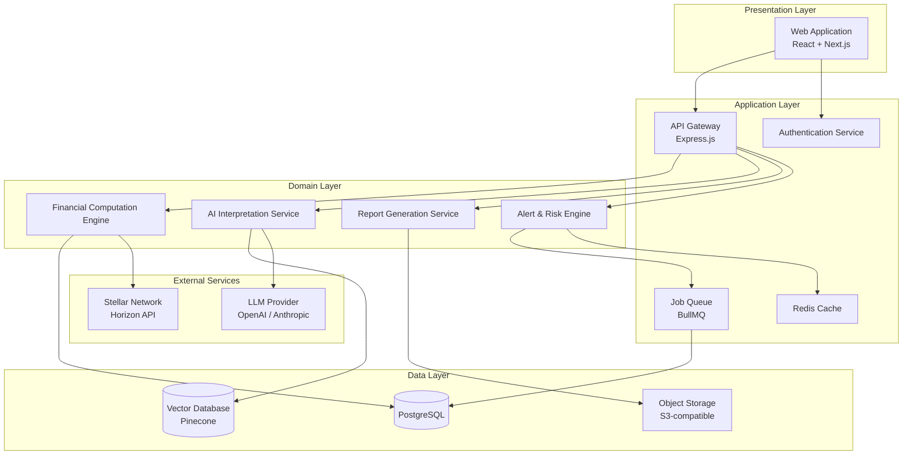

### 2.1 Layer Responsibilities

| Layer | Responsibility | Components |
|---|---|---|
| **Presentation Layer** | User interface and interaction | React/Next.js web app, responsive design |
| **Application Layer** | API gateway, auth, orchestration, caching | Express API, JWT auth, BullMQ queue, Redis cache |
| **Domain Layer** | Core business logic: computation, AI, reports, alerts | Financial Engine, AI Service, Report Gen, Alert Engine |
| **Data Layer** | Storage and retrieval | PostgreSQL, Pinecone, S3-compatible storage |
| **External Services** | Blockchain data, AI models | Stellar Horizon API, LLM providers |

### 2.2 Key Architectural Decisions

**Why Next.js + React?**
- Excellent developer experience and TypeScript support
- Server-side rendering for SEO and performance
- Built-in API routes for lightweight endpoints
- Strong ecosystem and community

**Why Express.js?**
- Mature, stable, and well-understood
- Flexible middleware ecosystem
- Easy to integrate with Node.js tooling
- Good performance for API workloads

**Why PostgreSQL?**
- ACID compliance for financial data integrity
- JSONB support for flexible AI report storage
- Strong reliability and replication capabilities
- Proven in production at scale

**Why Redis?**
- High-performance caching for frequently accessed data
- Pub/sub for real-time notifications
- Distributed locks for job coordination
- Rate limiting and session management

**Why BullMQ?**
- Persistent job queue with Redis backend
- Excellent for report generation and AI processing
- Monitoring and retry capabilities
- Scales well with worker processes

**Why Separate Computation from AI?**
- Trust: users can verify numbers independently
- Auditability: every claim traceable to source
- Accuracy: deterministic math prevents hallucinations
- Testability: financial logic can be unit-tested

---

## 3. High-Level Architecture Diagram

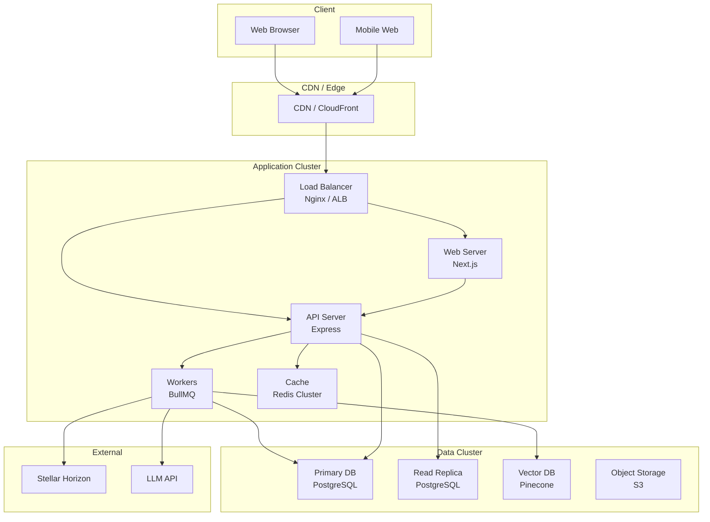

### 3.1 Data Flow Paths

1. **User Request Path:** Browser → CDN → Load Balancer → Web/API → Cache/DB → Response
2. **Wallet Connection Path:** User → API → Horizon → Validation → User/DB
3. **Transaction Processing Path:** Worker → Horizon → Compute Engine → DB
4. **Report Generation Path:** Scheduled Job → Worker → Compute Engine → AI Service → Storage → DB
5. **AI Query Path:** User → API → Compute Engine → AI Service → Response

---

## 4. Frontend Architecture

### 4.1 Technology Stack

| Component | Technology | Rationale |
|---|---|---|
| **Framework** | Next.js 14 (React 18) | SSR, routing, API routes, optimal performance |
| **Language** | TypeScript 5 | Type safety, better DX, maintainability |
| **State Management** | Zustand + React Query | Zustand for client state; React Query for server state |
| **Styling** | Tailwind CSS + CSS Modules | Utility-first, fast development, maintainable |
| **UI Components** | Custom Design System | Full control, consistent with DESIGN_SYSTEM.md |
| **Charts** | Recharts + D3 | Declarative, interactive, high-quality visualizations |
| **Forms** | React Hook Form | Performance, validation, complex forms |
| **API Client** | tRPC or Fetch + Zod | Type-safe API calls, validation |

### 4.2 Application Structure

```
src/
├── app/                    # Next.js App Router
│   ├── (auth)/            # Auth routes (login, connect)
│   ├── (dashboard)/       # Authenticated routes
│   │   ├── dashboard/
│   │   ├── portfolio/
│   │   ├── transactions/
│   │   ├── report/
│   │   ├── ask/
│   │   ├── alerts/
│   │   └── settings/
│   └── api/               # API routes (Next.js)
├── components/
│   ├── ui/               # Design system components
│   ├── layout/           # Layout components
│   ├── dashboard/        # Dashboard-specific
│   ├── portfolio/        # Portfolio-specific
│   ├── report/           # Report-specific
│   ├── ask/              # Ask Nexora components
│   └── settings/         # Settings components
├── lib/
│   ├── api/              # API client
│   ├── hooks/            # Custom React hooks
│   ├── store/            # Zustand stores
│   ├── utils/            # Utilities
│   └── constants/        # Constants
├── types/                # TypeScript types
└── styles/               # Global styles
```

### 4.3 State Management

**React Query (Server State):**
- Wallet data, transactions, portfolio, reports
- Automatic caching and revalidation
- Optimistic updates for user actions
- Background refresh with stale-while-revalidate

**Zustand (Client State):**
- UI state (sidebar open/closed, modals, etc.)
- User preferences (theme, notification settings)
- Form state and wizard state
- Quick Ask Bar state

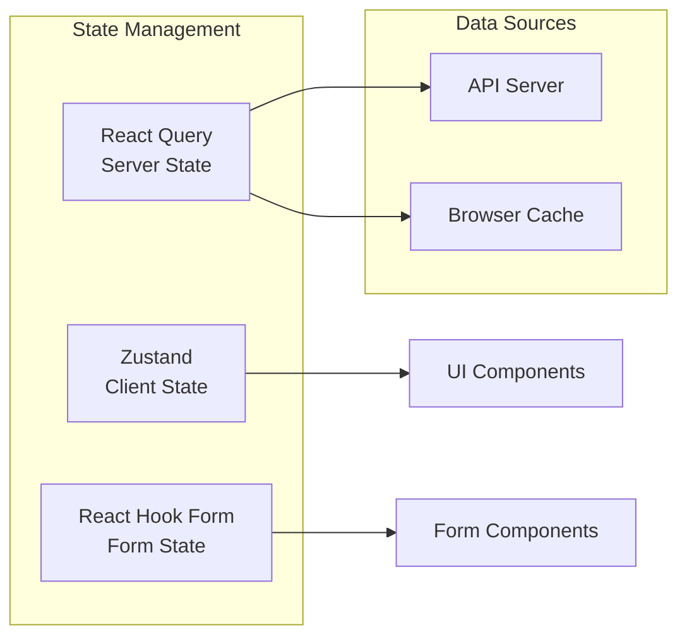

### 4.4 Authentication Flow

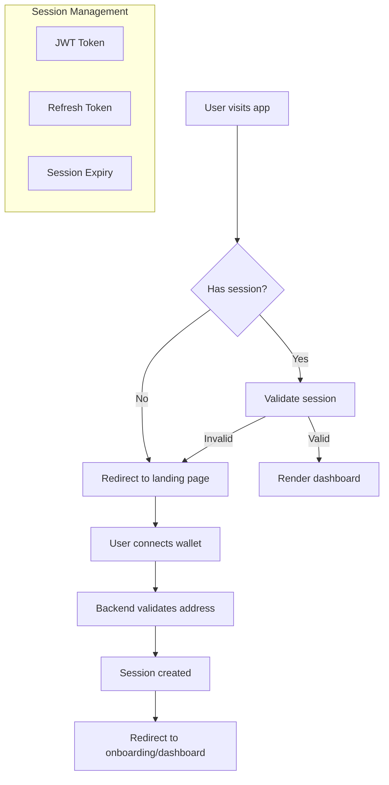

### 4.5 Responsive Architecture

| Breakpoint | Grid | Layout |
|---|---|---|
| **Mobile (< 768px)** | 4-column | Single column, bottom navigation |
| **Tablet (768-1024px)** | 8-column | Two-column grids, top navigation |
| **Desktop (> 1024px)** | 12-column | Multi-column, full navigation |
| **Wide (> 1440px)** | 12-column | Centered max-width 1200px |

**Mobile-First Approach:**
- Progressive enhancement from mobile up
- Performance optimized for slower connections
- Touch-friendly interactions (44px minimum hit targets)
- Reduced animations and simplified visualizations

---

## 5. Backend Architecture

### 5.1 Technology Stack

| Component | Technology | Rationale |
|---|---|---|
| **Runtime** | Node.js 20 LTS | Event-driven, excellent for I/O, huge ecosystem |
| **Framework** | Express.js 4 | Mature, flexible, battle-tested |
| **Language** | TypeScript 5 | Type safety, maintainability, developer experience |
| **Queue System** | BullMQ + Redis | Persistent job processing, retries, monitoring |
| **Caching** | Redis 7 | High-performance in-memory cache |
| **Auth** | JWT + Secure HTTP-only cookies | Stateless, secure, scalable |
| **ORM** | Prisma ORM | Type-safe database access, migrations |
| **Validation** | Zod + express-validator | Runtime validation, type inference |
| **Logging** | Winston + Pino | Structured logging, performance |
| **Monitoring** | OpenTelemetry + Prometheus | Observability, metrics |

### 5.2 Backend Responsibilities

1. **API Gateway** — Request routing, rate limiting, authentication, CORS
2. **Authentication Service** — Session management, wallet verification
3. **Orchestration** — Coordinate between services, handle complexity
4. **Background Processing** — Report generation, AI analysis, alerts
5. **Data Access** — Database operations, caching, storage
6. **External Integration** — Stellar Horizon, LLM APIs

### 5.3 API Structure

```mermaid
flowchart TB
    subgraph "API Gateway"
        Auth[Auth Middleware]
        RateLimit[Rate Limiter]
        Cors[CORS]
        Logging[Request Logger]
    end

    subgraph "Route Groups"
        Wallets[/api/wallets]
        Portfolio[/api/portfolio]
        Transactions[/api/transactions]
        Reports[/api/reports]
        Ask[/api/ask]
        Alerts[/api/alerts]
        Settings[/api/settings]
    end

    subgraph "Services"
        WalletSvc[Wallet Service]
        ComputeSvc[Compute Service]
        AISvc[AI Service]
        ReportSvc[Report Service]
        AlertSvc[Alert Service]
        SettingsSvc[Settings Service]
    end

    API Gateway --> Route Groups
    RouteGroups --> Services
    Services --> DB[(Database)]
    Services --> Cache[Redis Cache]
    Services --> Queue[BullMQ]
    Services --> Horizon[Stellar Horizon]
    Services --> LLM[LLM API]
```

### 5.4 API Endpoints (Key Examples)

| Endpoint | Method | Description | Auth |
|---|---|---|---|
| `/api/wallets/connect` | POST | Connect Stellar wallet | Public |
| `/api/wallets/disconnect` | POST | Disconnect wallet | Required |
| `/api/portfolio` | GET | Get portfolio data | Required |
| `/api/portfolio/performance` | GET | Performance time-series | Required |
| `/api/transactions` | GET | Transaction feed | Required |
| `/api/transactions/:id` | GET | Transaction detail | Required |
| `/api/reports/latest` | GET | Latest AI Financial Report | Required |
| `/api/reports/archive` | GET | Report archive list | Required |
| `/api/reports/:id` | GET | Specific report | Required |
| `/api/ask` | POST | Natural-language query | Required |
| `/api/alerts` | GET | Alert feed | Required |
| `/api/alerts/:id/dismiss` | POST | Dismiss alert | Required |
| `/api/settings` | GET | User settings | Required |
| `/api/settings` | PUT | Update settings | Required |

### 5.5 Background Processing Architecture

```mermaid
flowchart TB
    subgraph "Job Producers"
        Schedule[Schedule Trigger\nWeekly]
        UserTrigger[User Trigger\nManual Report]
        Event[Event Trigger\nRisk Threshold]
    end

    subgraph "Queue"
        Queue[BullMQ Queue]
    end

    subgraph "Workers"
        ReportWorker[Report Generator]
        AIWorker[AI Analysis Worker]
        AlertWorker[Alert Engine]
        TransactionWorker[Transaction Processor]
    end

    subgraph "Job Handlers"
        GenerateReport[Generate Financial Report]
        ProcessQuery[Process AI Query]
        EvaluateRisk[Evaluate Risk]
        ProcessTx[Process New Transactions]
    end

    Schedule --> Queue
    UserTrigger --> Queue
    Event --> Queue
    Queue --> ReportWorker
    Queue --> AIWorker
    Queue --> AlertWorker
    Queue --> TransactionWorker
    ReportWorker --> GenerateReport
    AIWorker --> ProcessQuery
    AlertWorker --> EvaluateRisk
    TransactionWorker --> ProcessTx
```

### 5.6 Security Architecture

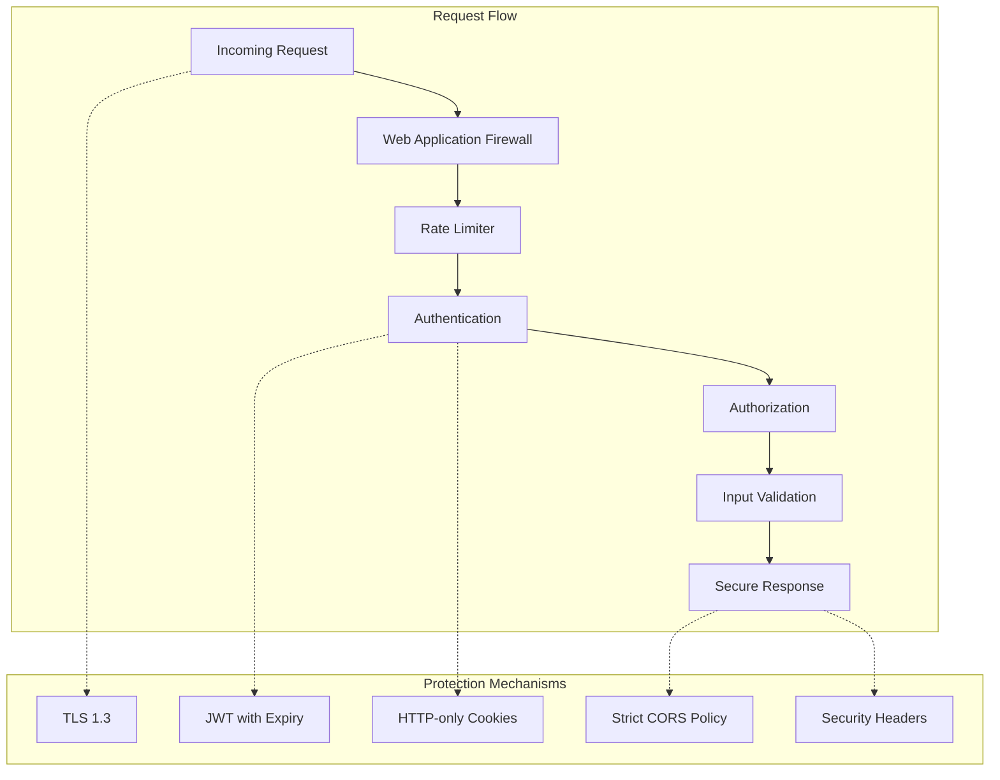

### 5.7 Data Processing Flow

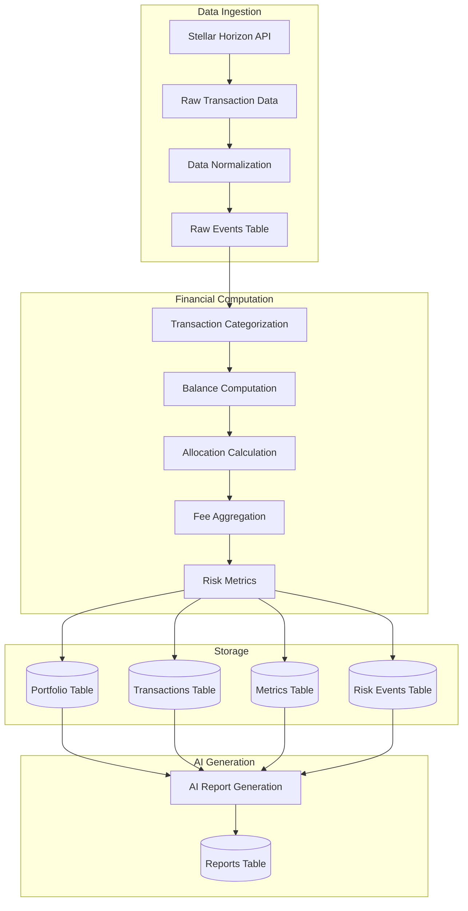

---

## 6. Database Architecture

### 6.1 Data Models

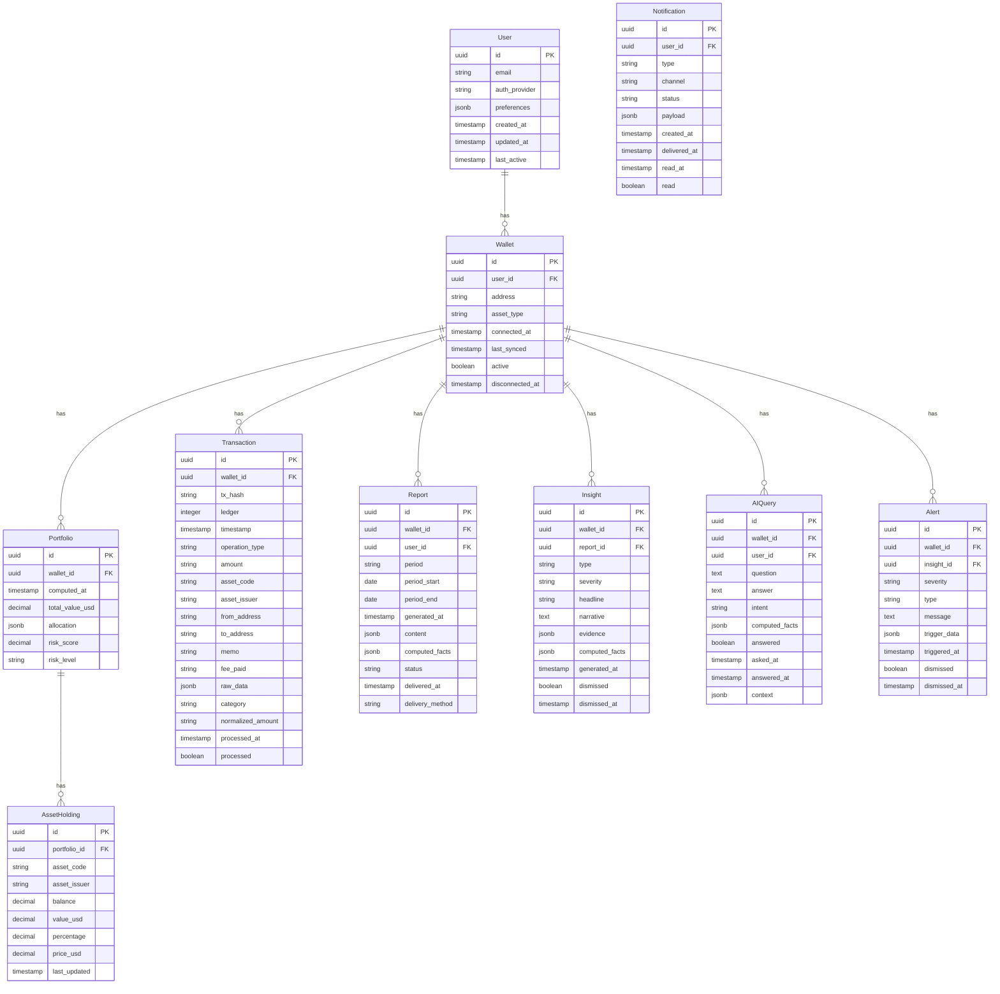

### 6.2 Storage Strategy

**Transactional Data (PostgreSQL):**
- User accounts, wallets, transactions, portfolio snapshots
- ACID compliance for financial accuracy
- JSONB for flexible, semi-structured data
- Time-series data for performance trends
- Full-text search for transaction queries

**Report & AI Data (PostgreSQL JSONB):**
- AI reports stored as JSONB
- Query metadata and computed facts
- Versioning for audit trails

**Vector Embeddings (Pinecone):**
- Transaction embeddings for search
- Similarity matching for anomaly detection
- Semantic search for Ask Nexora
- Pattern matching across users (aggregated, anonymous)

**File/Object Storage (S3-compatible):**
- Generated report PDFs (future)
- Export files (CSV, JSON)
- User-uploaded documents (future)
- Static assets

### 6.3 Caching Strategy

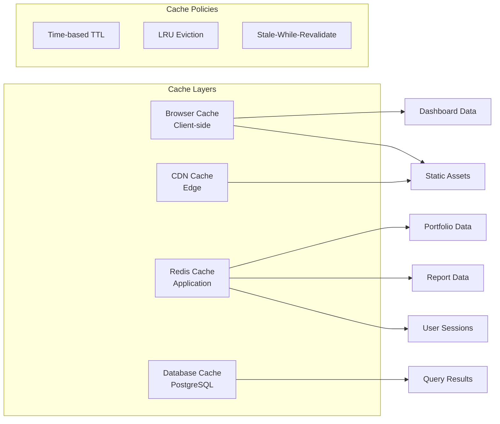

**Cache Keys & TTL:**

| Data Type | Cache Key Pattern | TTL | Strategy |
|---|---|---|---|
| Portfolio data | `portfolio:{wallet_id}` | 5 min | Stale-while-revalidate |
| Transaction feed | `transactions:{wallet_id}:{page}` | 1 min | Short TTL |
| Report content | `report:{report_id}` | 1 hour | Long TTL |
| AI Query results | `query:{query_hash}` | 1 hour | Exact match |
| User session | `session:{session_id}` | 7 days | Sliding expiry |
| Rate limit | `rate:{user_id}:{endpoint}` | 60 sec | Fixed window |

---

## 7. Stellar Integration Architecture

### 7.1 Stellar SDK & Horizon API

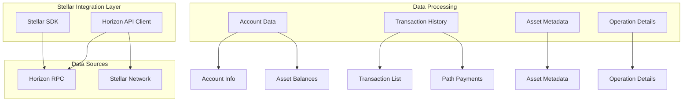

### 7.2 Wallet Connection Flow

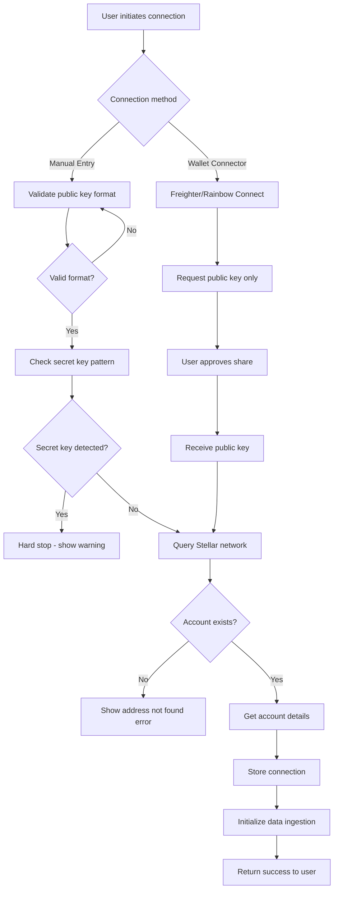

### 7.3 Data Fetching & Processing

```mermaid
flowchart TD
    subgraph "Fetch Strategy"
        A[Initial Sync] --> B[Get account data]
        B --> C[Get transaction history]
        C --> D[Process batch]
        D --> E{More transactions?}
        E -- Yes --> C
        E -- No --> F[Full sync complete]
    end

    subgraph "Incremental Updates"
        G[Scheduled check] --> H[Get latest ledger]
        H --> I[Compare with last sync]
        I --> J{New transactions?}
        J -- Yes --> K[Fetch new transactions]
        K --> L[Process new data]
        J -- No --> M[No updates]
    end

    subgraph "Error Handling"
        N[Network error] --> O[Retry with backoff]
        O --> P{Retry succeeded?}
        P -- No --> Q[Log error, alert]
        P -- Yes --> R[Resume processing]
    end
```

### 7.4 Transaction Categorization Logic

| Category | Detection Logic | Example |
|---|---|---|
| **Payment** | `type` = `payment` or `create_account` | Sending XLM to another account |
| **Swap** | `type` = `path_payment` or `manage_offer` | Trading XLM for USDC |
| **Fee** | `fee_charged` > 0 | Network fee for a transaction |
| **Receipt** | `type` = `payment` and destination = user | Receiving funds |
| **Other** | Default fallback | Complex or unrecognized operations |

### 7.5 Rate Limiting & Performance

| Operation | Rate Limit | Strategy |
|---|---|---|
| Horizon API calls | 100 req/min per IP | Exponential backoff |
| Transaction fetch | 50 req/min per wallet | Cursor-based pagination |
| Full sync | Once per wallet per day | Background processing |
| Incremental sync | Every 5 minutes per wallet | Batch processing |

---

## 8. AI Architecture

### 8.1 Overview

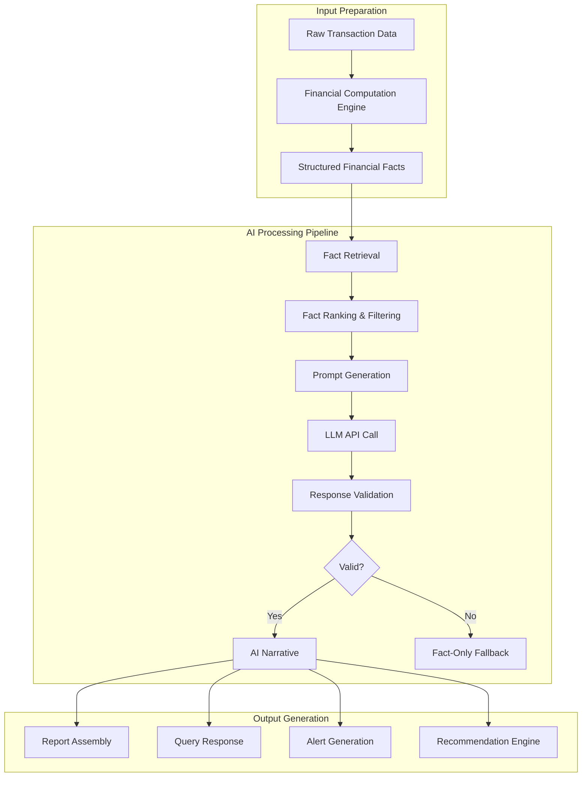

### 8.2 LLM Integration

**Provider Selection:**

| Provider | Primary Use | Rationale |
|---|---|---|
| **OpenAI GPT-4** | Report generation | Superior reasoning, instruction following |
| **OpenAI GPT-3.5** | Ask Nexora queries | Cost-effective, fast |
| **Anthropic Claude** | Security-sensitive analysis | Safety features, Constitutional AI |

**Prompt Pipeline:**

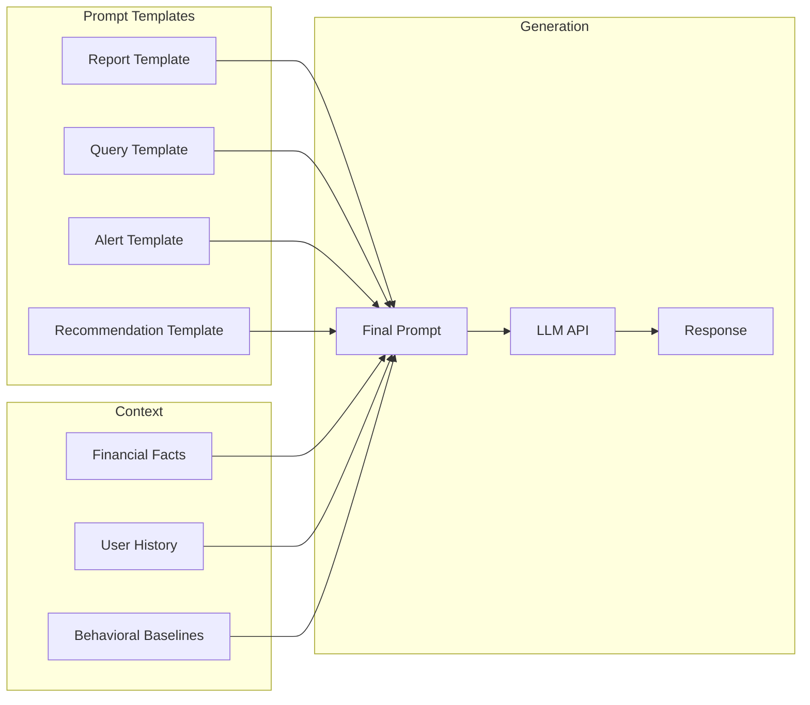

### 8.3 Report Generation Pipeline

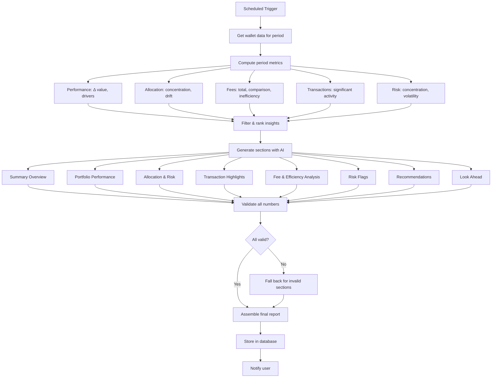

### 8.4 Query Processing Pipeline (Ask Nexora)

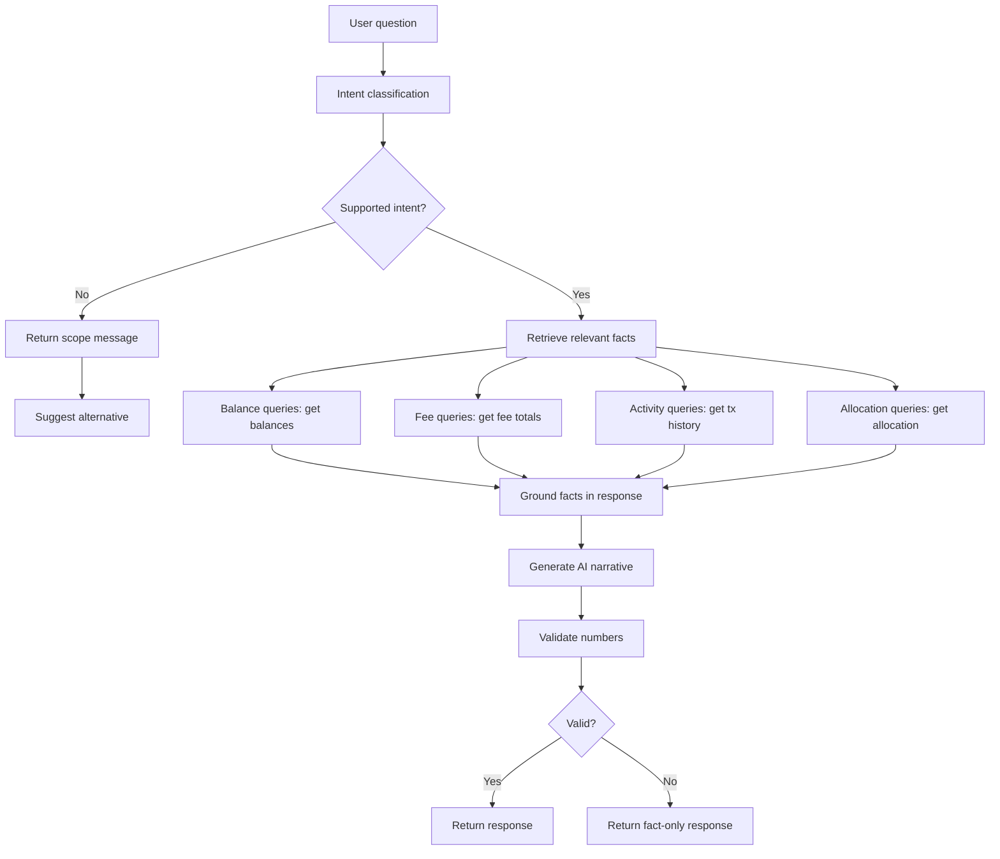

### 8.5 Risk & Alert Engine

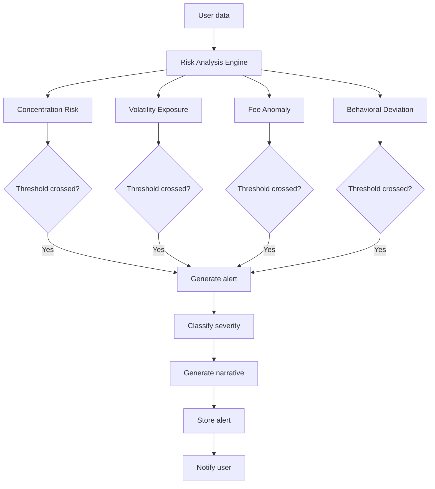

### 8.6 Personalization Layer

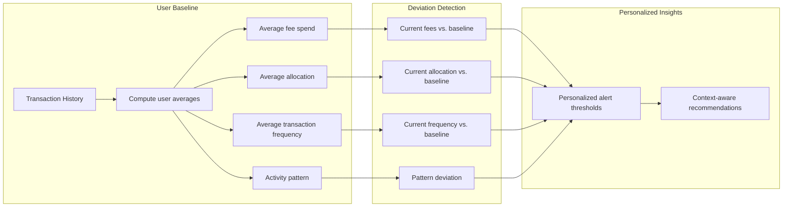

### 8.7 Recommendation Engine

**Non-Prescriptive, Risk-Aware Recommendations:**

| Recommendation Type | Trigger | Example |
|---|---|---|
| **Diversification** | Concentration > 70% | "Your portfolio is heavily concentrated in XLM. Consider diversifying across other assets." |
| **Fee Optimization** | Fees 20% above average | "Your fee spend is above average. You might benefit from batching transactions." |
| **Risk Awareness** | Volatility spike | "Your portfolio volatility has increased. This may be worth reviewing." |
| **Behavioral Observation** | Unusual activity | "Your transaction frequency has increased significantly this month." |

---

## 9. Data Flow: Complete User Journey

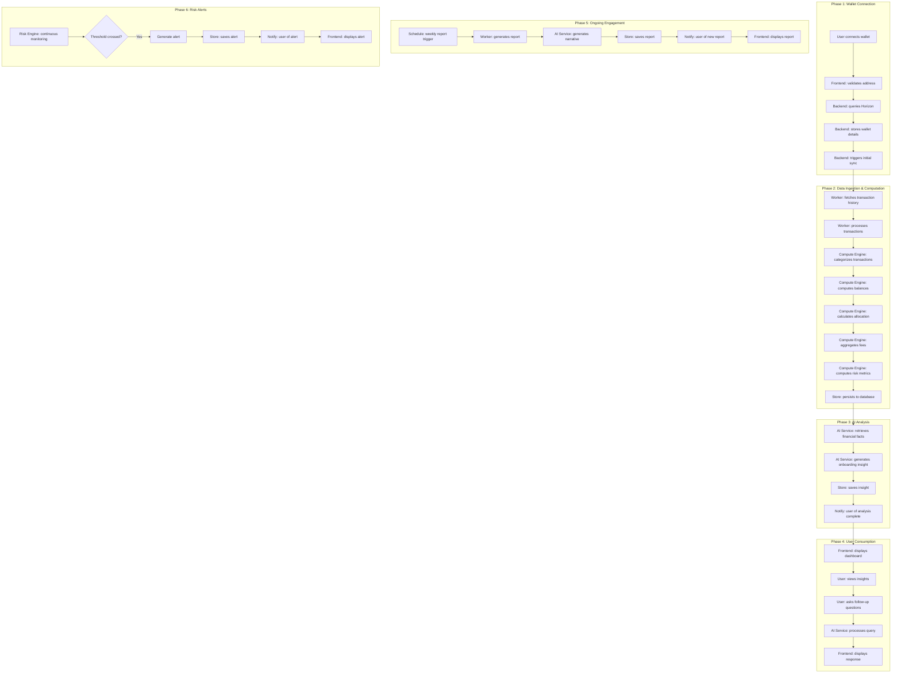

---

## 10. Security Architecture

### 10.1 Security Principles

1. **Defense in Depth** — Multiple layers of security controls
2. **Least Privilege** — Minimum required access for all components
3. **Zero Trust** — Verify everything, trust nothing
4. **Security by Design** — Security integrated from the start
5. **Read-Only Core** — Primary security boundary

### 10.2 Security Layers

```mermaid
flowchart TB
    subgraph "Edge Layer"
        WAF[Web Application Firewall]
        DDoS[DDoS Protection]
        RateLimit[Rate Limiter]
    end

    subgraph "Transport Layer"
        TLS[TLS 1.3]
        HSTS[HTTP Strict Transport Security]
        CORS[CORS Policy]
    end

    subgraph "Application Layer"
        Auth[Authentication]
        RBAC[Authorization]
        Validation[Input Validation]
        Sanitization[Data Sanitization]
    end

    subgraph "Data Layer"
        Encryption[Encryption at Rest]
        Audit[Audit Logging]
        Backup[Backup & Recovery]
    end

    subgraph "Developer Layer"
        Secrets[Secrets Management]
        CI[CI/CD Security]
        Scanning[Vulnerability Scanning]
    end
```

### 10.3 Authentication & Authorization

```mermaid
flowchart LR
    subgraph "Authentication Flow"
        A[User] --> B[Connect Wallet]
        B --> C[Verify Address]
        C --> D[Generate JWT]
        D --> E[Set HTTP-only Cookie]
        E --> F[Session Created]
    end

    subgraph "Authorization Flow"
        G[Request] --> H[Extract JWT]
        H --> I[Verify Token]
        I --> J{Valid?}
        J -- Yes --> K[Check Wallet Ownership]
        K --> L[Allow Access]
        J -- No --> M[Deny Access]
    end
```

### 10.4 Data Protection

| Data Type | Protection | Storage |
|---|---|---|
| **User credentials** | Never stored | N/A |
| **Wallet addresses** | Encrypted at rest | PostgreSQL |
| **Transaction data** | Encrypted at rest, in transit | PostgreSQL |
| **AI reports** | Encrypted at rest | PostgreSQL + S3 |
| **Session tokens** | HTTP-only cookies, encrypted | Redis |
| **API keys** | Environment variables, encrypted | Vault (future) |
| **Audit logs** | Immutable storage | ELK / CloudWatch |

### 10.5 API Security

```mermaid
flowchart TD
    A[API Request] --> B{API Key Present?}
    B -- No --> C[401 Unauthorized]
    B -- Yes --> D{Rate Limit Check}
    D -- Exceeded --> E[429 Too Many Requests]
    D -- OK --> F{Valid JWT?}
    F -- No --> G[401 Unauthorized]
    F -- Yes --> H{Wallet Ownership?}
    H -- No --> I[403 Forbidden]
    H -- Yes --> J[Process Request]
    
    subgraph "Security Headers"
        Headers[Helmet Middleware]
    end
    
    J --> Headers
    Headers --> Response[Response]
```

### 10.6 Stellar Security

| Risk | Mitigation |
|---|---|
| **Private key exposure** | Never request, never store, never transmit |
| **Phishing attacks** | Warn users about secret key entry |
| **Address spoofing** | Validate address format and network existence |
| **Man-in-the-middle** | TLS 1.3 for all Stellar API communication |
| **Data integrity** | Verify transaction hashes on Stellar network |

### 10.7 Privacy by Design

```mermaid
flowchart TD
    subgraph "Privacy Controls"
        A[Data Minimization] --> B[Only collect necessary data]
        C[Purpose Limitation] --> D[Only use for stated purposes]
        E[User Control] --> F[Disconnect & delete data]
        G[Transparency] --> H[Plain-language privacy documentation]
        I[Anonymization] --> J[Aggregate data for model training]
    end

    subgraph "User Rights"
        K[View Data] --> L[Users can see what data is stored]
        M[Delete Data] --> N[Permanent deletion on request]
        O[Export Data] --> P[Export reports and data]
    end
```

---

## 11. Scalability Plan

### 11.1 Growth Phases

```mermaid
flowchart LR
    subgraph "Phase 1: MVP"
        MVP[Single Server]
        Scale1[Up to 10,000 users]
    end

    subgraph "Phase 2: Growth"
        Growth[Multi-Server Deployment]
        Scale2[10,000 - 100,000 users]
    end

    subgraph "Phase 3: Scale"
        Scale[Distributed System]
        Scale3[100,000 - 1M users]
    end

    subgraph "Phase 4: Enterprise"
        Enterprise[Global Deployment]
        Scale4[1M+ users]
    end

    MVP --> Growth --> Scale --> Enterprise
```

### 11.2 Scaling Strategy

**Database Scaling:**

| Component | MVP | Growth | Scale | Enterprise |
|---|---|---|---|---|
| **PostgreSQL** | Single instance | Read replicas | Sharding | Multi-region |
| **Redis** | Single instance | Cluster mode | Redis Cluster | Global replication |
| **Pinecone** | Starter tier | Pro tier | Enterprise tier | Custom deployment |

**Application Scaling:**

| Component | MVP | Growth | Scale | Enterprise |
|---|---|---|---|---|
| **Web/API** | Single server | 2-3 servers | Auto-scaling | Global load balancer |
| **Workers** | Single worker | Worker pool | Auto-scaling | Dedicated queues |
| **CDN** | CloudFront | CloudFront | CloudFront + Edge | Multi-CDN |

**Database Read Replicas:**
```mermaid
flowchart TD
    Master[Primary DB\nWrite-heavy]
    Replica1[Replica 1\nRead-heavy]
    Replica2[Replica 2\nRead-heavy]
    Replica3[Replica 3\nAnalytics]
    
    Master --> Replica1
    Master --> Replica2
    Master --> Replica3
    
    API[API Server] --> Replica1
    API --> Replica2
    Report[Report Generation] --> Replica3
    Admin[Admin Tools] --> Replica3
```

### 11.3 Performance Optimization

| Area | Optimization | Impact |
|---|---|---|
| **API** | Caching, pagination, compression | 50-80% reduction in latency |
| **Database** | Indexing, query optimization | 60-90% reduction in query time |
| **AI** | Caching, batching, model selection | 40-70% reduction in costs |
| **Frontend** | Code splitting, lazy loading | 30-50% reduction in load time |
| **CDN** | Edge caching, asset optimization | 70-90% reduction in latency |

### 11.4 Cost Optimization

| Resource | Optimization | Estimated Savings |
|---|---|---|
| **Compute** | Reserved instances, spot instances | 30-50% |
| **Database** | Rightsizing, read replicas | 20-40% |
| **AI** | Caching, model selection | 50-70% |
| **Storage** | Lifecycle policies, compression | 20-30% |
| **CDN** | Edge caching, traffic optimization | 30-50% |

---

## 12. MVP Technical Scope

### 12.1 What Will Be Built (V1)

**Frontend:**
- ✅ Responsive web application (React + Next.js)
- ✅ Wallet connection flow (manual address + Freighter)
- ✅ Dashboard with Portfolio Health Card, widgets
- ✅ Portfolio views (allocation, holdings, performance)
- ✅ Transaction Intelligence Feed with search/filter
- ✅ AI Financial Report display
- ✅ Ask Nexora natural-language Q&A
- ✅ Insights & Alerts feed
- ✅ Settings (wallet management, notifications)
- ✅ Dark/Light mode
- ✅ Source evidence drill-down for AI claims

**Backend:**
- ✅ Express.js API server
- ✅ Authentication (JWT-based wallet session)
- ✅ Stellar Horizon integration
- ✅ Wallet connection and validation
- ✅ Transaction fetching and processing
- ✅ Financial Computation Engine
- ✅ AI Integration (OpenAI API)
- ✅ Report generation (weekly)
- ✅ Query processing (Ask Nexora)
- ✅ Alert/Risk engine (concentration, fee anomalies)
- ✅ PostgreSQL database with core models
- ✅ Redis for caching and session management
- ✅ BullMQ for background jobs

**Core Features:**
- ✅ Read-only wallet connection
- ✅ Portfolio Health Score
- ✅ Asset Allocation Intelligence
- ✅ Transaction Intelligence Feed
- ✅ Fee & Cost Analysis
- ✅ Weekly AI Financial Report
- ✅ Ask Nexora (supported intents: balances, fees, activity, allocation)
- ✅ Basic risk/alerts (concentration, unusual fees)
- ✅ User settings and preferences
- ✅ Privacy controls and data deletion

### 12.2 What Will NOT Be Built (V1)

**Infrastructure:**
- ❌ Multi-chain support (Version 2+)
- ❌ Native mobile apps (responsive web only)
- ❌ High-availability deployment (single-region only)
- ❌ Advanced observability (basic monitoring only)
- ❌ Global load balancing

**Features:**
- ❌ Multi-wallet aggregation
- ❌ PDF/CSV exports
- ❌ Email delivery (in-app notifications only)
- ❌ Tax reporting
- ❌ Automated trading or rebalancing
- ❌ Social features
- ❌ B2B/API licensing
- ❌ Prescriptive investment advice
- ❌ Goal-based tracking
- ❌ Scenario modeling
- ❌ Advanced anomaly detection
- ❌ Smart contract integration (Soroban)

### 12.3 MVP Deployment Architecture

```mermaid
flowchart TB
    subgraph "Cloud Infrastructure"
        subgraph "Compute"
            Web[Web Server\nNext.js]
            API[API Server\nExpress]
            Worker[Worker\nBullMQ]
        end

        subgraph "Data"
            DB[(PostgreSQL)]
            Redis[Redis Cache]
            Pinecone[Pinecone]
            S3[Object Storage]
        end

        subgraph "External"
            Horizon[Stellar Horizon]
            LLM[OpenAI API]
        end

        subgraph "Edge"
            CDN[CloudFront]
        end
    end

    Browser[Browser] --> CDN
    CDN --> Web
    Web --> API
    API --> DB
    API --> Redis
    API --> Worker
    Worker --> DB
    Worker --> Redis
    Worker --> Horizon
    Worker --> LLM
    API --> Pinecone
    Worker --> Pinecone
    Worker --> S3
```

---

## 13. Future Architecture

### 13.1 AI Agents & Autonomous Insights

```mermaid
flowchart TB
    subgraph "AI Agents"
        Monitor[Monitoring Agent]
        Analytics[Analytics Agent]
        Advisory[Advisory Agent]
        Action[Action Agent]
    end

    subgraph "Orchestration"
        Orchestrator[Agent Orchestrator]
        Context[Context Management]
        Memory[Memory System]
    end

    subgraph "User Interaction"
        Dashboard[Dashboard]
        Report[Financial Report]
        Chat[Conversational Interface]
    end

    Monitor --> Context
    Analytics --> Context
    Advisory --> Context
    Action --> Context
    Context --> Orchestrator
    Orchestrator --> Memory
    Memory --> Dashboard
    Memory --> Report
    Memory --> Chat
```

### 13.2 Multi-Chain Expansion

```mermaid
flowchart TB
    subgraph "Chain Adapters"
        Stellar[Stellar Adapter]
        EVM[EVM Adapter]
        Solana[Solana Adapter]
    end

    subgraph "Unified Data Layer"
        Normalizer[Data Normalizer]
        Aggregator[Portfolio Aggregator]
        Analyzer[Cross-Chain Analyzer]
    end

    subgraph "AI Intelligence Layer"
        AI[Financial Intelligence]
    end

    Stellar --> Normalizer
    EVM --> Normalizer
    Solana --> Normalizer
    Normalizer --> Aggregator
    Aggregator --> Analyzer
    Analyzer --> AI
```

### 13.3 Soroban (Stellar Smart Contracts)

```mermaid
flowchart TB
    subgraph "Smart Contract Integration"
        Soroban[Soroban RPC]
        Events[Event Listening]
        State[State Reading]
    end

    subgraph "DeFi Intelligence"
        LP[Liquidity Pool Analysis]
        Lending[Lending/ Borrowing Analysis]
        Yield[Yield Optimization]
    end

    subgraph "User Insights"
        DeFi[DeFi Activity Report]
        Risk[Smart Contract Risk]
        Opportunities[Yield Opportunities]
    end

    Soroban --> Events
    Soroban --> State
    Events --> LP
    State --> LP
    Events --> Lending
    State --> Lending
    LP --> Yield
    Lending --> Yield
    Yield --> DeFi
    Yield --> Risk
    Yield --> Opportunities
```

### 13.4 Automated Financial Actions

```mermaid
flowchart LR
    subgraph "User Intent"
        Goal[Set Financial Goal]
        Strategy[Define Strategy]
    end

    subgraph "Execution"
        Orchestrator[Action Orchestrator]
        Rebalancer[Rebalancing Engine]
        Optimizer[Optimization Engine]
    end

    subgraph "Security"
        Approval[User Approval Required]
        Simulation[Pre-execution Simulation]
        Monitoring[Transaction Monitoring]
    end

    subgraph "Blockchain"
        Tx[Transaction Signing]
        Settlement[On-chain Settlement]
    end

    Goal --> Orchestrator
    Strategy --> Orchestrator
    Orchestrator --> Rebalancer
    Orchestrator --> Optimizer
    Rebalancer --> Approval
    Optimizer --> Approval
    Approval --> Simulation
    Simulation --> Monitoring
    Monitoring --> Tx
    Tx --> Settlement
```

### 13.5 B2B / Ecosystem Expansion

```mermaid
flowchart TB
    subgraph "API Layer"
        PublicAPI[Public API]
        Whitelabel[Whitelabel Service]
        Webhook[Webhook System]
    end

    subgraph "Ecosystem"
        Wallets[Wallet Integrations]
        Exchanges[Exchange Integrations]
        DApps[DApp Integrations]
        Enterprise[Enterprise Solutions]
    end

    subgraph "Revenue"
        SaaS[SaaS Subscriptions]
        API[API Usage Fees]
        Licenses[Enterprise Licenses]
    end

    PublicAPI --> Wallets
    PublicAPI --> Exchanges
    PublicAPI --> DApps
    Whitelabel --> Enterprise
    Webhook --> Wallets
    Webhook --> Exchanges
    Webhook --> DApps
    Wallets --> SaaS
    Exchanges --> API
    DApps --> API
    Enterprise --> Licenses
```

### 13.6 Architecture Evolution

```mermaid
flowchart LR
    subgraph "V1: MVP"
        V1_Web[Next.js Web]
        V1_API[Express API]
        V1_DB[PostgreSQL]
        V1_AI[OpenAI API]
    end

    subgraph "V2: Depth"
        V2_MultiWallet[Multi-Wallet]
        V2_Exports[PDF/CSV Exports]
        V2_Email[Email Delivery]
        V2_Tax[Tax Exports]
    end

    subgraph "V3: Multi-Chain"
        V3_EVM[EVM Support]
        V3_Solana[Solana Support]
        V3_CrossChain[Cross-Chain]
    end

    subgraph "V4: Predictive"
        V4_Scenario[Scenario Modeling]
        V4_Goals[Goal Tracking]
        V4_AdvancedAI[Advanced AI]
    end

    subgraph "V5: Platform"
        V5_API[Public API]
        V5_Whitelabel[Whitelabel]
        V5_Enterprise[Enterprise]
    end

    V1_Web --> V2_MultiWallet
    V1_API --> V2_Exports
    V1_DB --> V2_Email
    V1_AI --> V2_Tax
    V2_MultiWallet --> V3_EVM
    V2_Exports --> V3_Solana
    V3_EVM --> V4_Scenario
    V3_CrossChain --> V4_Goals
    V4_Scenario --> V5_API
    V4_AdvancedAI --> V5_Whitelabel
    V5_API --> V5_Enterprise
```

---

## 14. Technology Decisions Summary

### 14.1 Frontend

| Decision | Choice | Rationale |
|---|---|---|
| **Framework** | Next.js 14 | SSR for SEO, built-in API routes, excellent DX |
| **Language** | TypeScript 5 | Type safety, reduced bugs, better maintainability |
| **State Management** | React Query + Zustand | React Query handles server state, Zustand handles client state |
| **Styling** | Tailwind CSS | Rapid development, consistent design system, responsive |
| **Charts** | Recharts | Declarative, built on D3, good API, customizable |
| **Forms** | React Hook Form | Performance, validation, complex form handling |
| **API Client** | Fetch + Zod | Simple, typed, validation built in |

### 14.2 Backend

| Decision | Choice | Rationale |
|---|---|---|
| **Runtime** | Node.js 20 LTS | Event-driven, excellent for I/O, largest ecosystem |
| **Framework** | Express.js | Mature, flexible, battle-tested |
| **Language** | TypeScript 5 | Type safety, maintainability |
| **Queue** | BullMQ + Redis | Persistent jobs, retries, monitoring |
| **Cache** | Redis 7 | High performance, multiple data structures |
| **Auth** | JWT + HTTP-only cookies | Stateless, secure, scalable |

### 14.3 Database

| Decision | Choice | Rationale |
|---|---|---|
| **Primary DB** | PostgreSQL 16 | ACID compliance, JSONB support, proven at scale |
| **ORM** | Prisma | Type-safe queries, migrations, excellent DX |
| **Vector DB** | Pinecone | Managed, scalable, good integration |
| **Object Storage** | S3-compatible | Scalable, cost-effective, reliable |
| **Caching** | Redis | High performance, flexible use cases |

### 14.4 AI

| Decision | Choice | Rationale |
|---|---|---|
| **LLM Provider** | OpenAI | Best-in-class reasoning, proven reliability |
| **Fallback** | Anthropic Claude | Safety, constitutional AI |
| **Prompt Framework** | Custom | Full control, auditable, deterministic |
| **Embeddings** | OpenAI | Highest quality, consistent with LLM |
| **Vector Store** | Pinecone | Managed, scalable, search quality |

### 14.5 Infrastructure

| Decision | Choice | Rationale |
|---|---|---|
| **Cloud Provider** | AWS / Heroku | Stability, services, ease of deployment |
| **Containerization** | Docker | Consistency, portability, CI/CD |
| **Orchestration** | Kubernetes (future) | Scalability, self-healing |
| **CI/CD** | GitHub Actions | Integrated, flexible, free tier |
| **Monitoring** | Prometheus + Grafana | Open source, scalable, customizable |

### 14.6 Stellar

| Decision | Choice | Rationale |
|---|---|---|
| **SDK** | Stellar SDK | Official, maintained, TypeScript support |
| **API** | Horizon RPC | Official, reliable, widely used |
| **Wallet Connectors** | Freighter | Most popular Stellar wallet, good API |
| **Asset Support** | Native + Issued | Covers all Stellar assets |

---

*End of Document — Nexora TECHNICAL_ARCHITECTURE.md v1.0*