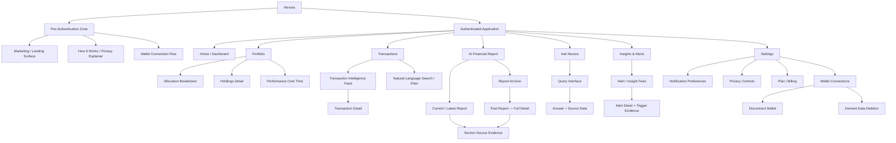
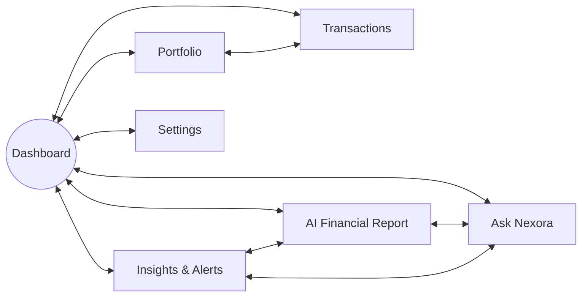
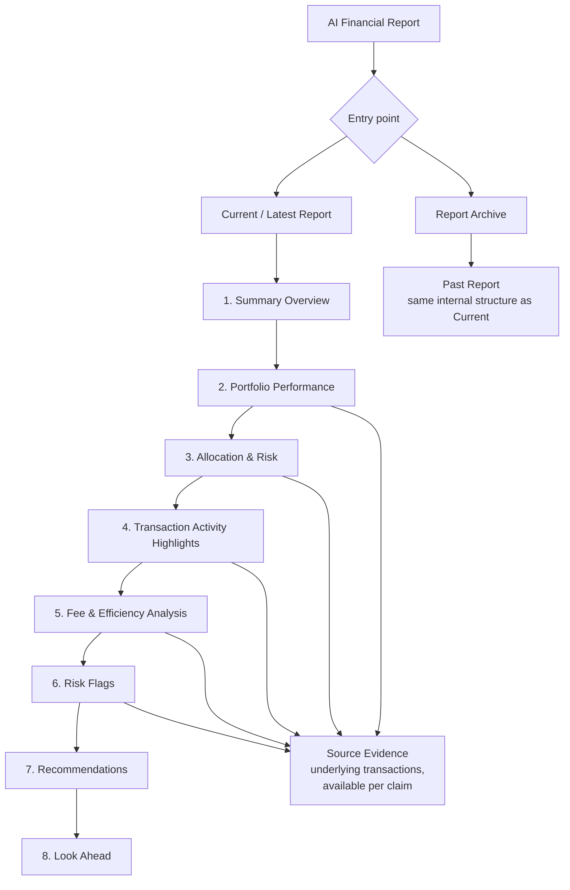
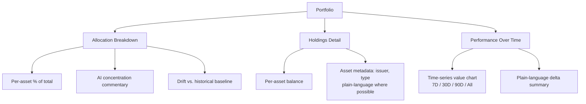
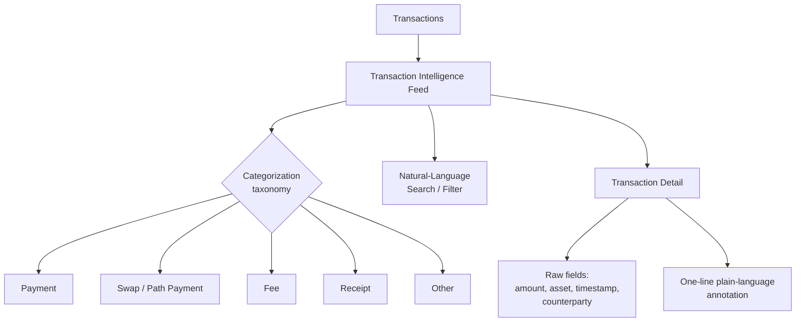
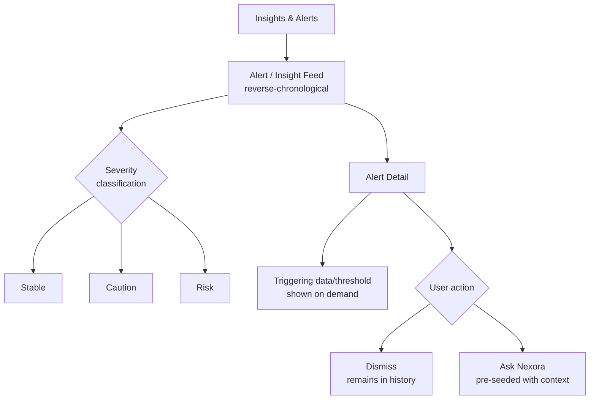
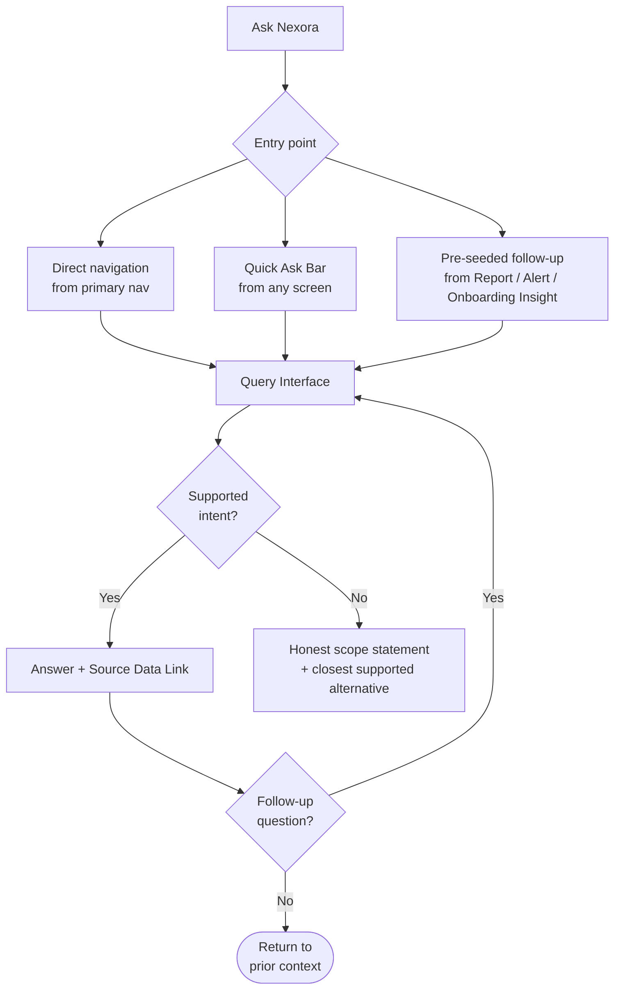
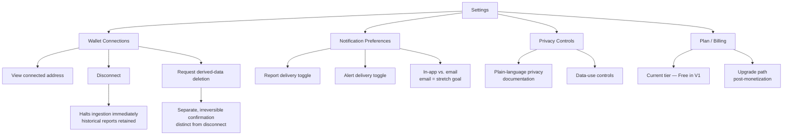

# NEXORA — INFORMATION_ARCHITECTURE.md
## AI Financial Intelligence Platform — Information Architecture
### Version 1.0 | Companion to PRODUCT_REQUIREMENTS.md and USER_FLOW.md

---

## 0. Purpose and Scope

This document defines the **structural organization** of Nexora V1 — every section, sub-section, page, and navigation path, and how they relate to one another. It answers *"where does everything live, and how do you get there?"* — not *"what does it look like"* (no UI design) and not *"what happens step by step"* (see USER_FLOW.md for behavior).

This document is derived entirely from:
- **PRODUCT_REQUIREMENTS.md** — Section 18 (Information Architecture), Section 19 (Feature Breakdown), Section 20 (MVP Scope), Section 28 (Dashboard), Section 29 (AI Financial Report), Section 11 (Settings/Permissions references).
- **USER_FLOW.md** — Section 15 (Navigation Flow), and the structural implications of Sections 4–14 (what states and destinations each flow requires).

Two structural facts from the source documents shape every section below:

1. **Seven top-level destinations, one hub.** PRD Section 18 defines exactly seven IA nodes; Dashboard is the anchor every other section connects back to (USER_FLOW Section 15). This document does not introduce an eighth top-level destination.
2. **Every AI-bearing screen carries two visually/structurally distinct content types** — a **computed fact** and an **AI observation** (PRD Section 38) — and every AI claim must expose a "source evidence" drill-down (PRD Sections 24, 38). This pattern recurs identically in the Dashboard, Report, Ask Nexora, and Alerts structures below, and is treated as a structural primitive, not a per-feature decision.

---

## 1. Information Architecture Principles

These principles govern every structural decision in this document:

- **Flat before deep.** Seven top-level sections, no more than three levels deep anywhere in the product (Section > Sub-section > Detail). This mirrors PRD Section 6's "clarity over completeness."
- **Dashboard as hub, not gateway.** Every section is reachable from Dashboard, but several sections also cross-link directly to each other where the user's task naturally spans them (Report ↔ Ask Nexora ↔ Alerts), per USER_FLOW Section 15.
- **Progressive disclosure as a structural rule, not a visual one.** Every list/summary-level page has exactly one drill-down level beneath it exposing source detail — never more, never a dead end (PRD Section 31).
- **State-gated content, not role-gated content.** V1 has no user roles or permission tiers in the RBAC sense — content visibility is gated by *connection state* (connected / analyzing / empty / disconnected) and, in the future, *plan tier* (free / paid), not by user type.
- **One data-boundary per account.** V1 supports a single connected wallet per account (PRD Section 20); the IA below reflects a single-wallet structure and flags where Version 2's multi-wallet aggregation would extend it.
- **No content type invented beyond the PRD's four AI-facing surfaces.** Dashboard, Report, Ask Nexora, and Alerts are the only places AI narrative appears. Portfolio and Transactions carry AI *annotations* on computed data but are not independently AI-generative surfaces.

---

## 2. Product Sitemap



---

## 3. Application Hierarchy (Depth Model)

| Level | Description | Examples |
|---|---|---|
| **L0 — Zone** | Pre-authentication vs. authenticated application | Marketing surface / Authenticated app |
| **L1 — Top-Level Section** | The seven IA nodes from PRD Section 18 | Dashboard, Portfolio, Transactions, AI Financial Report, Ask Nexora, Insights & Alerts, Settings |
| **L2 — Sub-Section** | A named grouping within a top-level section | Allocation Breakdown (within Portfolio); Report Archive (within AI Financial Report); Wallet Connections (within Settings) |
| **L3 — Detail / Evidence View** | The terminal drill-down: a single transaction, a single past report, a single alert's trigger data, a single Ask Nexora answer's source figures | Transaction Detail; Past Report — Full Detail; Alert Detail + Trigger Evidence |

No page in Nexora V1 sits deeper than L3. This is a deliberate structural ceiling, not an incidental result — it operationalizes PRD Section 31's "progressive disclosure: simple by default, detailed on demand" as a hard rule rather than a guideline.

---

## 4. Global Navigation Structure



**Structural notes:**
- **Primary navigation** exposes all seven L1 sections at all times (PRD Section 18 is a flat, complete list — no section is nested under another at the primary-nav level).
- **Quick Ask Bar** (PRD Section 28) is a persistent, cross-cutting entry point into Ask Nexora, structurally independent of primary navigation — reachable from any L1 or L2 screen, not just the Dashboard.
- **Cross-links bypass Dashboard** specifically between Report, Alerts, and Ask Nexora, because a user consuming a report or alert frequently needs an immediate follow-up question or a related insight — forcing a Dashboard detour would violate the "no dead-end, no forced detour" principle (USER_FLOW Section 15).
- **Deep links** (from notification/email) land directly on the target L2/L3 content (a specific report, a specific alert) — deep-linked content is a structural entry point into the IA, not just a shortcut.
- **Settings is reachable but not cross-linked** — it is intentionally the one section with no lateral connections to the others, since its content (connections, preferences, privacy, billing) is not part of the "insight consumption" loop the other six sections form together.

---

## 5. Page Inventory

| Page / Screen | Level | Parent | Purpose | Primary Content | Required Access State |
|---|---|---|---|---|---|
| Marketing / Landing Surface | L1 (pre-auth) | — | First-visit explainer and CTA | Value proposition, "what we do/don't access" framing | No session |
| How It Works / Privacy Explainer | L1 (pre-auth) | Landing | Pre-connection trust building | Plain-language explanation of read-only model | No session |
| Wallet Connection Flow | L1 (pre-auth) | Landing | The single required onboarding action | Address input / connector delegation, consent confirmation | No session → transitions to Analyzing |
| Onboarding Insight | L1 (transitional) | — | First AI observation shown once per account | One ranked insight + source evidence link | Analyzing complete, history found |
| **Dashboard** | L1 | — | Anchor / hub; portfolio health at a glance | Health Card, Allocation Widget, Recent Insights Feed, Performance Snapshot, Fee Summary Card, Quick Ask Bar | Connected (any sub-state) |
| **Portfolio** | L1 | Dashboard | Full holdings and allocation detail | See Section 9 | Connected, data present |
| Allocation Breakdown | L2 | Portfolio | Asset-by-asset allocation with concentration commentary | Deterministic % + AI concentration narrative | Connected, data present |
| Holdings Detail | L2 | Portfolio | Per-asset holding detail | Balance, cost context, issuer/type metadata | Connected, data present |
| Performance Over Time | L2 | Portfolio | Time-series value view | Chart (7D/30D/90D/All) + delta narrative | Connected, data present |
| **Transactions** | L1 | Dashboard | Categorized, searchable transaction history | See Section 10 | Connected, data present |
| Transaction Detail | L2 | Transactions | Single transaction, fully annotated | Raw fields + plain-language explanation | Connected, data present |
| **AI Financial Report** | L1 | Dashboard | Flagship periodic statement | See Section 8 | Connected (any sub-state) |
| Current / Latest Report | L2 | Report | Most recent generated report | 8 report sections, in order | Connected, ≥1 report generated |
| Report Archive | L2 | Report | List of all past reports | Chronological list, one entry per period | Connected, ≥1 report generated |
| Past Report — Full Detail | L3 | Report Archive | A specific historical report | Same 8-section structure as current report | Connected, report exists for period |
| **Ask Nexora** | L1 | Dashboard | Conversational Q&A over own data | See Section 12 | Connected (any sub-state, scoped answers if empty) |
| **Insights & Alerts** | L1 | Dashboard | Proactive notification feed | See Section 11 | Connected (any sub-state) |
| Alert Detail + Trigger Evidence | L2 | Insights & Alerts | Single alert, fully explained | Severity label, narrative, triggering data | Connected, alert exists |
| **Settings** | L1 | Dashboard | Account configuration | See Section 13 | Any session state |

---

## 6. Content Organization Model

Every content-bearing screen in Nexora organizes information using the same three-layer pattern, regardless of section:

```mermaid
flowchart TD
    A[Computed Fact\nDeterministic — Financial Computation Layer] --> C[Combined Display]
    B[AI Narrative\nGrounded to the fact above — AI Interpretation Layer] --> C
    C --> D{User wants to verify?}
    D -- Yes --> E[Source Evidence Drill-Down\nunderlying transaction(s)]
    D -- No --> F[User continues browsing]
```

This is the **single recurring content unit** of the product — PRD calls it "number/visual first, one-sentence AI explanation directly beneath it, and a 'see details' expansion" (Section 28), and it is not exclusive to the Dashboard: the same unit structures every Report section, every Ask Nexora answer, and every Alert. Content organization in Nexora is therefore best understood as **one repeating unit, instantiated seven different places**, rather than seven unrelated content models.

**Distinguishing rule (structural, not visual):** computed facts and AI narrative are always organized as two separably identifiable content blocks on every screen — never merged into a single undifferentiated block of text — so that "what Nexora calculated" and "what Nexora concluded" remain traceable back to their respective source layers (PRD Section 38).

---

## 7. User Access Patterns (Connection State Model)

Content availability across the entire IA is gated by connection state, not by user role. This state model applies uniformly to Dashboard, Portfolio, Transactions, Report, Ask Nexora, and Alerts:

```mermaid
stateDiagram-v2
    [*] --> Unauthenticated
    Unauthenticated --> Connecting: Connect Wallet selected
    Connecting --> Unauthenticated: Cancelled / validation error
    Connecting --> Analyzing: Address validated on-chain
    Analyzing --> AnalysisError: Timeout / ingestion failure
    AnalysisError --> Analyzing: Retry
    Analyzing --> ActiveEmpty: No transaction history found
    Analyzing --> ActiveWithData: History found
    ActiveEmpty --> ActiveWithData: Activity begins on-chain
    ActiveWithData --> SessionExpired: Session timeout
    ActiveEmpty --> SessionExpired: Session timeout
    SessionExpired --> ActiveWithData: Re-authenticated
    SessionExpired --> ActiveEmpty: Re-authenticated
    ActiveWithData --> Disconnected: User disconnects wallet
    ActiveEmpty --> Disconnected: User disconnects wallet
    Disconnected --> ActiveWithData: Reconnects same address\n(history retained)
    Disconnected --> DataDeleted: User requests derived-data deletion
    DataDeleted --> [*]
```



**How this maps onto the IA:**

| State | Dashboard | Portfolio / Transactions | Report | Ask Nexora | Alerts |
|---|---|---|---|---|---|
| **Unauthenticated** | Not reachable — redirects into Wallet Connection Flow | Not reachable — redirects into Wallet Connection Flow | Not reachable | Not reachable | Not reachable |
| **Analyzing** | Progress state shown | Not reachable yet | Not reachable yet | Not reachable yet | Not reachable yet |
| **ActiveEmpty** | Monitoring-state widgets, no fabricated insight | Empty states with explanatory copy | "No report history yet" state, shows next report date | Reachable, scoped to "no data yet" answers | "No alerts yet," explains what would trigger one |
| **ActiveWithData** | Full widget set | Full content | Full report + archive | Full scope (balances/fees/activity/allocation) | Full feed |
| **SessionExpired** | Re-auth interstitial, then restores place | Re-auth interstitial | Re-auth interstitial | In-progress question preserved across re-auth | Re-auth interstitial |
| **Disconnected** | "No wallet connected" state across all sections | Same | Historical reports remain accessible (PRD Section 27) | Not reachable (no live data) | Historical alerts remain in read-only history |
| **DataDeleted** | Full reset to pre-connection state | Reset | Reports removed | Reset | Reset |

**Structural note on multi-wallet (forward-looking, non-normative):** V1's IA assumes exactly one connected wallet per account throughout this document. Version 2's multi-wallet aggregation (PRD Section 22) would insert a new L1.5 concept — a wallet-selector or aggregated-view toggle — above Portfolio/Transactions/Report; this document does not model that state, since it is explicitly out of scope for V1 (PRD Section 21).

---

## 8. AI Financial Report — Structure

The Report is the flagship deliverable (PRD Section 29) and has the deepest, most codified internal structure of any section.



**Internal organization rules:**
- **Fixed section order, every report, every period** — Summary Overview → Portfolio Performance → Allocation & Risk → Transaction Activity Highlights → Fee & Efficiency Analysis → Risk Flags → Recommendations → Look Ahead (PRD Section 29). This order is identical between the current report and every archived past report — the archive is a list of structurally identical documents, not a changing format.
- **Report Archive is flat, not categorized** — a single reverse-chronological list, one entry per generation period (weekly in V1). No folders, tags, or sub-groupings in V1.
- **Each section is independently degradable** — per USER_FLOW Section 9a, a section that fails validation falls back to a fact-only version rather than blocking the whole report; structurally, this means each of the 8 sections must be able to render in either "narrative + facts" or "facts only" form without breaking the document's overall structure.
- **Notification surfacing points into this structure directly** — a notification/email/badge deep-links to the Current Report at the Summary Overview (top of document), never to an archive list first (USER_FLOW Section 9c, Navigation Edge Cases).
- **Consumption is linear-first, non-linear-optional** — the reading order above is the default path; jumping to a specific section is supported but the structure itself is authored as a sequential document (USER_FLOW Section 9b), closer to a bank statement than a dashboard.

---

## 9. Portfolio — Structure



- **Allocation Breakdown, Holdings Detail, and Performance Over Time are peer sub-sections**, not a sequential drill-down — a user can enter any one directly from Portfolio's top level (all three are L2, reachable independently).
- **Allocation Breakdown is the only Portfolio sub-section carrying AI narrative** beyond simple annotation (concentration commentary, baseline drift) — Holdings Detail and Performance Over Time present computed data with lighter, single-line annotation, consistent with PRD Section 19's description of "Asset Allocation Intelligence" as the AI-bearing feature within Portfolio.
- **Portfolio and Transactions are laterally linked** (Section 4) because holdings detail and the transactions that produced those holdings are the same underlying dataset viewed two ways — the IA treats this as a single data domain surfaced through two entry points.

---

## 10. Transactions — Structure



- **The Feed is the single entry point** into Transactions — there is no separate "all transactions" vs. "categorized transactions" split; categorization is a property of every feed item, not a separate view.
- **Search/Filter is a lens on the same feed**, not a separate section — narrowing the feed by category, date range, or natural-language query returns the same item structure (feed item → detail), consistent with PRD Section 19's description of the feed as "categorized, annotated, searchable in natural language" as one integrated feature.
- **Transaction Detail is the terminal L2 node** for this section — there is no further drill-down beneath an individual transaction.
- **The five-category taxonomy (PRD Section 27, USER_FLOW references)** is a fixed, closed set in V1 — the IA does not support user-defined categories or sub-categories.

---

## 11. Insights & Alerts — Structure



- **Severity is text-labeled, never color-only** (PRD Section 37, 38) — this is a structural/content requirement, not a visual one: every alert item carries a severity label as data, independent of how it is later styled.
- **Feed is undifferentiated between "insight" and "alert"** at the top level — PRD Section 18 names this single section "Insights & Alerts," and USER_FLOW treats risk/anomaly alerts and milestone-type insights as items in one feed, distinguished by severity classification rather than by separate sub-sections.
- **Dismissal does not remove history** — dismissed items remain queryable in the feed; there is no deletion of alert history from this section (deletion of *derived data generally* is a Settings-level action, Section 13 below).
- **Multiple simultaneous triggers surface as multiple distinct feed items**, never merged (USER_FLOW Section 10 edge cases) — this is a structural rule: one alert = one feed item = one Alert Detail page, always.

---

## 12. Ask Nexora — Structure



- **Ask Nexora has no persistent "conversation history" section in V1** — each session is a query interface, not a saved-thread inbox; PRD Section 20 scopes Ask Nexora to four intent types (balances, fees, activity-over-time, allocation) with no mention of thread persistence or history browsing as an IA element.
- **Three structurally distinct entry points feed the same interface** — direct navigation, the persistent Quick Ask Bar, and context-seeded entry from Report/Alert/Onboarding Insight all resolve to the identical Query Interface node; the only difference is whether a question is pre-populated.
- **Out-of-scope questions are a first-class structural outcome**, not an error state — the "honest scope statement + closest supported alternative" path (USER_FLOW Section 8) is as much a part of this section's structure as a successful answer, since V1 deliberately bounds Ask Nexora's query taxonomy (PRD Section 21).

---

## 13. Settings — Structure



- **Four peer sub-sections**, all reachable directly from Settings' top level — no nesting deeper than L2 within Settings except the two Wallet Connections actions (Disconnect, Deletion), which are treated as L3 because each carries its own distinct confirmation flow.
- **Disconnect and Delete are structurally two separate actions**, never one combined control — this directly implements PRD Section 39's framing of "disconnect" and "request deletion of derived data" as two distinct user rights, each needing its own confirmation step (USER_FLOW Section 11).
- **Plan/Billing is present in the IA in V1 but functionally minimal** — PRD Section 20 scopes V1 to a single free tier; the sub-section exists structurally now so the upgrade path (PRD Section 42) has a home once monetization ships, rather than requiring new top-level navigation later.

---

## 14. Mobile Information Architecture Considerations

Nexora V1 is **responsive web, not a native app** (PRD Section 21 explicitly defers native apps to a later roadmap item). The IA itself does not change between breakpoints — all seven L1 sections, all sub-sections, and all state gating in Sections 7–13 above apply identically on mobile. What changes at mobile widths is **navigation surface and content density**, not the underlying structure:

- **Primary navigation collapses to a condensed pattern** (e.g., a bottom bar or menu drawer) but must still expose all seven L1 sections — no section is demoted to a secondary/hidden tier on mobile, since PRD Section 18's IA is flat by design and at least two personas (Amara/Saver, Julio/Earner) are described as primarily mobile users (PRD Section 13).
- **The Quick Ask Bar's cross-screen persistence is especially load-bearing on mobile** — with less on-screen navigation chrome available at small widths, the always-available Ask entry point (PRD Section 28) becomes the primary shortcut past a multi-level menu, not just a convenience.
- **The Dashboard's widget stack becomes strictly vertical/sequential on mobile** — Portfolio Health Card, Allocation Widget, Recent Insights Feed, Performance Snapshot, and Fee Summary Card retain their existing priority order (Health Card first, per PRD Section 28) but stack top-to-bottom rather than in a multi-column layout; the IA's "one primary anchor widget first" rule becomes more, not less, important at narrow widths.
- **The Report's already-linear structure (Section 8) maps naturally to mobile** without restructuring — its 8-section sequential design was modeled on a bank-statement reading pattern (PRD Section 30) that was never column-dependent to begin with.
- **Transaction Detail and Alert Detail (L2/L3 evidence views) must remain single-tap reachable from their parent feed** — progressive disclosure (Section 6) cannot add an extra navigational hop on mobile just because screen space is constrained; the two-layer "summary → evidence" pattern must hold at every breakpoint.
- **Settings sub-sections likely collapse into an accordion or stacked-list pattern** on mobile, but the four-way peer structure (Section 13) and the two-step Disconnect/Delete distinction must remain equally explicit — mobile space constraints are not a rationale for merging those two irreversible-vs-reversible actions into one control.
- **No mobile-specific content or feature set exists in V1** — there is no "lite" version of any section; the same computed-fact-plus-AI-narrative-plus-evidence unit (Section 6) appears on every breakpoint, since the product's core deliverable is text-and-number legibility (PRD Section 32), which degrades gracefully by typography and layout, not by content removal.

---

## 15. Cross-Reference: IA Nodes to Source Requirements

| IA Section (this document) | PRD Grounding | USER_FLOW Grounding |
|---|---|---|
| Sitemap / Hierarchy (§2–3) | Section 18 (Information Architecture) | Section 15 (Navigation Flow) |
| Global Navigation (§4) | Section 18, 28 (Quick Ask Bar) | Section 15, edge cases |
| Content Organization Model (§6) | Section 25, 26, 38 | Section 16 (AI Analysis Trace) |
| Access Pattern / State Model (§7) | Section 20, 21, 27 | Sections 4, 5, 5a, 11, 14 |
| AI Financial Report Structure (§8) | Section 29 | Sections 9, 9a, 9b, 9c |
| Portfolio Structure (§9) | Section 19 (Asset Allocation Intelligence) | Section 7 |
| Transaction Structure (§10) | Sections 19, 27 | Section 7 |
| Insights & Alerts Structure (§11) | Sections 19, 26, 37, 38 | Section 10 |
| Ask Nexora Structure (§12) | Sections 19, 20, 21, 26 | Section 8 |
| Settings Structure (§13) | Sections 18, 27, 39 | Section 11 |
| Mobile IA (§14) | Sections 13, 21, 28, 30, 32 | (implicit — no dedicated mobile flow) |

---

*End of Document — Nexora INFORMATION_ARCHITECTURE.md v1.0*
