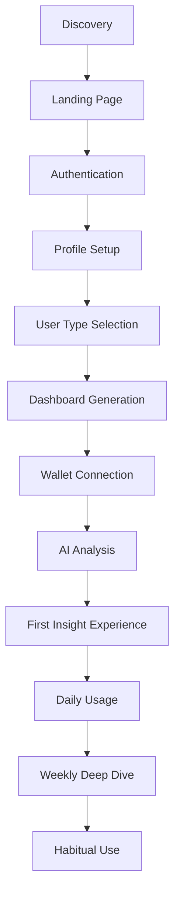
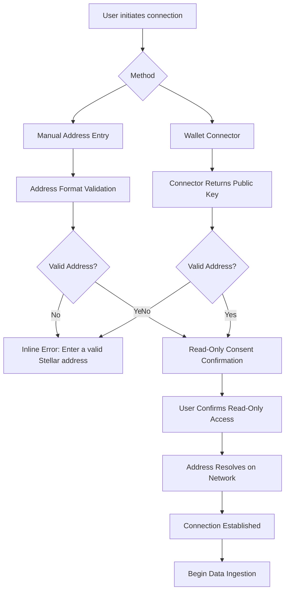
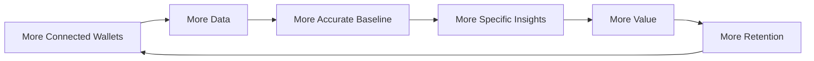
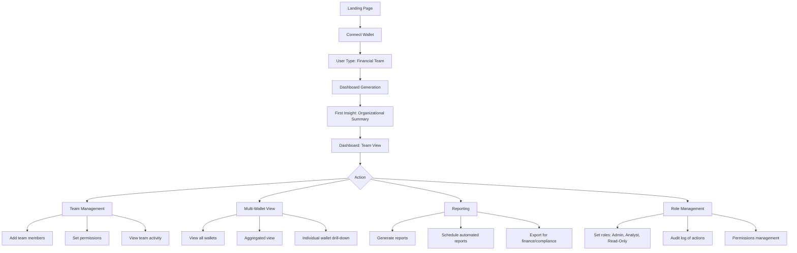

# Nexora — User Journey & Experience Architecture
## AI-Powered Trading & Digital Asset Intelligence Platform
### Version 1.0 | Product Experience Document

---

## 1. Product Goal

Nexora transforms the chaotic, unstructured reality of digital asset trading into a disciplined, data-informed financial practice. Traders fail not because they lack market insight, but because they lack self-insight — they don't journal trades consistently, don't track performance accurately, don't measure risk objectively, and don't learn from their own behavior.

**Nexora's core promise:** Automatically organize every financial decision, surface behavioral patterns, and deliver structured intelligence that makes traders better over time — not by telling them what to buy, but by showing them who they are as traders and where they consistently leave money on the table.

**The single metric that matters:** Does a user feel they understand their own trading behavior better after 30 days of using Nexora than they did on day one? If yes, retention follows.

---

## 2. User Personas

### Persona 1 — The Active Trader
**Name:** Marcus
**Age:** 34
**Occupation:** Full-time crypto trader / former finance professional
**Experience Level:** Advanced
**Primary Device:** Desktop (multi-monitor setup)
**Behavioral Profile:** Executes 10-50 trades weekly across multiple assets. Uses limit orders, stop-losses, and occasionally leveraged positions. Already keeps a manual trading journal (spreadsheet) but finds it tedious.

**Core Question:** *"Am I actually getting better, or just trading more?"*

**Pain Points:**
- Manual journaling is time-consuming and inconsistent
- Can't easily see which setups work and which don't
- Overtrading goes unnoticed until the P&L is already red
- No objective feedback loop — just market outcomes, not process evaluation

**What Nexora Delivers:**
- Automated trade journaling (no manual entry)
- Performance breakdown by asset, strategy, time of day
- Behavioral pattern detection (overtrading, revenge trading, FOMO entries)
- Weekly performance reviews with actionable insights

---

### Persona 2 — The Strategic Investor
**Name:** Elena
**Age:** 41
**Occupation:** Portfolio manager at a family office / high-net-worth individual
**Experience Level:** Intermediate-to-Advanced (traditional finance background, newer to crypto)
**Primary Device:** Tablet and laptop (checking on-the-go, deep-dives at desk)
**Behavioral Profile:** Makes 5-20 trades per month. Focused on portfolio allocation, risk management, and long-term positioning rather than short-term speculation. Holds multiple assets across wallets.

**Core Question:** *"Is my crypto allocation performing as it should relative to risk?"*

**Pain Points:**
- Crypto portfolio is spread across wallets with no unified view
- Can't easily measure risk-adjusted returns (Sharpe, drawdown, correlation)
- No clear way to compare crypto performance against traditional portfolio
- "Health" of portfolio is gut feel, not measured

**What Nexora Delivers:**
- Consolidated view across all wallets
- Risk metrics: volatility, drawdown, correlation across assets
- Performance comparison against benchmarks (BTC/ETH)
- Allocation drift alerts and rebalancing suggestions

---

### Persona 3 — The Digital Asset User
**Name:** Jay
**Age:** 27
**Occupation:** Tech worker / early crypto adopter
**Experience Level:** Beginner-to-Intermediate
**Primary Device:** Mobile-first (checks during commutes, evenings)
**Behavioral Profile:** Makes 2-10 trades per month. Uses crypto for payments, DeFi yield, and occasional speculation. Holds assets in multiple wallets for different purposes (trading, savings, DeFi).

**Core Question:** *"What's actually happening with my money?"*

**Pain Points:**
- Doesn't understand what transactions mean
- No clear picture of overall financial position
- Wants to learn but finds crypto data overwhelming
- Not confident enough to make informed decisions

**What Nexora Delivers:**
- Plain-language explanations of every transaction
- Simple "how am I doing" dashboard
- Educational insights layered naturally in the experience
- Confidence-building through understanding

---

### Persona 4 — The Financial Team (B2B/B2B2C)
**Name:** Sasha
**Age:** 38
**Occupation:** Head of Crypto Operations at a fintech company / DAO treasury manager
**Experience Level:** Advanced (operational focus)
**Primary Device:** Desktop (team collaboration context)
**Behavioral Profile:** Manages multiple wallets on behalf of the organization. Needs operational visibility, audit trails, and reporting for stakeholders. Coordinates with finance, compliance, and leadership teams.

**Core Question:** *"Can I show our stakeholders a clear, accurate picture of our crypto financials?"*

**Pain Points:**
- Wallets are spread across team members
- No single source of truth for crypto financials
- Reporting is manual and time-consuming
- Audit trails are weak or non-existent
- Risk exposure across wallets is unclear

**What Nexora Delivers:**
- Multi-wallet aggregation under one organizational view
- Role-based access (read-only for stakeholders, full for operations)
- Automated reporting for finance, compliance, and leadership
- Audit trail of all activity and decisions

---

## 3. User Problems and Pain Points

### Universal Pain Points (All Personas)

| Pain Point | Description | Impact |
|---|---|---|
| **Data Fragmentation** | Assets and transaction history are spread across multiple wallets, exchanges, and chains | Users have no unified view of their financial position |
| **No Behavioral Feedback** | Users see P&L but not *why* they made money or lost it | No learning loop; repeated mistakes go unnoticed |
| **Journaling Is Hard** | Manual trade journaling is tedious, inconsistent, and often abandoned | Users lose the ability to review and learn from their decisions |
| **Risk Is Invisible** | Risk metrics (drawdown, correlation, concentration) are not surfaced | Users take on more risk than they realize until it's too late |
| **Crypto Is Jargon-Heavy** | Transaction data is technical and unfriendly | Users feel excluded and uncertain |
| **No Context for Numbers** | Balances and P&L are shown without meaning or comparison | Users don't know what "good" looks like |
| **Analysis Requires Expertise** | Meaningful financial analysis requires skills most users don't have | Users make decisions based on incomplete understanding |

### Persona-Specific Pain Points

| Persona | Unique Pain Points |
|---|---|
| **Marcus (Trader)** | Manual journaling is unsustainable; can't see performance by setup; overtrading is invisible; no process feedback |
| **Elena (Investor)** | No risk-adjusted metrics; can't compare crypto to traditional portfolio; no unified view across wallets |
| **Jay (Digital Asset User)** | Doesn't understand transactions; no clear "am I doing okay" signal; feels overwhelmed by data |
| **Sasha (Financial Team)** | No single source of truth; reporting is manual; poor audit trail; role-based access is missing |

---

## 4. User Goals

### Universal Goals (All Personas)

1. **Understanding** — Know what's happening with my assets in plain language
2. **Confidence** — Feel informed enough to make decisions without anxiety
3. **Time Savings** — Get insights without doing manual work
4. **Trust** — Believe the numbers are accurate and explainable
5. **Growth** — Get better at managing assets over time

### Persona-Specific Goals

| Persona | Specific Goals |
|---|---|
| **Marcus (Trader)** | Automate journaling; identify winning patterns; stop overtrading; improve process |
| **Elena (Investor)** | Measure risk-adjusted returns; consolidate portfolio view; compare to benchmarks |
| **Jay (Digital Asset User)** | Understand my financial picture; learn as I go; feel confident in decisions |
| **Sasha (Financial Team)** | Single source of truth; automated reporting; auditability; role-based access |

---

## 5. Complete User Journey

### Journey Overview

The complete user journey from first discovery to habitual use:



---

### Stage 1: Discovery

**Touchpoints:**
- Organic search (SEO content, blog posts)
- Social media / crypto communities (Twitter, Discord, Reddit)
- Referral from existing users
- Ecosystem partner referrals (wallets, exchanges, DeFi protocols)
- Content marketing (educational articles, "how to journal" guides)

**User State:** Curious but skeptical. Most users have tried other tools and been disappointed.

**Experience Goal:** Build credibility without hype. Position Nexora as a serious tool for serious users, not another "moon" app.

**What the User Needs to Know:**
- What problem Nexora solves (traders fail without structure)
- How it works differently (automated journaling, behavioral AI)
- What it costs (freemium model, clear value upfront)
- Why they can trust it (read-only, non-custodial, transparent)

---

### Stage 2: Landing Page

**Purpose:** Convert a curious visitor into a user by demonstrating clear value within seconds.

**Key Content Sections:**

1. **Hero Section**
   - Headline: *"Stop Trading Blind. Start Understanding."*
   - Sub-headline: *"Nexora automatically journals your trades, analyzes your behavior, and gives you the insights to trade smarter — not just more."*
   - Primary CTA: "Connect Your Wallet" (purposefully placed early)

2. **Value Proposition** (3 pillars)
   - **Automated Journaling** — Every trade logged, categorized, and explained
   - **Behavioral AI** — Detect overtrading, risk patterns, and improvement areas
   - **Structured Insights** — Weekly reports that actually help you get better

3. **How It Works** (3 simple steps)
   - Connect your wallet (read-only, takes 30 seconds)
   - Nexora analyzes your history and behavior
   - Get your first AI insight within minutes

4. **Trust Signals**
   - "Read-only, non-custodial — we never move funds"
   - "Built for traders, by traders"
   - "Used by 1,000+ traders" (if applicable)
   - Integration badges (Freighter, Ledger, Stellar)

5. **Social Proof / Testimonials**
   - Quotes from real users or beta testers
   - Case study snippets (e.g., "Marcus reduced overtrading by 40% in 3 weeks")

6. **Footer**
   - Privacy policy, terms of service, blog, support, social links

**Key UX Decisions:**
- Primary CTA is "Connect Your Wallet" — front and center
- Secondary CTA is "See How It Works" (scrolls to explainer)
- No dark patterns — users can leave without being trapped

---

### Stage 3: Authentication

**Purpose:** Allow users to create an account with minimal friction while collecting enough information for personalization.

**Auth Methods:**
- Email + password (primary)
- Google OAuth (optional)
- Wallet-based authentication (optional stretch)

**Onboarding Flow:**

1. **Sign Up / Sign In**
   - Clear distinction between new and returning users
   - "Continue with Google" for speed
   - Email confirmation (optional — can defer to post-connection)

2. **Email Confirmation** (if required)
   - Simple verification email
   - "Resend" option available

**UX Principles:**
- Minimal friction — don't ask for more than email + password
- Clear security messaging (no private keys ever requested)
- "Skip for now" options where appropriate

---

### Stage 4: Profile Setup

**Purpose:** Collect essential user information to personalize the experience from day one.

**Key Information Collected:**

1. **Basic Profile**
   - Full name (or display name)
   - Time zone (for report timing and activity analysis)
   - Preferred language (currently English, more later)

2. **Experience Level**
   - Beginner — "I'm new to crypto and want to learn"
   - Intermediate — "I have some experience and want to improve"
   - Advanced — "I trade regularly and want advanced analytics"

3. **Primary Goal** (single-select)
   - "Learn and understand my finances" (Education)
   - "Improve my trading performance" (Performance)
   - "Track my investment portfolio" (Tracking)
   - "Manage my team/organization's assets" (Team)

4. **Trading Experience** (optional, helps with personalization)
   - How often do you trade? (Daily / Weekly / Monthly / Occasionally)
   - What's your primary focus? (Spot / Derivatives / DeFi / All)
   - What's your approximate portfolio size? (Range select)

**UX Decisions:**
- These questions are optional where possible — don't block access
- "I'll tell you later" option for all non-essential questions
- Progress indicator to show how far through setup they are
- Focus on one question per screen (reduces cognitive load)

**Why This Matters:**
- Experience level and goals determine dashboard composition
- Time zone ensures insights are relevant (e.g., "Your most active trading hour is 2pm")
- Portfolio size influences risk thresholds and report tone

---

### Stage 5: User Type Selection

**Purpose:** Tailor the core product experience to the user's specific needs from the start.

**User Types:**

1. **Trader** — I trade actively and want to improve my performance
   - *Result:* Performance-focused dashboard, automated journaling, behavioral insights

2. **Investor** — I hold assets and want portfolio health insights
   - *Result:* Risk-focused dashboard, allocation views, benchmark comparison

3. **Digital Asset User** — I use crypto for payments, DeFi, and occasional trading
   - *Result:* Education-focused dashboard, plain-language explanations, "how am I doing" summary

4. **Financial Team** — I manage assets for a team or organization
   - *Result:* Multi-wallet management, reporting, role-based access

**UI Approach:**
- Four distinct, visually differentiated cards
- Each card has:
  - A clear icon
  - Short name
  - One-sentence description of what this type is about
  - What they'll see (e.g., "Automated journaling + behavioral AI")
- A "I'm not sure yet" option that suggests the most likely fit

**UX Decision:**
- User can change their type later in Settings
- Selection immediately impacts dashboard generation (no need to reconnect)

---

### Stage 6: Dashboard Generation

**Purpose:** Create a personalized, usable dashboard immediately after the user connects their wallet — not a blank screen waiting for configuration.

**Trigger:** User connects wallet → data ingestion begins → dashboard generates.

**Generation Process:**

1. **Data Ingestion (0-60 seconds)**
   - Pull all transaction history from connected wallet
   - Fetch balances and asset metadata
   - Detect patterns (trading frequency, assets traded, fee patterns)

2. **Financial Computation (0-30 seconds)**
   - Calculate balances, allocation percentages, P&L
   - Categorize transactions (trade, fee, payment, receipt, transfer)
   - Compute performance metrics (overall, per-asset, per-period)

3. **AI Processing (0-30 seconds)**
   - Rank insights by financial significance
   - Generate narrative for top 3-5 insights
   - Validate all numbers against source facts

4. **Dashboard Assembly (0-10 seconds)**
   - Apply user type + experience level + goal to determine widget priority
   - Render personalized dashboard

**State Management:**
- **Before connection:** Dashboard shows "Connect a wallet to get started"
- **During analysis:** Progress indicator with estimated time remaining
- **After analysis:** Full dashboard + first insight notification

---

### Stage 7: Wallet Connection

**Purpose:** Connect a wallet in a read-only, non-custodial way — the single action that unlocks the entire product.

**Supported Methods:**
1. **Manual Address Entry** — User pastes a public address
2. **Wallet Connector** — Freighter (Stellar), other connectors as supported
3. **Copy/Paste from Explorer** — Import via QR code or clipboard detection

**Connection Flow:**



**Key UX Safeguards:**
- **Secret Key Detection:** If a user pastes a secret key instead of a public key, the system must:
  1. Detect the pattern immediately
  2. Show a prominent safety warning
  3. Refuse to proceed
  4. NEVER store or transmit the value
- **Format Validation:** Client-side validation before any network call
- **Explicit Consent:** "Nexora can read your balances and transaction history but can NEVER move your funds" — clear, plain-language
- **No Dead Ends:** If connection fails, clear error with actionable steps

**Trust Messaging:**
- "We read only your public data. Nexora is structurally incapable of moving funds."
- "No private keys are requested, stored, or transmitted."
- "Learn more about our security model" (link to documentation)

---

### Stage 8: AI Analysis

**Purpose:** Process the user's on-chain history and generate the first set of insights.

**Analysis Pipeline:**

1. **Data Ingestion**
   - Fetch full transaction history
   - Pull balance data
   - Retrieve asset metadata

2. **Financial Computation**
   - Calculate total portfolio value
   - Determine allocation percentages
   - Compute P&L (realized and unrealized)
   - Calculate fee totals and efficiency
   - Categorize every transaction
   - Detect trading patterns (frequency, size, timing)

3. **Insight Generation**
   - Rank all possible observations by significance
   - Select top 3-5 insights for first view
   - Generate grounded narrative for each
   - Validate numbers against source data

4. **Personalization**
   - Apply user type to prioritize certain insights
   - Adjust tone based on experience level
   - Surface the most relevant insight first

**First Insight Selection:**

Based on user type:

| User Type | First Insight Priority |
|---|---|
| **Trader** | "You've made X trades this month with a win rate of Y%. Your best-performing setup is..." |
| **Investor** | "Your portfolio is currently Z% allocated to [asset]. Your historical baseline is..." |
| **Digital Asset User** | "Here's a plain-language breakdown of what you hold and what it means..." |
| **Financial Team** | "We've identified X wallets and Y assets across your organization. Here's a summary..." |

**Progress Communication:**
- Estimated time remaining (progress bar or "about 30 seconds")
- Processing stages shown as steps (e.g., "Analyzing your trades...")
- Notifications when complete (in-app, no email required)

---

### Stage 9: First Insight Experience

**Purpose:** Demonstrate value immediately. The very first thing the user sees after connecting should be a meaningful insight, not a generic "welcome" screen.

**Components of the First Insight:**

1. **Headline Insight** — One financially significant observation
2. **Explanation** — Plain-language description of what it means
3. **"Why This Matters"** — The financial consequence
4. **Source Data** — Underlying transactions (expandable, visible on demand)
5. **Action Suggestion** — What to do next (e.g., "Explore your allocation" or "View full report")

**UX Pattern:**
```
[Headline: You've made 47 trades this month]
[Explanation: Your win rate is 62%, with a profit factor of 1.8x]
[Why This Matters: This places you in the top 25% of traders in your cohort]
[See source data ▸]
[CTA: View your trading journal →]
```

**Trust-Building Moment:**
- Expandable source data explicitly shows the trades behind the claim
- "Every Nexora insight is traceable to your on-chain data" — visible guarantee
- This sets the pattern: insights are always grounded, never invented

**User Options After First Insight:**
- View Dashboard (primary CTA)
- Ask Nexora a question (if they want more context)
- Explore a related section (e.g., journal, allocation)

---

### Stage 10: Daily Usage

**Purpose:** Make Nexora a daily touchpoint for users — not just when something goes wrong, but as part of their routine.

**Daily Experience Components:**

| Component | What It Does | When It Appears |
|---|---|---|
| **Dashboard** | Snapshot of all key metrics | Every login |
| **Recent Activity Feed** | What's happened since last visit | Daily |
| **Today's Insight** | One AI observation relevant to today | Daily |
| **Quick Ask Bar** | Ask a question at any time | Always available |
| **Watchlist Updates** | Price and performance alerts | Real-time |
| **Market News** | Curated, relevant news | Daily |

**Daily User Flows:**

**Flow 1: Quick Check (2-3 minutes)**
```
User logs in → Dashboard loads → Scans Health Card → 
Checks Recent Activity → Reviews Today's Insight → Logs out
```
*Goal:* Keep the user informed without requiring a time commitment.

**Flow 2: Deep Work (15-30 minutes)**
```
User logs in → Dashboard loads → Today's Insight prompts a question → 
Uses Ask Nexora to explore → Opens Trading Journal → 
Reviews weekly performance → Sets a goal → Logs out
```
*Goal:* Provide depth for users who want to actively improve.

**Flow 3: Research (30+ minutes)**
```
User logs in → Opens Portfolio → Compares performance across assets → 
Runs "what-if" scenarios in Ask Nexora → Reviews benchmarks → 
Checks Top Traders → Exports a report → Logs out
```
*Goal:* Serve power users who want deep analysis.

---

### Stage 11: Weekly Deep Dive

**Purpose:** The weekly AI Financial Report is the primary retention mechanic — a recurring, valuable touchpoint that brings the user back without push notifications.

**Weekly Report Structure:**

1. **Executive Summary** — 2-3 sentence plain-language state of the user's finances
2. **Performance Review** — How did they perform this week? (P&L, win rate, profit factor)
3. **Behavioral Analysis** — What patterns were detected? (overtrading, FOMO entries, time-of-day effectiveness)
4. **Risk Review** — Any concentration, drawdown, or volatility flags
5. **Comparison** — How does their performance compare to their own baseline?
6. **Learning Moment** — One clear insight about what worked and what didn't
7. **Recommendations** — Non-prescriptive suggestions (not "sell X" but "this pattern may be worth reviewing")
8. **Look Ahead** — What Nexora will watch for next week

**Report Delivery:**
- **In-app:** Visible on Dashboard with a banner, and in the Reports section
- **Email:** Optional (stretch goal, see V2)
- **Push notification:** For users with notifications enabled

**UX on Return:**
```
User opens Nexora → New report available banner → 
Opens report → Reads Summary → Expands sections of interest →
Asks follow-up question via Ask Nexora → Returns to Dashboard
```

---

### Stage 12: Habitual Use

**Purpose:** Make Nexora the default place the user goes to understand their financial life.

**Signs of Habitual Use:**

- Weekly report is opened within 48 hours of generation
- Dashboard is viewed at least 3-5 times per week
- Ask Nexora queries are used for routine questions (not just "what happened")
- User voluntarily upgrades to paid tier or recommends to others

**Retention Flywheel:**



**Compounding Value:**
- Week 1: General insights
- Week 4: Personalized insights (baseline established)
- Week 12: Predictive insights (patterns recognized)
- Week 26: Behavior-shaping insights (user is actively improving)

---

## 6. Detailed User Flows

### Flow 1: Trader Flow (Marcus)

```mermaid
flowchart TD
    A[Landing Page] --> B[Connect Wallet]
    B --> C[User Type: Trader]
    C --> D[Dashboard Generation]
    D --> E[First Insight: Trade Performance]
    E --> F[Dashboard: Performance View]
    
    F --> G{Action}
    G --> H[Trading Journal]
    G --> I[Ask Nexora: "What's my win rate on XLM?"]
    G --> J[Weekly Report]
    G --> K[Watchlist]
    
    H --> H1[View all trades with auto-categorization]
    H --> H2[Filter by asset, time period, setup]
    H --> H3[View trade performance by strategy]
    H --> H4[Export journal]
    
    I --> I1[Query resolved via deterministic data]
    I --> I2[Answer: "Your win rate on XLM is 68% over 47 trades"]
    I --> I3[Source data shown]
    
    J --> J1[Executive Summary]
    J --> J2[Performance Review]
    J --> J3[Behavioral Analysis]
    J --> J4[Risk Review]
    J --> J5[Recommendations]
    
    K --> K1[Watchlist Management]
    K --> K2[Price Alerts]
    K --> K3[Performance Tracking]
```

**Key Trader Features:**

- **Automated Journal:** Every trade is logged, categorized, and searchable
- **Performance Breakdown:** Win rate, profit factor, R/R ratio, average hold time
- **Behavioral Detection:** Overtrading, revenge trading, FOMO entries, time-of-day patterns
- **Weekly Review:** Structured report showing improvement over time

---

### Flow 2: Investor Flow (Elena)

```mermaid
flowchart TD
    A[Landing Page] --> B[Connect Wallet]
    B --> C[User Type: Investor]
    C --> D[Dashboard Generation]
    D --> E[First Insight: Portfolio Health]
    E --> F[Dashboard: Risk View]
    
    F --> G{Action}
    G --> H[Portfolio]
    G --> I[Ask Nexora: "What's my risk-adjusted return?"]
    G --> J[Weekly Report]
    G --> K[Allocation Management]
    
    H --> H1[View all holdings]
    H --> H2[Allocation by asset]
    H --> H3[Performance by asset]
    H --> H4[Risk metrics: volatility, drawdown, correlation]
    
    I --> I1[Compute risk-adjusted metrics]
    I --> I2[Answer: "Your Sharpe ratio is 1.2, outperforming BTC's 0.9"]
    I --> I3[Comparison to benchmarks]
    
    J --> J1[Executive Summary]
    J --> J2[Portfolio Performance]
    J --> J3[Risk Review]
    J --> J4[Allocation Analysis]
    J --> J5[Benchmark Comparison]
    
    K --> K1[View allocation]
    K --> K2[Detect drift]
    K --> K3[Get rebalancing suggestions]
```

**Key Investor Features:**

- **Risk Metrics:** Sharpe ratio, maximum drawdown, volatility, correlation
- **Benchmark Comparison:** Performance relative to BTC, ETH, or custom benchmarks
- **Allocation Management:** Current allocation vs. target, drift detection
- **Risk-Adjusted Returns:** Not just "what you made," but "what you made per unit of risk"

---

### Flow 3: Digital Asset User Flow (Jay)

```mermaid
flowchart TD
    A[Landing Page] --> B[Connect Wallet]
    B --> C[User Type: Digital Asset User]
    C --> D[Dashboard Generation]
    D --> E[First Insight: Plain-Language Summary]
    E --> F[Dashboard: Education View]
    
    F --> G{Action}
    G --> H[Portfolio Explained]
    G --> I[Ask Nexora: "What does this transaction mean?"]
    G --> J[Weekly Report: "How am I doing?"]
    G --> K[Learning Hub]
    
    H --> H1[Plain-language summary of holdings]
    H --> H2[Every asset explained]
    H --> H3["What this means for you" section]
    
    I --> I1[Retrieve transaction data]
    I --> I2[Generate plain-language explanation]
    I --> I3[Answer: "This was a payment of 500 USDC to..."]
    
    J --> J1[Simple summary]
    J --> J2["You're doing X well, Y could improve"]
    J --> J3["Here's what changed this week"]
    
    K --> K1[Educational content]
    K --> K2[Personalized learning path]
    K --> K3[Crypto basics explained]
```

**Key Digital Asset User Features:**

- **Plain-Language Everywhere:** No crypto jargon without explanation
- **Transaction Explanations:** Every transaction has a "what this means" section
- **Simple Summaries:** "Am I doing okay?" answered in plain terms
- **Learning Hub:** Educational content tailored to their portfolio and questions

---

### Flow 4: Financial Team Flow (Sasha)



**Key Financial Team Features:**

- **Multi-Wallet Management:** Connect and manage multiple wallets
- **Team Access:** Role-based access for different team members
- **Automated Reporting:** Scheduled reports for stakeholders
- **Audit Trail:** Complete history of all actions and decisions
- **Compliance:** Export-ready reports for finance and compliance teams

---

## 7. Personalized Dashboard Logic

### Core Principle

The dashboard is not static — it adapts based on:
1. **User Type** (Trader, Investor, Digital Asset User, Financial Team)
2. **Experience Level** (Beginner, Intermediate, Advanced)
3. **Primary Goal** (Learn, Improve, Track, Manage Team)
4. **Activity Level** (How frequently they use the product)
5. **Time of Day / Session Context** (Morning check vs. deep dive)

### Dashboard Configuration Matrix

| User Type | Primary Widget | Secondary Widgets | Tertiary Widgets |
|---|---|---|---|
| **Trader** | Performance Summary | Journal Highlights, Behavioral Insights, Watchlist | News, Top Traders |
| **Investor** | Portfolio Health | Risk Metrics, Allocation View, Benchmark Comparison | News, Watchlist |
| **Digital Asset User** | "How Am I Doing?" Summary | Portfolio Explained, Recent Activity, Learning Tip | News |
| **Financial Team** | Organizational Summary | Multi-Wallet View, Team Activity, Reports | News |

### Experience Level Adjustments

| Experience Level | Widget Adjustment | Language Adjustment | Data Depth |
|---|---|---|---|
| **Beginner** | More education widgets | Plain language, no jargon | Surface-level summaries |
| **Intermediate** | Balanced view | Some jargon explained | Moderate depth |
| **Advanced** | More data-dense widgets | Jargon-native | Full depth + advanced metrics |

### Goal-Based Adjustments

| Goal | Dashboard Emphasis |
|---|---|
| **Learn and understand** | Education widgets, plain-language explanations, learning paths |
| **Improve trading** | Performance metrics, behavioral insights, coaching suggestions |
| **Track portfolio** | Risk metrics, allocation views, benchmarking |
| **Manage team assets** | Team activity, reporting, role management |

### Activity-Based Adjustments

| Activity Level | Dashboard Behavior |
|---|---|
| **New User (Week 1)** | Onboarding tips, simple widgets, highlight key features |
| **Active User (Daily)** | Full widgets, recent activity prominent, quick actions accessible |
| **Returning User (Weekly)** | "What's new" section, report highlights, recently changed metrics |
| **Infrequent User (Monthly)** | Summary view, key changes highlighted, simplified layout |

### Dashboard Prioritization Algorithm

```
1. User Type determines primary widget set
2. Experience Level adjusts depth and language
3. Goal adjusts secondary and tertiary widgets
4. Activity Level determines prominence of recent activity
5. Time-of-day determines whether educational or performance widgets are emphasized (morning = education, evening = performance review)
```

---

## 8. Core Product Sections

### 8.1 Dashboard

**Purpose:** The anchor and hub — a single screen that answers "how am I doing?" at a glance.

**User Goal:** Understand their current financial state without digging.

**Information Displayed:**

| Widget | What It Shows | Priority |
|---|---|---|
| **Health Card** | One-sentence status + qualitative state | #1 (always first) |
| **Performance Summary** | P&L, win rate, profit factor (traders) / returns, volatility (investors) | #2 |
| **Allocation Widget** | Simple donut/bar of holdings | #3 |
| **Recent Insights** | Latest AI observations | #4 |
| **Activity Feed** | Recent transactions and trades | #5 |
| **Quick Ask Bar** | Always-available chat entry | Persistent |

**User Actions:**
- Click widget → navigate to full section
- Ask question via Quick Ask Bar
- Change time window (7D/30D/90D/All)
- Expand "source data" on any insight

**Empty State:**
- "Connect a wallet to see your dashboard"
- "We're analyzing your first wallet..." (during initial analysis)

**Loading State:**
- Skeleton widgets that fill in progressively
- Progress indicator during initial analysis

**Error State:**
- "Unable to fetch latest data. Please refresh."
- "Wallet disconnected. Reconnect to continue."

---

### 8.2 Portfolio

**Purpose:** Full holdings and allocation detail with risk and performance context.

**User Goal:** Understand exactly what they hold, how it's performing, and whether their allocation is healthy.

**Information Displayed:**

| Sub-Section | What It Shows |
|---|---|
| **Allocation Breakdown** | Asset-by-asset % of total, concentration commentary |
| **Holdings Detail** | Per-asset balance, cost basis, realized/unrealized P&L |
| **Performance Over Time** | Time-series value (7D/30D/90D/All) |
| **Risk Metrics** | Volatility, drawdown, correlation (investors) |

**User Actions:**
- View allocation by asset
- Drill into specific asset for detail
- View performance chart with time window toggle
- Compare to benchmarks
- Export data

---

### 8.3 Trading Journal

**Purpose:** Automated, searchable, annotated record of every trade.

**User Goal:** Review their trading history, learn from past decisions, identify patterns.

**Information Displayed:**

| Sub-Section | What It Shows |
|---|---|
| **Journal Feed** | All trades with auto-categorization (buy, sell, swap, fee) |
| **Performance Summary** | Win rate, profit factor, average hold time, R/R ratio |
| **Pattern Detection** | Most profitable setups, time-of-day performance, asset performance |
| **Behavioral Markers** | Overtrading flags, revenge trading detection, FOMO entries |

**User Actions:**
- Filter by asset, time period, setup, outcome
- Add tags or notes to trades (optional)
- View performance by strategy or setup
- Export journal
- Ask Nexora: "Show me all trades I made in March"

**Empty State:**
- "No trades found yet. Once you start trading, your journal will auto-populate."

---

### 8.4 AI Report

**Purpose:** The flagship deliverable — a periodic, readable financial statement.

**User Goal:** Get a structured, comprehensive view of their performance and behavior.

**Information Displayed (8 Sections):**

| Section | What It Covers |
|---|---|
| **Summary Overview** | 2-3 sentence state of finances for the period |
| **Portfolio Performance** | Value change with drivers named |
| **Allocation & Risk** | Current allocation, concentration commentary |
| **Transaction Activity** | Most significant transactions with explanations |
| **Fee & Efficiency** | Total fees, comparison to historical average |
| **Risk Flags** | Concentration, volatility, anomalies |
| **Recommendations** | Non-prescriptive, risk-aware suggestions |
| **Look Ahead** | What Nexora will watch next period |

**User Actions:**
- Read linearly (default)
- Jump to specific section
- Verify any claim (source data expandable)
- Ask follow-up via Ask Nexora
- View archive of past reports
- Export (PDF/CSV — stretch goal)

**Empty State:**
- "Your first report will be ready on [date]"
- "No activity this period — stability is a calm outcome"

---

### 8.5 Transactions

**Purpose:** Categorized, searchable, intelligible transaction history.

**User Goal:** Understand their transaction history without blockchain-explorer confusion.

**Information Displayed:**

| Sub-Section | What It Shows |
|---|---|
| **Transaction Feed** | Reverse-chronological list with auto-categorization |
| **Transaction Detail** | Raw fields + plain-language explanation |
| **Natural-Language Search** | Search by "show me all USDC payments" |

**User Actions:**
- Filter by category (Payment, Swap, Fee, Receipt, Other)
- Search by natural language
- Select transaction for detail view
- Ask Nexora: "What was this transaction for?"

---

### 8.6 Watchlist

**Purpose:** Track assets of interest, receive price and performance alerts.

**User Goal:** Monitor assets without being constantly glued to the market.

**Information Displayed:**

| Sub-Section | What It Shows |
|---|---|
| **Watchlist** | Assets added by user with current price, 24h change |
| **Price Alerts** | Configurable alerts (price above/below, % change) |
| **Performance Tracking** | Performance of watched assets |

**User Actions:**
- Add/remove assets from watchlist
- Set price alerts
- View price history
- Compare watchlist assets

---

### 8.7 Market News

**Purpose:** Curated, relevant market news integrated with the user's portfolio context.

**User Goal:** Stay informed about what's moving the market without information overload.

**Information Displayed:**

| Sub-Section | What It Shows |
|---|---|
| **Top Stories** | Curated news relevant to the user's holdings |
| **Market Overview** | Major asset prices, 24h change, volume |
| **Contextual News** | News linked to specific assets in user's portfolio |

**User Actions:**
- Read news headlines
- Click through to full article (external or summary)
- Filter news by asset

---

### 8.8 Top Traders

**Purpose:** (Optional V1 feature) Learn from the best by seeing what top traders are doing.

**User Goal:** Gain inspiration and insights from proven traders.

**Information Displayed:**

| Sub-Section | What It Shows |
|---|---|
| **Top Trader Rankings** | Based on verified performance |
| **Trader Insights** | What they're trading, how they're performing |
| **Learn from the Best** | Educational content from top traders |

**User Actions:**
- View top trader profiles
- See their performance metrics (aggregated, anonymized)
- Learn from their strategies

---

### 8.9 Settings

**Purpose:** Full account configuration and management.

**User Goal:** Control their account, preferences, and data.

**Sub-Sections:**

| Sub-Section | What It Contains |
|---|---|
| **Wallet Connections** | View connected wallets, disconnect, request data deletion |
| **User Profile** | Name, experience level, goals, time zone |
| **Notification Preferences** | Report delivery, alert delivery, email vs. in-app |
| **Privacy Controls** | Plain-language privacy documentation, data-use toggles |
| **Plan / Billing** | Current tier, upgrade path |

**Critical UX Decisions:**
- **Disconnect and Delete are two separate actions** — disconnection is reversible and retains history; deletion is irreversible and removes everything
- Both require explicit confirmation
- Profile type can be changed here (re-triggering dashboard personalization)

---

## 9. AI Assistant Experience

### Core AI Capabilities

**1. Automated Journaling**
- Every trade is automatically logged, categorized, and annotated
- No manual entry required — but users can add tags or notes if they want
- All data is grounded in on-chain fact

**2. Behavioral Analysis**

The AI analyzes trading patterns across multiple dimensions:

| Dimension | What It Detects | Example Insight |
|---|---|---|
| **Overtrading** | Trading frequency above personal baseline | "You've made 47 trades this week — 2x your usual volume" |
| **Revenge Trading** | Larger-than-normal trades after losses | "Your trades are 40% larger than usual after a losing day" |
| **FOMO Entries** | Entries near market peaks | "Your last 5 entries were within 2% of the high" |
| **Time-of-Day Effectiveness** | Performance by hour/time block | "Your win rate is 25% higher between 9-11am" |
| **Emotional Triggers** | Pattern detection based on market events | "You tend to trade more when XLM drops 3%+" |

**3. Risk Detection**

- **Concentration Risk:** "You're 80% allocated to XLM — above your historical baseline of 65%"
- **Drawdown Risk:** "Your current drawdown of 12% is the highest in 90 days"
- **Fee Inefficiency:** "You've spent 2% of portfolio value on fees this month"

**4. Report Generation**

The AI generates the weekly AI Financial Report with:
- Grounded facts (all numbers verifiable)
- Narrative explanation (plain language)
- Recommendations (non-prescriptive)
- Source data (on demand)

**5. Improvement Suggestions**

- "You typically trade best between 9-11am. Consider focusing your trading there."
- "Your win rate on ETH is 72% vs. XLM at 58%. You may want to review why XLM trades are underperforming."
- "You've taken 3 large losses this month in the same pattern — identical entry timing and size. This pattern may be worth reviewing."

**6. Natural-Language Q&A (Ask Nexora)**

Users can ask questions like:

| Question Type | Example | How It Works |
|---|---|---|
| **Balances** | "How much XLM do I have?" | Retrieve from Financial Computation Layer |
| **Performance** | "What's my win rate?" | Retrieve from Financial Computation Layer |
| **Allocation** | "What's my exposure to USDC?" | Retrieve from Financial Computation Layer |
| **Fees** | "How much did I pay in fees this month?" | Retrieve from Financial Computation Layer |
| **Behavioral** | "Am I overtrading?" | Analyze pattern from Financial Computation Layer |
| **Comparative** | "How does my ETH performance compare to BTC?" | Retrieve and compare |

**Out-of-Scope Safeguards:**
- "I can't give investment advice, but here's what I see about your current allocation..."
- "That's outside my scope right now, but I can tell you about your trading patterns."

**7. Trust Anchors**

Every AI output includes:
- **Source data** (expandable, shows the underlying transactions)
- **Confidence** (not a numeric confidence, but a statement: "I'm confident this is accurate because it's based on your transaction data")
- **Fallback** (if validation fails, show fact-only response without narrative)

**AI Interaction Patterns:**

| Pattern | When Used | Example |
|---|---|---|
| **Proactive Insight** | On Dashboard, weekly report | "Here's something important about your portfolio..." |
| **On-Demand Analysis** | Via Ask Nexora | "What's my win rate on XLM?" |
| **Context-Seeded Follow-up** | From Report, Alert, or Transaction | From a trade: "Ask Nexora about this trade" |
| **Educational Guidance** | For beginner users | "Here's what this transaction means..." |

---

## 10. UX Principles

### Principle 1: Lead with Narrative, Support with Data
The sentence explaining *what it means* comes before the chart or number. Users should understand before they see the supporting evidence.

**Example:** "You've made 47 trades this month with a win rate of 68%" → then show the chart.

**Why:** Crypto apps drown users in data. Nexora's job is to make data understandable.

---

### Principle 2: One Primary Action Per Screen
Every screen has one clear call-to-action. No competing buttons, no decision paralysis.

**Example:** Dashboard has "Open Your Weekly Report" as the primary action. Secondary actions are available but visually subordinate.

**Why:** Decision fatigue is real. A clear path keeps users moving.

---

### Principle 3: Never Show a Number Without Context
Every number needs a change, comparison, or explanation attached.

**Example:** Not "Your portfolio is $12,450" but "Your portfolio is $12,450 — up 4% this week, driven by XLM's 8% rise."

**Why:** Bare numbers don't tell a story. Context creates understanding.

---

### Principle 4: Progressive Disclosure
Simple by default, detailed on demand. The surface shows the headline; depth is available but requires an explicit action to reveal.

**Example:** Insight summary → "See details" → Source data.

**Why:** Users have different depths of interest. Don't force detail on those who don't want it, but make it accessible for those who do.

---

### Principle 5: Consistency of Explanation Style
Dashboard, Report, and Ask Nexora use the same tone and structure — one coherent voice.

**Example:** All three use "fact → narrative → source" structure. All three use plain language. All three avoid jargon unless explicitly explained.

**Why:** Inconsistent voice undermines trust. Users should feel they're talking to the same system everywhere.

---

### Principle 6: Trust Through Transparency
Every AI-generated claim must be traceable to source data. No unverifiable statements.

**Example:** Every insight has an expandable "See source data" section showing the underlying transactions.

**Why:** This is the product's core trust differentiator. Without it, users can't distinguish Nexora from generic AI tools.

---

### Principle 7: Calm, Not Alarmist
Tone is always calm, competent, never manufactured urgency.

**Example:** "Your portfolio has experienced an 8% drawdown — this is above your historical average of 4%" not "URGENT: PORTFOLIO DOWN 8%!"

**Why:** Financial anxiety is real. A calm tone builds trust and reduces stress.

---

### Principle 8: No Dark Patterns
No manufactured urgency, no fear-based engagement tactics, no misleading or confusing UI.

**Example:** Not "Only 3 spots left at this tier!" or "Your portfolio is at risk! (unless you upgrade)".

**Why:** Dark patterns destroy trust, especially in financial products. Nexora's brand is trust.

---

### Principle 9: Honest When Uncertain
If the AI doesn't know, it says so — clearly and honestly.

**Example:** "I can't answer that from your data yet. I can tell you about your trading patterns, though — would you like to see those?"

**Why:** Overconfidence is worse than uncertainty. Users trust an AI that admits its limits.

---

### Principle 10: Accessibility as Baseline
WCAG 2.1 AA as a minimum. Not optional, not a stretch goal.

**Key commitments:**
- Sufficient color contrast
- Full keyboard navigability
- Screen-reader-friendly structure
- No meaning encoded by color alone
- Alt text for every chart

**Why:** Accessibility isn't a feature — it's a baseline requirement for a product that serves diverse users.

---

## 11. Future UX Improvements

### V2 — Depth & Trust
- **Multi-Wallet Aggregation:** Unified dashboard across multiple wallets
- **PDF/CSV Exports:** Downloadable reports for tax, compliance, or personal records
- **Conversation History:** Ask Nexora remembers past questions (not just session-based)
- **Push Notifications:** Report and alert delivery via push (web push + email)
- **Journal Enrichment:** Users can add tags, notes, and strategy markers to trades
- **Expanded Ask Nexora:** More query intents (correlation, comparative, predictive)

---

### V3 — Multi-Chain Expansion
- **Cross-Chain View:** Unified dashboard across Stellar + EVM chains
- **Cross-Chain Comparison:** Performance comparison across chains
- **Unified Health Score:** One health score across all assets, regardless of chain
- **Chain-Specific Insights:** What's happening on each chain

---

### V4 — Predictive & Prescriptive (Carefully)
- **Scenario Modeling:** "What if I rebalanced to X allocation?"
- **Goal Tracking:** Savings targets, risk tolerance profiles
- **Behavioral Coaching:** Personalized suggestions based on behavioral patterns
- **Anomaly Detection:** Behavioral baselines improve over time

**Note:** V4 requires careful regulatory review — prescriptive advice crosses into regulated territory. The product must remain descriptive (here's what would happen if you did X) rather than prescriptive (you should do X).

---

### V5 — Platform & Ecosystem
- **API Access:** Embeddable insight widgets for partners
- **B2B2C Distribution:** White-label or branded insights for wallets, exchanges, DAOs
- **Team Features:** Shared dashboards, collaborative journals, team performance

---

### UX-Focused Future Improvements

| Improvement | Description | When |
|---|---|---|
| **Personalized Learning Paths** | Dynamic educational content based on user behavior | V2+ |
| **Interactive Scenario Planning** | "What if" modeling in the UI | V4 |
| **Gamified Goal Tracking** | Non-anxiety-inducing progress tracking | V4+ |
| **Social Learning** | Anonymized best practices from top traders | V5 |
| **Mobile App** | Native iOS/Android experience | Post-V1 |
| **Voice Interface** | Ask Nexora via voice | Long-term |
| **Visualization Enhancements** | More charts, custom views | V2+ |

---

*End of Document — Nexora User Journey & Experience Architecture v1.0*