# NEXORA — USER_FLOW.md
## AI Financial Intelligence Platform — User Experience & Flow Architecture
### Version 1.0 | Companion to PRODUCT_REQUIREMENTS.md

---

## 0. Purpose and How to Read This Document

This document maps every user journey in Nexora V1, from a first-time visitor landing on the site to a returning user habitually reading their weekly AI Financial Report. It is **implementation-agnostic**: it defines what happens, in what order, under what conditions, and why — not what it looks like or how it is coded. No visual design, component names, or code appear here. Designers should treat this as the skeleton onto which UI is designed; engineers should treat it as the behavioral specification each screen and API must satisfy.

Every flow is traceable back to a principle or requirement in PRODUCT_REQUIREMENTS.md. Where a design decision is non-obvious, a **Rationale** note explains the "why," so downstream teams don't have to reverse-engineer intent.

Two architectural facts from the PRD shape almost every flow in this document and are worth holding in mind throughout:

1. **Deterministic math, generative narrative.** Anywhere a flow produces a number (balance, %, fee total), that number comes from the Financial Computation Layer, never the AI. Anywhere a flow produces a sentence explaining a number, that sentence comes from the AI Interpretation Layer, grounded to the number it's describing. Flows never let the AI compute or the deterministic engine narrate.
2. **Read-only, non-custodial.** No flow in this document ever asks a user to sign a transaction, expose a private key, or grant spending permission. Every "connection" flow terminates at "we can read your public data," never further.

---

## 1. Personas Referenced in Flows

Flows below refer back to these four personas (full detail in PRD Section 13) to justify branching decisions:

| Persona | Shorthand | Flow-relevant trait |
|---|---|---|
| Amara — Diversifying Saver | **Saver** | Wants confidence, not homework. Low tolerance for friction. |
| Julio — Cross-Border Earner | **Earner** | Cares about fees specifically. Skeptical of anything crypto-flavored. |
| Devon — Active On-Chain Participant | **Active** | Wants depth and speed. Will use Ask Nexora heavily. |
| Priya — Curious Newcomer | **Newcomer** | Needs plain-English scaffolding. Highest risk of drop-off if confused. |

---

## 2. High-Level Journey Map

This is the master flow referenced throughout the rest of the document — the same journey described in PRD Section 17, expressed as a flow.

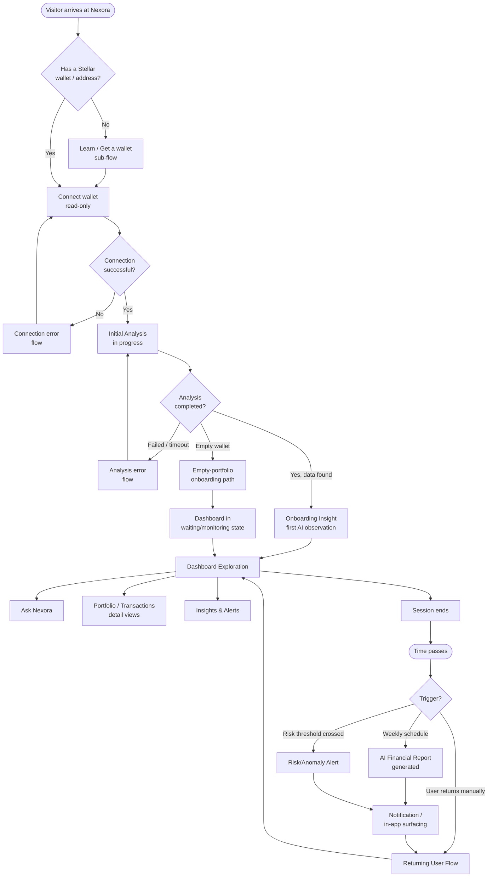

**Rationale:** The loop from `H` (Dashboard Exploration) back through `L → M → N → Q → H` is the retention engine described in PRD Section 44 — the product is designed to pull the user back in via the report and alerts, not to require them to remember to check in. Every downstream flow in this document sits inside one node of this map.

---

## 3. Discovery & Landing Flow

**Entry points:** direct link, Stellar ecosystem partner referral, word of mouth, content marketing (PRD Section 43).

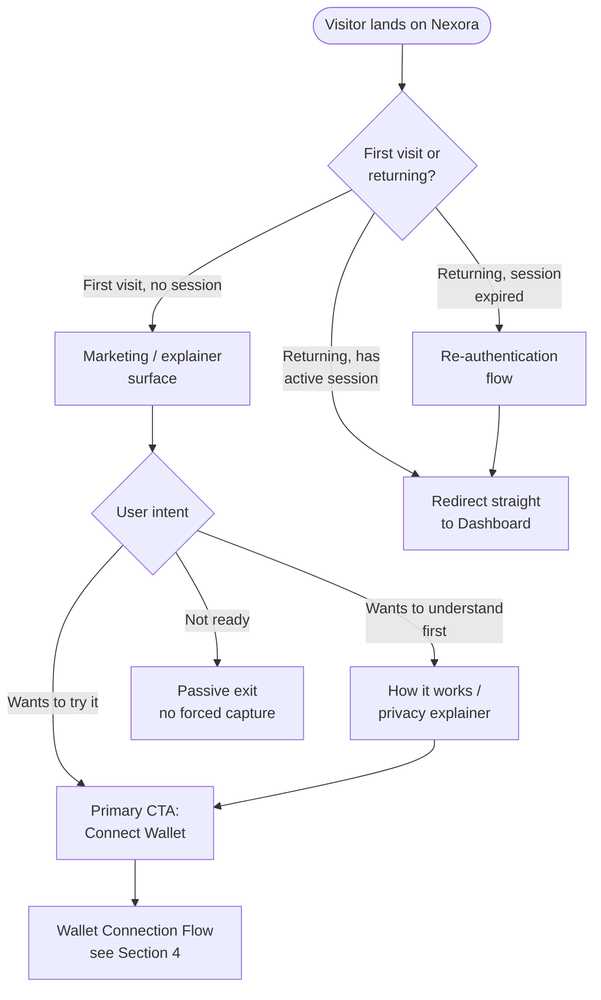

**Rationale:** Nexora's read-only, non-custodial model is a trust asset (PRD Sections 6, 39), so the landing experience should surface "what we do and don't have access to" *before* asking for connection — this reduces the skepticism named as a top pain point for the Earner and Newcomer personas. Node `G` is deliberate: consistent with "no dark patterns" (PRD Section 38), a visitor who isn't ready is allowed to leave without an interstitial trying to force conversion.

### Edge Cases — Discovery
- **No JavaScript / degraded environment:** explainer content must be legible and CTA reachable without relying on client-side rendering for the core value proposition.
- **Visitor arrives via a partner deep link that pre-fills an intended public address:** flow skips straight to Wallet Connection Flow with the address pre-populated but **still requires explicit user confirmation** before ingestion begins — a partner referral is not implicit consent to connect.

---

## 4. Wallet Connection Flow (Onboarding Action #1)

This is the single required onboarding action (PRD Section 19). It must be low-friction, since it is the entire activation event.

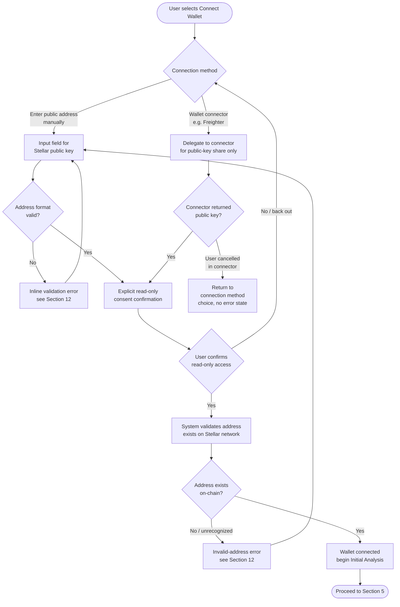

**Rationale for the explicit consent step (`F`/`H`):** Even though the connection is technically read-only and therefore low-risk, PRD Section 39 (Privacy Principles) and Section 38 (Trust & Transparency) require that users always understand *what* they're granting. A single explicit confirmation step — stating plainly that Nexora can read balances and history but cannot move funds or sign anything — is cheap in friction and high in trust payoff, especially for the Earner and Newcomer personas who are named as skeptical of crypto tools by default.

**Rationale for supporting both manual address entry and a wallet connector:** PRD Section 27 lists both as supported methods. Manual entry matters because Nexora is explicitly *not* a wallet — some users (e.g., someone checking a wallet they don't hold the signing key for, like a shared family address or a cold-storage address) will only ever have the public key, not an installed connector.

### Edge Cases — Wallet Connection
- **User already has a wallet connected to their account (V1 = single wallet):** attempting to connect a second address must present a clear choice — replace the existing connection, or explain that multi-wallet aggregation is a Version 2 capability — rather than silently failing or silently overwriting.
- **Connector app not installed:** flow must detect this and offer the manual public-address path as a fallback, not a dead end.
- **User pastes an address belonging to an unsupported/incorrect network (e.g., a non-Stellar address):** must be caught at validation (`J`), not deep into ingestion.
- **User attempts to paste a Stellar *secret key* instead of a public key:** this is a critical safety case. The system must detect the pattern (Stellar secret keys and public keys are distinguishably formatted) and **refuse to proceed**, showing an explicit warning that a secret key must never be entered anywhere, rather than silently accepting it. This is a non-negotiable safeguard given the product's entire trust model rests on never touching private key material.

---

## 5. Initial Analysis Flow (First 60 Seconds)

This flow operationalizes PRD Product Goal #1: "Turn any Stellar wallet into a fully understood financial profile within 60 seconds of connection."

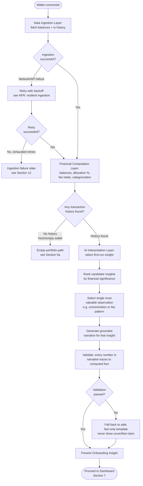

**Rationale for step `K`/`L` (validation gate):** This is the direct operationalization of the "Trustworthy math" principle (PRD Section 6) and the AI Processing Pipeline's fourth stage (PRD Section 26): *"Validate that all numbers in the generated text match the source facts before display."* No flow in this document that produces AI narrative is allowed to skip this gate — it is repeated in the Report Generation Flow (Section 9) and Ask Nexora Flow (Section 8) as well. The fallback at `M` is important: if validation fails, the product degrades gracefully to a plain factual statement rather than either blocking the user or (worse) showing an unverified claim.

**Rationale for selecting a *single* first insight (`I`) rather than a full report immediately:** PRD Section 17, Step 4, is explicit that onboarding should demonstrate value immediately via one well-chosen observation, not a generic welcome screen. This also respects the "clarity over completeness" principle (Section 6) at the moment a user is most likely to be overwhelmed or to churn.

### 5a. Empty-Portfolio / No-History Onboarding Path

Relevant for the Newcomer persona (Priya) who may connect a wallet with minimal or zero transaction history.

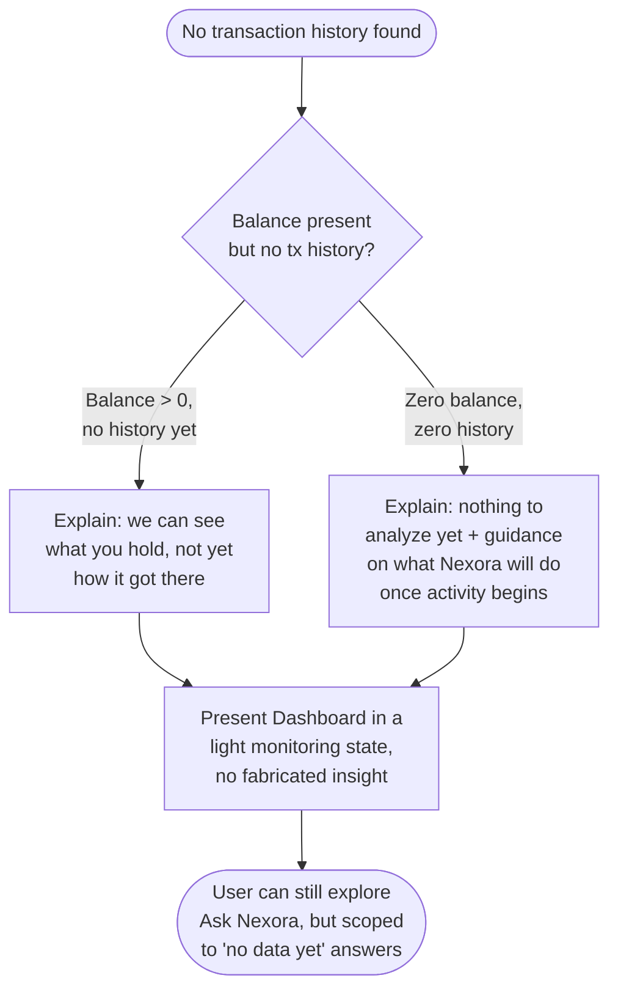

**Rationale:** The alternative — generating an insight from insufficient data — would violate the auditability and trustworthy-math principles. It is better to honestly show "we don't have enough yet" than to manufacture a first insight, especially since the Newcomer persona is the most likely to take an early AI misstep as evidence the product can't be trusted.

---

## 6. Onboarding Insight — Detailed Task Flow

This is the moment referenced as Step 4 in PRD Section 17, expanded to the level of individual user actions.

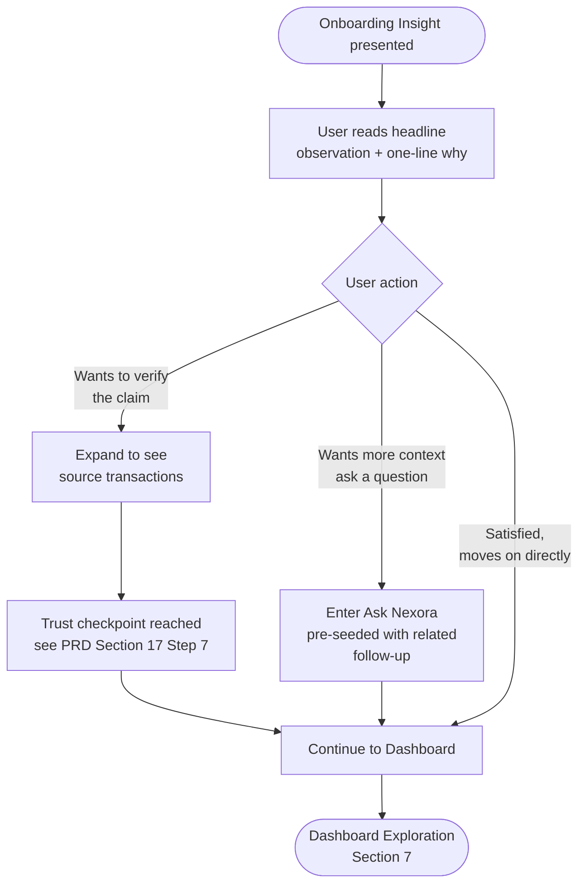

**Rationale:** Offering an immediate "show your work" expansion (`D`) at the very first insight a user ever sees is a deliberate acceleration of the trust-building step that PRD Section 17 otherwise describes happening later in the journey ("Step 7 — Deepening Trust"). Letting a skeptical first-time user verify the *very first claim* Nexora ever makes to them is higher-leverage than waiting.

---

## 7. Dashboard Exploration Flow

Reflects the Information Architecture (PRD Section 18) and Dashboard widget set (PRD Section 28).

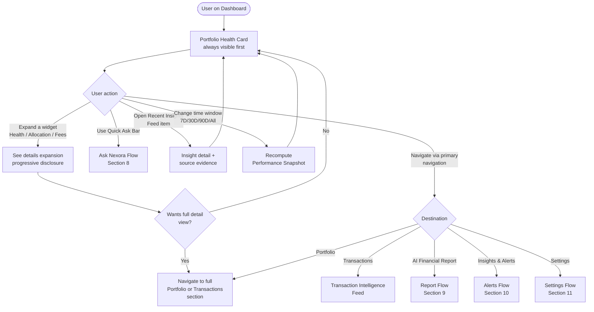

**Rationale:** Every branch off the Dashboard either goes one level deeper (progressive disclosure, per PRD Section 31) or moves to one of the six other top-level IA destinations. There is no dead-end interaction on the Dashboard — this matches the "one primary action per screen; no competing calls-to-action" principle by ensuring the dashboard's job is navigation and headline understanding, with depth deliberately deferred.

### Edge Cases — Dashboard
- **Data currently refreshing (e.g., a scheduled recompute in progress):** widgets must show a distinct "updating" state rather than either blocking the whole dashboard or silently showing stale numbers without indication.
- **Wallet was disconnected in another session/tab:** dashboard must detect this on next interaction and redirect to a reconnect prompt rather than continuing to render data for a wallet no longer connected.

---

## 8. Ask Nexora Flow (Conversational Q&A)

Ask Nexora is explicitly scoped in V1 (PRD Section 20) to a defined set of intents — this flow enforces that scope rather than presenting as open-ended.

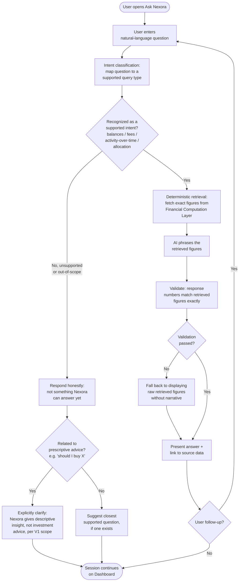

**Rationale:** This flow is the clearest expression of PRD Section 26's AI Processing Pipeline and Section 19's promise that Ask Nexora "never lets the model invent numbers." The branch at `D`/`E1`/`E2` exists specifically to satisfy the Out-of-Scope requirement in PRD Section 21 — the product must not drift into prescriptive advice even when a user directly asks for it, both for user trust and the regulatory risk named in Section 46. Refusing gracefully and explaining *why* (rather than just declining) is consistent with the "never hide the why" principle in Section 38.

### Edge Cases — Ask Nexora
- **Ambiguous question that partially matches multiple intents** (e.g., "how am I doing with fees this year" could span fee totals and time-series trend): system should ask a single clarifying question rather than guessing, or answer the best-supported interpretation and state the assumption explicitly.
- **Question about data outside the connected wallet's history window** (e.g., asking about a period before the wallet was connected, if on-chain history is genuinely unavailable): must state the limitation rather than silently answering with partial data.
- **Rapid repeated queries (abuse/scraping pattern):** rate limiting (PRD Section 40) triggers a distinct "please slow down" state, not a silent failure indistinguishable from a bug.
- **Query interface used while ingestion/analysis is still in progress for a brand-new wallet:** must clearly state analysis isn't complete yet rather than answering from partial data as if it were final.

---

## 9. AI Financial Report Flow (Flagship Feature)

Covers both report generation (system-side trigger) and report consumption (user-side flow), per PRD Sections 22 and 29.

### 9a. Report Generation (System-Triggered)

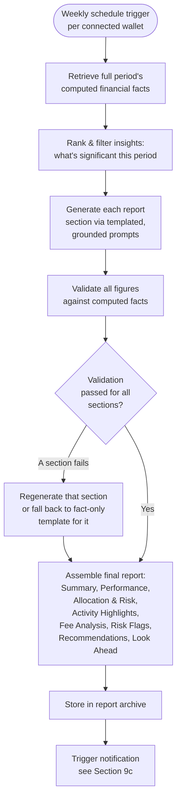

**Rationale for per-section validation (`E`–`G`) rather than validating the whole report at once:** a single invalid figure in one section (say, Fee Analysis) should not block the entire report from being delivered on schedule — regenerating or degrading just the affected section preserves the weekly cadence that PRD Section 44 identifies as the core retention mechanic, without compromising accuracy anywhere in the document.

### 9b. Report Consumption (User-Facing)

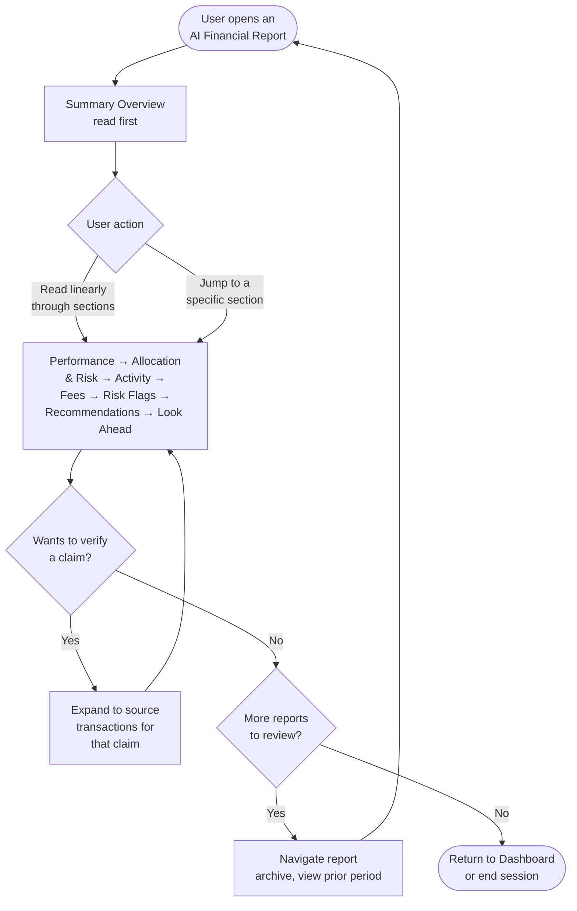

**Rationale:** Reports are designed to be read like a statement, not clicked through like a dashboard (PRD Section 30) — hence a mostly linear flow with verification (`E`/`F`) as the only significant branch, mirroring the "deepening trust" behavior established during onboarding (Section 6 above).

### 9c. Report/Alert Delivery & Notification Flow

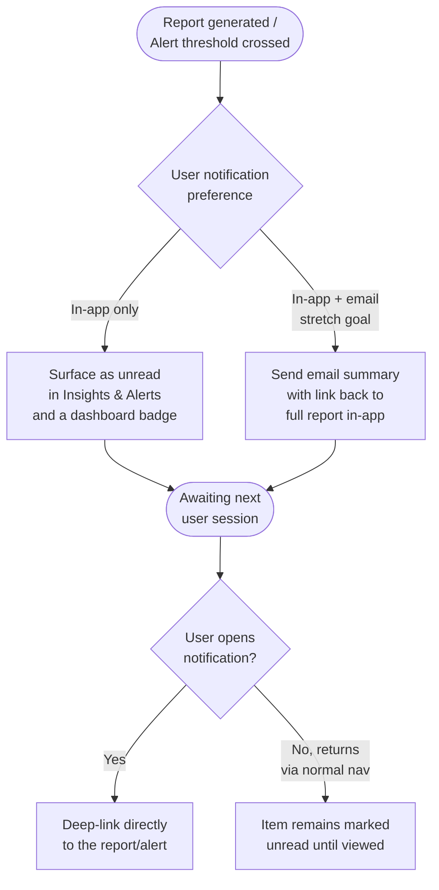

**Rationale:** Email is explicitly a stretch goal in V1 (PRD Section 20), so the in-app path (`B` → `C`) must be a fully complete, non-degraded experience on its own — the product cannot assume email delivery to close the retention loop.

---

## 10. Risk & Anomaly Alert Flow

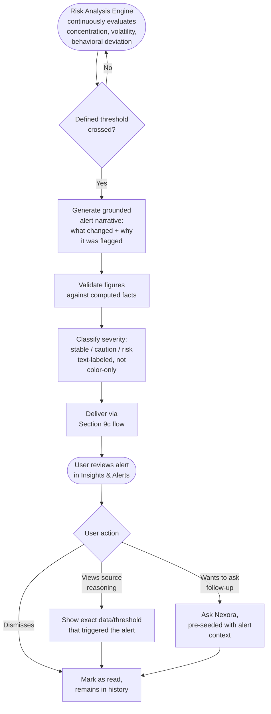

**Rationale:** The "no dark patterns" requirement (PRD Section 38) directly shapes `E` and `I`: alerts must never be styled to manufacture anxiety, and every alert must show its own triggering logic on demand ("users can always see why they received an alert, not just that they received one"). This flow is intentionally symmetric with Ask Nexora and the Report flow — same validation gate, same "show your work" affordance — because PRD Section 31 requires "consistency of explanation style across dashboard, report, and chat."

### Edge Cases — Alerts
- **Multiple thresholds cross simultaneously** (e.g., a concentration alert and a fee-spike alert in the same period): must be surfaced as distinct, individually-explained alerts, not merged into one vague notification.
- **A threshold crossing is a false-positive relative to user intent** (e.g., user deliberately concentrated into one asset on purpose): V1 has no mechanism to "teach" the system this was intentional beyond it affecting the personalized baseline over time (PRD Section 26, Personalization Layer) — this is a known limitation, not a flow to hide; the alert should still state its reasoning plainly so an informed user can dismiss it with full context.

---

## 11. Settings, Disconnection & Data Deletion Flow

Covers PRD Sections 18 (Settings in IA), 27 (Permissions), and 39 (Privacy Principles).

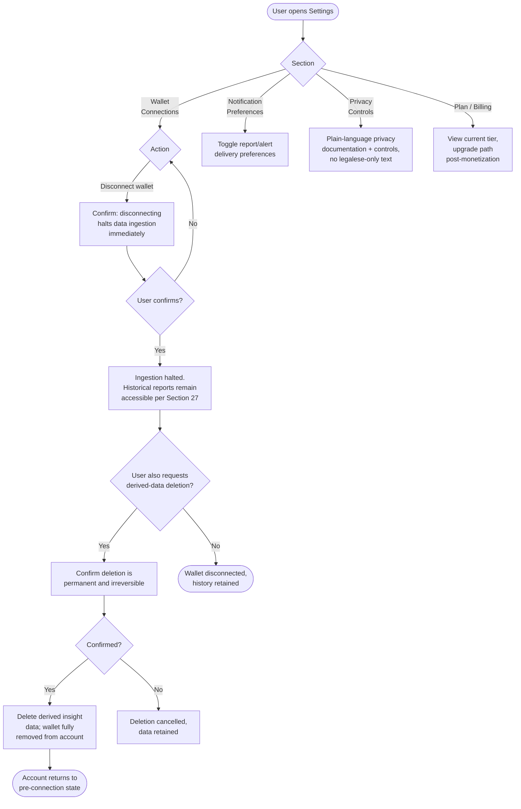

**Rationale:** The two-step distinction between "disconnect" (`F`) and "delete derived data" (`G`–`J`) directly implements PRD Section 39: users can disconnect at any time, and separately, "request deletion of derived data at any time" — these are described as two different user rights and must remain two different actions with two different confirmation flows, not conflated into a single "remove wallet" button, since deletion is irreversible and disconnection is not.

### Edge Cases — Settings
- **User disconnects their only wallet with no replacement:** account should fall back to a clear "no wallet connected" state across Dashboard, Reports, and Ask Nexora — not a broken or stale UI referencing a wallet that's no longer there.
- **User attempts to reconnect the same address shortly after disconnecting (before requesting deletion):** prior historical reports and derived data should still be associated correctly, since disconnection alone does not delete data.

---

## 12. Error States (Cross-Cutting)

These states can occur inside multiple flows above; they are defined once here and referenced by name elsewhere in this document so error handling stays consistent (PRD Section 31: "consistency of explanation style").

| Error State | Triggering Condition | Required Behavior |
|---|---|---|
| **Invalid address format** | User enters a string that isn't a well-formed Stellar public address | Inline, immediate feedback before any network call; explain expected format |
| **Secret-key-entered warning** | Input pattern matches a Stellar secret key rather than a public key | Hard stop; explicit safety warning; never store or transmit the value |
| **Address not found on network** | Well-formed address that doesn't resolve on Stellar | Distinct from format error; suggest re-checking the address, not a generic failure |
| **Ingestion failure** | Data Ingestion Layer cannot reach Stellar network data after retries | State plainly that Nexora couldn't retrieve data right now, with a retry action; never silently show an empty or fabricated portfolio |
| **Analysis timeout** | Initial Analysis exceeds expected latency (PRD NFR: ~60s target) for very large histories | Show ongoing-progress state past the target, not a false completion; allow the user to leave and return without losing progress |
| **Partial data availability** | Some but not all requested data (e.g., recent transactions) is available | State what is and isn't included in the current view, rather than presenting partial data as complete |
| **AI validation failure** | Any generated narrative fails the fact-matching validation gate | Fall back to a fact-only, template-based statement; never display unverified AI claims (applies identically in Sections 5, 8, 9, 10) |
| **Unsupported Ask Nexora intent** | Question falls outside the defined V1 query taxonomy | Honest scope statement + closest supported alternative, never a guessed answer |
| **Session expiration** | Auth session times out during use | Preserve the user's place where feasible; re-authenticate without losing unsaved context (e.g., an in-progress Ask Nexora question) |
| **Rate limit reached** | Abuse-protection threshold hit on Ask Nexora | Distinct "slow down" messaging, never indistinguishable from a generic error |

**Rationale:** Centralizing error states avoids five different flows inventing five different tones or behaviors for what is functionally the same situation (e.g., "we don't have a trustworthy answer right now") — which would undermine the calm, consistent "voice" the PRD requires (Section 31, 35).

---

## 13. Empty States (Cross-Cutting)

| Empty State | Context | Required Behavior |
|---|---|---|
| **No transaction history** | New/unused wallet just connected | See Section 5a; honest "nothing to analyze yet," no fabricated insight |
| **Zero balance, zero history** | Truly empty wallet | Explain what Nexora will do once activity begins; do not block account setup |
| **No insights this period** | A scheduled report period had no financially significant events | State plainly that nothing notable happened, framed positively (stability is a valid, calm outcome, not a failure of the AI to find something) |
| **No alerts yet** | New account, no thresholds crossed | Explain what would trigger an alert, so the empty state is informative, not just blank |
| **No report history yet** | First-time user viewing the report archive before their first weekly report has generated | Show when the first report will arrive, not just an empty list |
| **Ask Nexora, no prior questions** | First-time use of the Q&A interface | Suggest example supported questions to reduce blank-page hesitation, especially for the Newcomer persona |

**Rationale:** Per the philosophy that "the AI does continuous, proactive work... without being asked" (PRD Section 4), an empty state must never read as the product having nothing to say — it should always explain *why* it's empty and *what happens next*, keeping the sense of an "ongoing, proactive relationship" (PRD Section 29, "Look Ahead") intact even when there's nothing urgent to report.

---

## 14. Returning User Flow

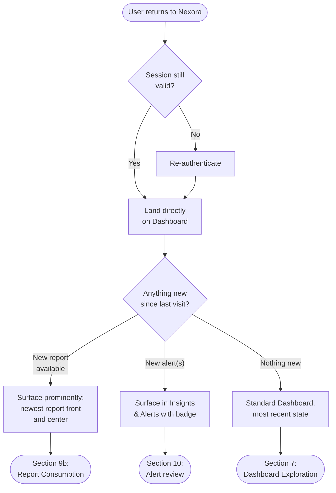

**Rationale:** Returning users should never have to hunt for what changed since their last visit — the flow actively surfaces the newest report or alert rather than presenting a neutral, unprioritized dashboard, reinforcing the "proactive, not reactive" principle (PRD Section 6) at the exact moment it matters most: the return visit that the whole retention strategy is built around (PRD Section 44).

---

## 15. Navigation Flow (Global)

Reflects the Information Architecture in PRD Section 18 as a navigable structure rather than a list.

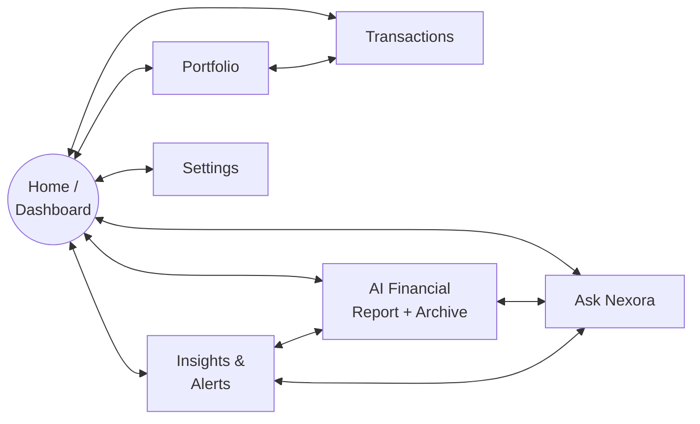

**Rationale:** Dashboard is the hub every other section connects back to (consistent with it being the "anchor" per PRD Section 28), but Report, Alerts, and Ask Nexora are also cross-linked directly to each other, since in practice a user reading a report or an alert will often want to immediately ask a follow-up question — the navigation model should not force a detour back through the Dashboard for that connective behavior. The Quick Ask Bar (PRD Section 28) is the concrete mechanism that makes the `Ask` node reachable in a single action from anywhere, not just via top-level navigation.

### Navigation Edge Cases
- **Deep link into a specific report or alert from a notification/email:** must land the user directly on that content, not on the Dashboard with an extra required click.
- **Direct link to Portfolio/Transactions before any wallet is connected:** must redirect into the Wallet Connection Flow (Section 4) rather than rendering an empty or broken authenticated view.

---

## 16. AI Analysis Flow (End-to-End Technical/Behavioral Trace)

This flow makes explicit the four-layer architecture from PRD Section 25 as it applies to *any* AI-touching flow in this document (Initial Analysis, Report Generation, Ask Nexora, Alerts). It is included as a reference flow so every other section can point back to a single canonical version of "how Nexora goes from raw data to a sentence."

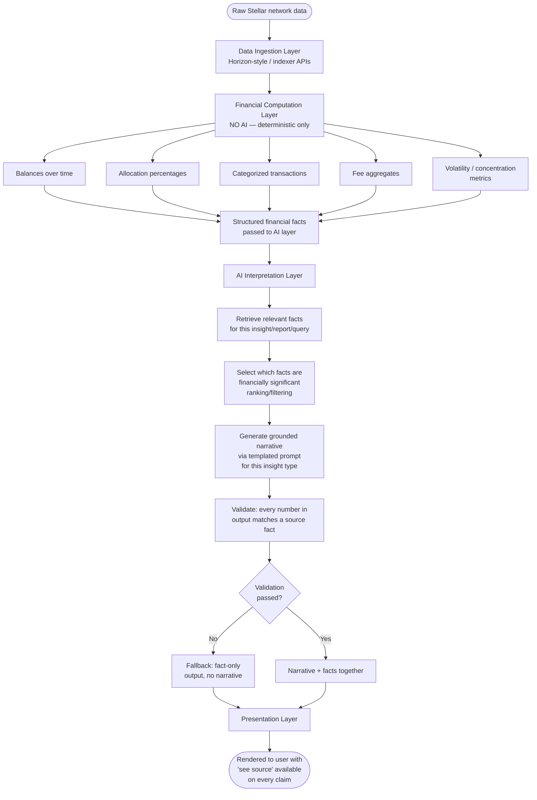

**Rationale:** This diagram is the single source of truth that Sections 5, 8, 9a, and 10 all instantiate for their specific context. Keeping it as one canonical flow — rather than re-deriving slightly different versions per feature — is itself an implementation of PRD Section 31's demand for a consistent "voice," and prevents drift where, say, the Report Generation flow validates facts but a future feature quietly skips that step.

---

## 17. Flow-to-Requirement Traceability

A quick-reference map from each flow in this document back to the PRD sections that justify it, for design/engineering QA and to keep this document from drifting out of sync with the PRD over time.

| Flow (this document) | Grounded in PRD Section(s) |
|---|---|
| Discovery & Landing (§3) | 17 (Journey, Step 1), 43 (Growth Strategy) |
| Wallet Connection (§4) | 6, 19, 27, 38, 39, 40 |
| Initial Analysis (§5) | 6, 17 (Step 3), 24, 25, 26 |
| Onboarding Insight (§6) | 17 (Step 4), 38 |
| Dashboard Exploration (§7) | 18, 28, 31 |
| Ask Nexora (§8) | 19, 20, 21, 26, 40 |
| AI Financial Report (§9) | 22, 26, 29, 44 |
| Risk & Anomaly Alerts (§10) | 19, 26, 38 |
| Settings / Disconnection / Deletion (§11) | 27, 39 |
| Error States (§12) | 24, 38, 46 |
| Empty States (§13) | 4, 29 |
| Returning User (§14) | 17 (Steps 6–8), 44 |
| Navigation (§15) | 18, 28 |
| AI Analysis Trace (§16) | 25, 26, 38 |

---

*End of Document — Nexora USER_FLOW.md v1.0*
